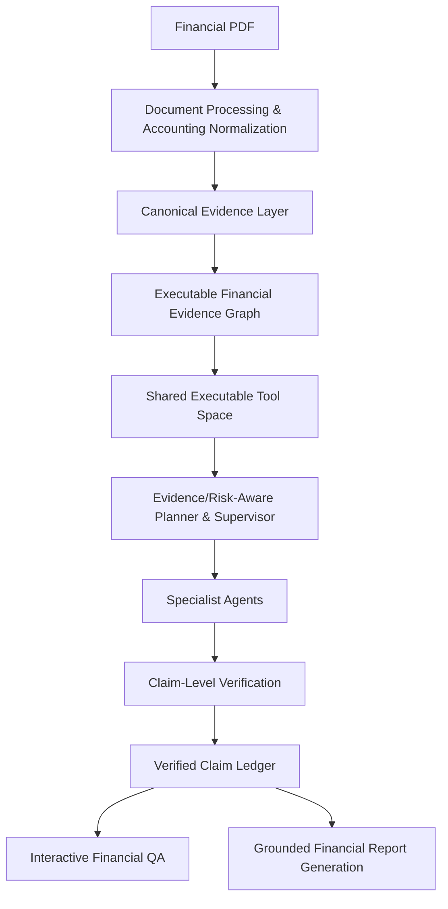

# vietnamese-financial-multi-agent

Khung đa tác nhân thích ứng cho kiểm tra báo cáo tài chính và tuân thủ quy định,
hỏi đáp và tạo báo cáo phân tích có dẫn nguồn bằng tiếng Việt.

Repository nghiên cứu sử dụng Python 3.11+ và kiến trúc modular monolith. M0-01
chỉ khởi tạo cấu trúc, cấu hình phát triển và tài liệu nền tảng. Các package hiện
chỉ có docstring; chưa có chức năng nghiệp vụ, server, CLI, OCR, Agent hoặc LLM Gateway.

## Mục tiêu và kiến trúc

- Chuẩn hóa báo cáo tài chính và duy trì nguồn gốc của từng bằng chứng.
- Dùng chung Executable Financial Evidence Graph (EF-EG) cho hỏi đáp và báo cáo.
- Điều phối tác nhân theo nhu cầu bằng chứng và tín hiệu rủi ro.
- Kiểm chứng từng nhận định trước khi tạo kết quả bằng tiếng Việt có dẫn nguồn.



Gemini và các LLM khác sẽ đi qua LLM Gateway dùng chung để đổi model, hỗ trợ
structured outputs và quản lý chi phí. Chưa chọn SDK, model hoặc triển khai Gateway.
Phạm vi kiểm tra tuân thủ quy định cụ thể là **TBD**; xem
[các quyết định và điểm cần làm rõ](planning/decisions.md).

## Cấu trúc repository

```text
.
├── .github/workflows/ci.yml
├── .env.example
├── .gitattributes
├── .gitignore
├── AGENTS.md
├── README.md
├── pyproject.toml
├── src/
│   ├── __init__.py
│   ├── core/__init__.py
│   ├── document_processing/__init__.py
│   ├── accounting/__init__.py
│   ├── evidence/__init__.py
│   ├── tools/__init__.py
│   ├── agents/__init__.py
│   ├── verification/__init__.py
│   ├── outputs/__init__.py
│   └── api/__init__.py
├── tests/
│   ├── unit/test_package.py
│   ├── integration/.gitkeep
│   └── evaluation/.gitkeep
├── configs/.gitkeep
├── scripts/.gitkeep
├── docs/
│   ├── architecture.md
│   ├── module-boundaries.md
│   ├── data-contracts.md
│   ├── dataset.md
│   └── evaluation.md
├── planning/
│   ├── roadmap.md
│   ├── tasks.md
│   ├── current-status.md
│   └── decisions.md
├── data/samples/.gitkeep
├── evaluation/.gitkeep
└── prompts/.gitkeep
```

Các file được theo dõi nằm trong cây trên. Workspace có thể chứa thêm môi trường
`.venv/`, dữ liệu `Financial_Report/`, `Financial_Report_OCR/` và tài liệu tham chiếu
`docs/report_midterm.docx`; chúng được bỏ qua bởi Git và không cần để chạy skeleton.

## Thiết lập môi trường

Cần Git và Python 3.11 trở lên. Lệnh dưới đây chạy tại thư mục gốc repository.
Không cần API key, cơ sở dữ liệu hoặc dữ liệu tài chính để cài đặt và kiểm tra.

Windows PowerShell:

```powershell
python -m venv .venv
.\.venv\Scripts\python.exe -m pip install -e ".[dev]"
if (-not (Test-Path .env)) { Copy-Item .env.example .env }
.\.venv\Scripts\python.exe -m ruff check .
.\.venv\Scripts\python.exe -m ruff format --check .
.\.venv\Scripts\python.exe -m pytest tests/unit
```

Linux/macOS:

```bash
python3 -m venv .venv
.venv/bin/python -m pip install -e '.[dev]'
test -e .env || cp .env.example .env
.venv/bin/python -m ruff check .
.venv/bin/python -m ruff format --check .
.venv/bin/python -m pytest tests/unit
```

`.env.example` chỉ khai báo cấu hình dự kiến; skeleton chưa tự nạp `.env`.
Để định dạng code, chạy `python -m ruff format .` trong môi trường phát triển.
Để kiểm tra toàn bộ tập test hiện có, chạy `python -m pytest`.

Distribution có tên `vietnamese-financial-multi-agent`; namespace import là
`vietnamese_financial_multi_agent`, ví dụ
`import vietnamese_financial_multi_agent.evidence`. `pyproject.toml` ánh xạ
namespace này vào `src/`. Khi thêm package, cần cập nhật danh sách đóng gói.
Các thư mục `tests/` không phải package ứng dụng nên không cần `__init__.py`.

CI cài package thường (không editable), kiểm tra Ruff và unit tests trên Python
3.11/3.12. Unit tests hiện chỉ kiểm tra khả năng cài và import các package;
không đại diện cho kiểm thử nghiệp vụ hoặc kết quả benchmark.

## Tài liệu và quy trình làm việc

Đọc [AGENTS.md](AGENTS.md), [kiến trúc](docs/architecture.md),
[ranh giới module](docs/module-boundaries.md) và
[data contracts](docs/data-contracts.md) trước khi thay đổi code.
Nguồn và cách quản lý dữ liệu ở [dataset.md](docs/dataset.md);
định hướng kiểm thử ở [evaluation.md](docs/evaluation.md).

Theo dõi [roadmap](planning/roadmap.md), [task](planning/tasks.md) và
[trạng thái hiện tại](planning/current-status.md). Các nội dung chưa được quyết định
được ghi `TBD`. Không đưa dữ liệu từ Google Drive, dữ liệu tài chính hoặc secrets
vào Git. M0-01 kết thúc sau khi khởi tạo; chỉ thực hiện task tiếp theo khi được giao.
