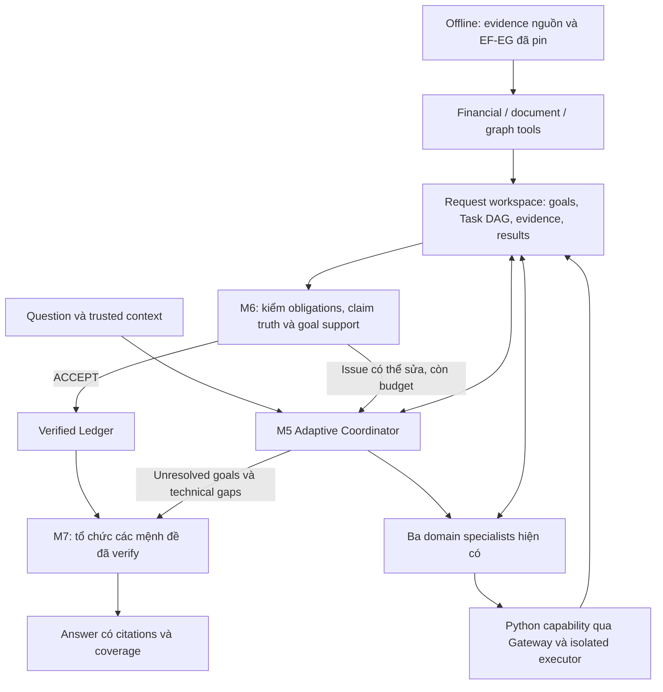

# ARCH-01 — Adaptive Evidence-Guided Multi-Agent Framework Review

Ngày 17/11/2026, Asia/Bangkok. **REVIEW — chờ Tech Lead**. Chỉ nghiên cứu và
thiết kế; chưa triển khai ARCH-02. Baseline HEAD đã xác minh:
`966b73a17dcf1a573f485ccc67f2ffb3be4bee0d`, cộng working tree có trước, gồm
runtime E2E-05 đã freeze. Không coi HEAD riêng lẻ là implementation của live-v6.

**Quy ước task:** registry đã có ARCH-01 DONE ngày 06/11 cho audit khác. Giữ
nguyên task đó; review được Owner gọi “ARCH-01” trong yêu cầu ngày 17/11 dùng
ID chưa sử dụng **ARCH-01a** trong planning. Tên file bàn giao giữ theo yêu cầu.

**Phạm vi bản publish:** theo yêu cầu Owner, commit chỉ gồm tài liệu ARCH-01a
và tracking tương ứng, đặt trên remote main `2b3c2ab` để không push kèm bốn commit
local ngoài task. Baseline phân tích vẫn là working tree `966b73a` nêu trên;
code liên kết trên GitHub có thể là phiên bản cũ hơn code đã review. Các báo cáo
E2E03/04/05 chưa publish được ghi tên/path để tra tại workspace local. Kết quả
planning 160 tasks/fingerprint bên dưới thuộc phiên review local, không phải
kiểm tra cây publish. Phiên commit/push không chạy lại tests hoặc CI thủ công.

## 1. Kết luận và phạm vi bằng chứng

**Đề xuất mở rộng V2 hiện có thành coordinator thích ứng theo nghĩa vụ bằng
chứng, thay vì viết lại hệ thống Multi-Agent.** Giữ ba specialist, Gateway,
Financial Tools, EF-EG, M6 Lite và ledger. Bổ sung tối thiểu: giao diện LLM nhỏ,
Task DAG có kết quả trung gian truy nguyên được, Python capability dùng chung,
và một vòng sửa cục bộ do phản hồi M6 dẫn đường. M7 tổ chức các mệnh đề tự nhiên
đã qua M6; không trở thành verifier hoặc nơi sinh phân tích tài chính mới.

Điểm nghẽn chính là **liên tục về mục tiêu và bằng chứng qua các bước**, không
phải thiếu số lượng agent. Tính toán đúng, claim đúng và trả lời đúng yêu cầu
là ba điều kiện khác nhau. V2 đã có nhiều cấu trúc cần thiết nhưng luồng hiện
tại vẫn lập kế hoạch một lần, xử lý theo thứ tự đã cho, rồi dừng ở kết quả M6.

Phân biệt trong báo cáo:

- **Quan sát code:** đọc trực tiếp working tree hiện tại, không chạy runtime.
- **Bằng chứng lịch sử:** kết quả được báo cáo trong các tài liệu bên dưới;
  không tái chạy hoặc tái xác minh toàn bộ hashes/artifacts của những task đó.
- **Suy luận:** giải thích cơ chế từ code và báo cáo, chưa có ablation nhân quả.
- **Đề xuất:** thiết kế cần đặc tả/đánh giá tiếp, chưa phải capability đã có.

| Đầu vào đã đọc | Điều có thể kết luận | Giới hạn |
| --- | --- | --- |
| VFB-E2E-03 (`vfb-e2e-03-qwen.md`, local) | 15 câu: 1 CORRECT, 1 INCORRECT, 13 NO_ANSWER; 0 graph calls; không ca nào chạy nhiều domain | Mẫu có chủ đích, tài liệu đã chỉ định; không phải accuracy 600 câu |
| VFB-E2E-04 (`vfb-e2e-04-targeted-fix.md`, local) | Cùng 5 câu: 0C/0P/1I/4N → 2C/1P/0I/2N; sửa routing/mapping/plan có ích; 5 graph calls found | Không chứng minh hiệu quả nhân quả của graph hay Multi-Agent |
| E2E-05 lịch sử (`vfb-e2e-05-evidence-reasoning.md`, local), freeze cuối (`vfb-e2e-05-live-validation.md`, local) | V4 → v5 → v6 trên 4 câu: 1C/3N → 1C/3N → 0C/4N; cả 4 Supervisor cuối sai schema. V5 tính đúng ROE nhưng proof/binding chặn release | Bản cuối là v6; không dùng lượt tốt nhất đại diện code hiện tại |
| [ARCH-RESET-01](arch-reset-01-multi-agent-simplification-review.md) | Đã đề xuất một workspace, requirement identity, M6 authority duy nhất; audit cũ không thấy mất toàn bộ ledger ở M7 | Nhiều nhận xét về Lite cũ đã được V2 thay đổi; phải đối chiếu code hiện tại |
| [QWEN-DIAG-01](qwen-diag-01.md) | Proof từng còn nguyên nhưng statement sai; từng có M7 đổi nghĩa dù số đúng | Lỗi M7 lịch sử không đồng nghĩa M7 hiện tại vẫn phát hành prose tự do |

Các lượt E2E trên dùng imported JSON, chưa kiểm độc lập PDF scan. Pointer resolve
và `financial_fact_verified=false` phải được giữ đúng nghĩa. Báo cáo này không
cung cấp kết quả thực nghiệm mới về chất lượng tài chính hoặc năng lực Qwen.

## 2. Kiến trúc thực tế và nguyên nhân gốc

### 2.1 Những gì đã có trong working tree

Luồng liên quan là `FinancialQAPipeline` với `integration_v2`/Lite; legacy,
document và fusion còn tồn tại. Không quy mọi controller cũ vào execution E2E.
Đối chiếu [architecture](architecture.md), [module boundaries](module-boundaries.md)
và [data contracts](data-contracts.md): vẫn giữ Offline → Online → Output.

| Code / điểm đọc | Hành vi hiện tại | Quyết định tái sử dụng |
| --- | --- | --- |
| [lite_orchestrator.py](../src/agents/lite_orchestrator.py): `LiteTask`, `LitePlan`, `integration_plan`, `SupervisorLite.plan`, `run` | Đã có requirements, task IDs, `depends_on`, sources, specialist; dependency chỉ được tham chiếu task trước. Retrieve tất cả task trước, rồi generate theo danh sách; không có replan sau M6 | Giữ orchestration entry và domain specialists; thay lịch thực thi bằng ready-task scheduling và plan patch hữu hạn |
| [integration_workspace.py](../src/agents/integration_workspace.py): `IntegrationWorkspace`, `export`, `answer_coverage` | Request-local evidence chung; tasks lưu statements/proofs/missing inputs. Candidate bindings được dựng bằng matcher; còn phụ thuộc quy ước `QARequirement`/text | Mở rộng kết quả task có identity/trạng thái kiểm chứng; giữ sidecar và coverage, tránh workspace thứ hai |
| `lite_orchestrator._specialist`, `shared_tasks` | Specialist nhìn evidence chung và kết quả các dependencies; trạng thái `generated/partial` được dùng để cho downstream chạy | Chia sẻ đã tồn tại; cần phân biệt kết quả đã tính với claim được M6 chấp nhận, giữ dependency tới phiên bản input |
| [financial_calculator.py](../src/tools/financial_calculator.py): `execute_dynamic`, `calculate_dynamic` | Decimal, lineage, operation/context guards; operators hữu hạn, chưa biểu diễn tổng quát filter/rank/join bảng | Giữ đường tính chuẩn; Python bổ sung cho trường hợp ngoài vocabulary, không thay tất cả Calculator |
| note_evidence.py (`../src/tools/note_evidence.py`, local), [graph.py](../src/evidence/graph.py), [graph_retrieval.py](../src/tools/graph_retrieval.py) | Truy xuất bảng/văn bản, giữ title/grid/heading/unit; graph có relations cấu trúc/nguồn | Giữ retrieval và IDs; bổ sung selection/join proof ở runtime workspace, không biến contextual edge thành semantic support |
| [lite_runtime.py](../src/verification/lite_runtime.py): `verify`, `_semantic`, `decide` | Source/value/proof checks rồi semantic batch khi cần; đã tách ACCEPT khỏi `supported_requirements`. `stop_reason=lite_single_pass`; không gửi repair task về M5 | Giữ một authority M6; xuất structured feedback từ check results hiện có |
| [financial_qa_pipeline.py](../src/api/financial_qa_pipeline.py): M5 → M6 → admission → `release_lite` | M6 summary được copy vào integration sidecar, rồi admit/select/render; không có nhánh repair cục bộ trong V2 | API chỉ wire coordinator; không đặt thêm planning/verification nghiệp vụ trong API |
| [qa_lite.py](../src/outputs/qa_lite.py): `compose_lite`, `_group_verified_segments` | Model đề xuất nhóm claim IDs; backend dùng `_verified_text`, không dùng text tài chính model sinh; V2 dùng verified bindings để coverage | Giữ output integrity/citation projection; cải thiện câu đã verify và renderer, tránh mở lại free paraphrase |
| [qwen_adapter.py](../src/core/qwen_adapter.py): `_payload`; [llm_gateway.py](../src/core/llm_gateway.py) | Có inline schema và local validation. Adapter chỉ gửi `strict` nếu caller đặt tường minh | Giữ Gateway; đo capability endpoint sau khi được giao, không giả định schema gửi đi là decoding đã enforce |

Đặc biệt, mô tả “mỗi agent không nhìn thấy kết quả agent khác” của Lite trước
ARCH-RESET không còn đúng hoàn toàn với V2. `workspace.merge` và `shared_tasks`
đã chia sẻ. Tuy nhiên, chia sẻ statements/proofs chưa tự tạo được một quy trình
chọn evidence, kiểm dependencies và sửa lỗi đáp ứng mục tiêu cuối.

### 2.2 RCA có thứ tự ưu tiên

| Ưu tiên / cơ chế | Bằng chứng và hệ quả | Hướng xử lý tổng quát |
| --- | --- | --- |
| P0 — Output LLM đang gánh internal contract | `IntegrationRequirement` kế thừa `QARequirement`; `qwen_plan_schema` yêu cầu nhiều field/null/enum cùng lúc. Nhánh prompt Qwen cuối bỏ schema/example khỏi nội dung và không nhắc field specialist trong danh sách trường task; Gateway chặn trước `integration_plan` khi schema sai | Một wire proposal nhỏ, ví dụ ngắn đúng contract, adapter backend sở hữu IDs/digests/caveats. Capability probe phải tách syntax khỏi semantics |
| P0 — Goal và supporting step bị trộn | E2E-05 v5: requirement bình quân trỏ vốn cuối kỳ; metric goal khai sai topic/operators; v6 tự tạo source IDs và trộn T handles với S handles | Goals là outputs người dùng cần; tasks là cách tìm/chứng minh outputs. Task arithmetic trung gian không bắt buộc trở thành answer goal |
| P0 — Retrieval thành công chưa hoàn tất selection/join | ADC có bảng nhưng đảo nhóm chi phí; BBS có hai bảng nhưng chọn sai đối tác/cột. Graph found chỉ trả quan hệ nguồn/cấu trúc | Chọn tập hàng/cột có căn cứ, thực thi rank/join có keys và so sánh domain đầy đủ; M6 kiểm cả phép chọn và liên hệ tới câu hỏi |
| P1 — Coordination vẫn theo plan cố định | `run` retrieve trước generation, dependency phải trỏ ngược; downstream chỉ kiểm generated/partial. Không tạo truy vấn mới theo entity vừa được tìm hoặc xử lý M6 issue | Scheduler topo nhỏ; task result mang selected entity/evidence handles; coordinator chỉ thêm/sửa nhánh cần thiết theo observation/feedback |
| P1 — Candidate quá nhiều nghĩa trong cùng envelope | Hà Tây v6 có core answer đúng nhưng limitations phủ nhận nguồn. NR v5 computation đúng nhưng `derived_fact` có assumptions, không bindings | Tách observation, pure computation, interpretation, conditional inference. Model notes không tự thành caveat/claim; giữ source caveats ở backend |
| P1 — Proof/binding chưa được dùng như một chuỗi nghĩa vụ | V5 ROE đúng số học, M6 bác proof; ba facts ACCEPT không đáp ứng goal ROE. E2E-03 từng ACCEPT đúng nguồn COGS nhưng trả sai chỉ tiêu | M6 kiểm truth và goal support riêng, gắn issue với obligation/input; sửa candidate/binding trước M6 tiếp theo, không ép M7 suy coverage |
| P2 — Context authority vẫn có thiếu thật | Company C69 và kỳ nợ AME chưa đủ authority; mapping/heading/OCR quality có giới hạn | Explicit unresolved/clarification; không dùng coordinator/Python để điền metadata từ tên thư mục hoặc biến raw cell thành canonical fact |
| P2 — Tình trạng kỹ thuật bị diễn giải sai | Schema mismatch cuối có usage nhưng surface báo provider unavailable; global technical list trong `answer_coverage` có thể làm mọi goal chưa có claim thành technical_error | Giữ category gốc và task/goal bị ảnh hưởng; nguồn thiếu, calculation sai, schema lỗi, binding thiếu phải phân biệt |

**Suy luận:** lỗi schema làm mất execution; khi qua schema thì lỗi selection,
composition và goal binding tiếp tục chặn. Do đó chỉ thêm Python hoặc bật strict
không đủ. Ngược lại, thêm debate/judge mặc định làm tăng calls mà không sửa
được identities/inputs. Regression v5→v6 thuộc cả gói thay đổi; chưa đủ bằng
chứng quy nguyên nhân duy nhất cho schema, prompt, quantization hay model size.

## 3. Đối chiếu nghiên cứu

Khảo sát có mục tiêu, cập nhật đến 17/11/2026; ưu tiên bài gốc/proceedings.
Đây chưa phải systematic literature review. Với các framework nền, đọc abstract
và mô tả phương pháp công khai; đọc thêm phần phương pháp của ba công trình
2026 gần nhất. Không sao chép mức tăng accuracy/latency sang DACNTT.

### 3.1 Các cơ chế đã tồn tại

| Công trình / nguồn chính | Cơ chế liên quan | Kết luận áp dụng cho DACNTT |
| --- | --- | --- |
| Wu et al., [AutoGen, 2023](https://arxiv.org/abs/2308.08155) | Agents hội thoại, dùng tools/code, lập trình interaction linh hoạt | Phân vai và code execution đã phổ biến. Học cách tách agent khỏi executor; không cần nhập cả framework để có các cơ chế này |
| Zhuge et al., [GPTSwarm, ICML 2024](https://proceedings.mlr.press/v235/zhuge24a.html) | Agents là computational graphs; tối ưu prompts của nodes và connectivity của edges | Task graph là abstraction hữu ích. Graph optimization bằng reward/training khác scheduling online theo evidence gap; chưa cần optimizer trong prototype |
| Zhang et al., [AFlow, ICLR 2025](https://proceedings.iclr.cc/paper_files/paper/2025/hash/5492ecbce4439401798dcd2c90be94cd-Abstract-Conference.html) | Tìm kiếm workflows biểu diễn bằng code bằng MCTS và execution feedback | Hữu ích cho tối ưu workflow về sau. Chi phí search/evaluator dễ lấn nghiên cứu cốt lõi; chưa chọn MCTS cho online coordinator |
| Huang et al., [ProFinAgent, ICML 2026](https://proceedings.mlr.press/v306/huang26ap.html) | ProFinR 528 bài, 53 tools/13 nhóm; DAG planner và case-based memory | Đã có financial DAG orchestration. Tái sử dụng dependency scheduling; chưa thêm case memory trước khi có traces thành công độc lập và chống leakage |
| Liu et al., [DyLAN, COLM 2024](https://arxiv.org/abs/2310.02170) | Chọn team và communication động theo đóng góp agent | Adaptive agent selection đã có. DACNTT nên chọn ít specialist theo nhu cầu chứng minh; chưa cần Agent Importance Score hoặc học team mới |
| Kim et al., [LLMCompiler, ICML 2024](https://arxiv.org/abs/2312.04511) | Planner, task fetching, executor cho function calls có dependencies và parallelism | DAG scheduler có thể rất nhỏ. Chạy tuần tự theo topo vẫn hợp prototype Qwen một GPU; tốc độ parallel không phải mục tiêu tiên quyết |
| Xu et al., [ReWOO, 2023](https://arxiv.org/abs/2305.18323) | Tách reasoning khỏi observations/tool execution để giảm prompt lặp | Dùng evidence/result handles thay chép toàn lịch sử. Plan trước tiết kiệm nhưng cần mở lại cục bộ khi evidence thực tế khác dự kiến |
| Gao et al., [RARR, ACL 2023](https://arxiv.org/abs/2210.08726) | Tìm evidence và sửa phần output chưa được hỗ trợ, giữ phần còn lại | Repair có mục tiêu đã tồn tại. DACNTT đặt repair trước admission, giữ version/provenance, không chỉnh trực tiếp nội dung ledger |
| Dhuliawala et al., [CoVe, 2023](https://arxiv.org/abs/2309.11495) | Lập verification questions, trả lời độc lập rồi sửa câu trả lời | Tách kiểm chứng khỏi lập luận ban đầu giúp giảm thiên lệch. Verification questions không thay source replay, typed obligations hoặc phép tính |
| Gou et al., [CRITIC, ICLR 2024](https://proceedings.iclr.cc/paper_files/paper/2024/hash/fef126561bbf9d4467dbb8d27334b8fe-Abstract-Conference.html) | Sửa output theo phản hồi từ external tools | Feedback phải có thông tin kiểm được, thay vì “hãy nghĩ lại”. Không cần thêm critic agent khi M6 đã giữ các check results |
| Gao et al., [PAL, 2022/ICML 2023](https://arxiv.org/abs/2211.10435); Chen et al., [PoT, TMLR 2023](https://arxiv.org/abs/2211.12588) | LLM sinh chương trình, runtime làm computation; PoT có đánh giá financial QA | Python reasoning có nền tảng rõ. Chương trình chạy được vẫn có thể lấy nhầm ô hoặc công thức; phải kiểm inputs/meaning độc lập |
| Edge et al., [GraphRAG, 2024, revised 2025](https://arxiv.org/abs/2404.16130) | Entity graph/community summaries cho global summarization | EF-EG có nhiệm vụ khác: typed financial provenance và execution lineage. Chưa cần community summaries cho bài toán exact cell/calculation |
| Min et al., [FActScore, EMNLP 2023](https://arxiv.org/abs/2305.14251); Gao et al., [ALCE, EMNLP 2023](https://arxiv.org/abs/2305.14627) | Đánh giá atomic factual support; tách fluency, correctness và citation quality | Đo claim support/coverage/citation entailment riêng. Citation pointer hợp lệ không đủ chứng minh đáp án tài chính đúng |

### 3.2 Các công trình gần nhất làm thu hẹp tuyên bố đóng góp

| Công trình | Giao nhau trực tiếp và giới hạn so sánh | Khác biệt DACNTT nên kiểm chứng |
| --- | --- | --- |
| Abdallah et al., [MoCA-Agent, EMNLP 2026](https://aclanthology.org/2026.emnlp-main.478/), [method §3](https://arxiv.org/html/2606.11537v2#S3) | Typed fact/formula/unit/sign/direction claims; specialist market; Python synthesis, code-aware verification và tối đa một repair. Rất gần tổ hợp claim + agents + code + feedback | Đánh giá obligation-guided task repair và provenance closure trên nguồn scan; không dùng voting/confidence thay M6. Cần baseline theo cùng backbone/tools/budget, không so leaderboard khác model |
| Faria et al., [CLAIR-Fin, arXiv v3, 09/2026, §3](https://arxiv.org/html/2608.13706v3#S3) | Shared typed claim ledger, evidence authority theo claim type, adaptive rebuttal, handoff verification và terminal audit. §3.3 ghi claims độc lập, chưa có dependency structure | Kiểm chứng lợi ích dependency-aware repair của chuỗi selection → join → calculation. Không sao chép chín agents, modality weights hoặc terminal semantic audit vào M7 |
| Wang et al., [AuditFlow, arXiv v2, 10/2026, §3](https://arxiv.org/html/2606.03031v2#S3) | Executable graph, typed tools, hai auditors và senior điều hướng refinement khi bất đồng; có checker-only baseline. Bài toán XBRL/DQC, không phải QA mở trên scan | Tách ích lợi deterministic tools khỏi ích lợi specialists. Không chuyển US-GAAP/DQC thành quy tắc kế toán Việt Nam; evidence obligations cho QA cần được đánh giá riêng |

**Kết luận nghiên cứu:** adaptive coordination, shared claim/evidence graph,
verification feedback và Python đều đã có tiền lệ, kể cả trong tài chính.
Tên “Evidence-Obligation-Aware Adaptive Multi-Agent Coordination” hiện là **hướng
giả thuyết**, chưa phải chứng nhận novelty. Khác biệt tiềm năng nằm ở việc dùng
nghĩa vụ kiểm chứng chưa hoàn tất để chọn *công việc tiếp theo và phạm vi sửa*
trên dependency graph, với provenance đến nguồn scan và chi phí hữu hạn. Nếu
thực nghiệm chỉ chứng minh tích hợp tốt hơn, đóng góp nên được mô tả đúng là
hệ thống/phương pháp đánh giá, không ép thành thuật toán mới.

## 4. Kiến trúc đề xuất và quyết định kỹ thuật

### 4.1 Một coordinator, ba loại quan hệ khác nhau



**Task DAG** chứa dependencies của công việc và phiên bản outputs. **EF-EG**
chứa quan hệ bằng chứng/nguồn/tính toán hiện có. **Claim–obligation bindings**
liên kết yêu cầu chứng minh với candidate và kết quả M6. Không nhập cả ba thành
graph database hoặc schema lớn. Workspace là projection request-local trên
evidence đã pin, không phải EF-EG mới hoặc ledger thứ hai.

M5 sở hữu scheduling/repair; `tools` sở hữu execution; `evidence` sở hữu nguồn;
M6 quyết định correctness; M7 sở hữu presentation. Context resolution xảy ra một
lần, giữ filing/snapshot/scope rõ; financial/document là capabilities của task.
Việc hợp nhất các lane còn lại phải đặc tả migration, không tự bỏ legacy guards.

### 4.2 M5: adaptive có giới hạn, không hội thoại tự do

1. Supervisor đề xuất outputs cần trả lời và ít tasks cần thiết. Backend cấp
   stable IDs, bind trusted context và kiểm references/dependency cycle một lần.
   Nếu dùng local indexes trong proposal, backend ánh xạ xác định sang task IDs.
2. Scheduler chọn task có dependencies sẵn sàng; thứ tự topo độc lập thứ tự JSON.
   Ban đầu chạy tuần tự, không triển khai distributed execution hoặc workflow SDK.
3. Specialist nhận original question, local goal, nghĩa vụ liên quan, evidence
   projection và dependency results. Evidence thuộc request/scope, không khóa theo
   role. Profitability/liquidity/cash-flow vẫn sở hữu nhận định domain.
4. Tool result có thể mở ra task follow-up, ví dụ lấy đúng hàng ở bảng thứ hai
   theo entity vừa chọn. Coordinator đề xuất **patch task**, không dựng lại cả plan.
   Backend kiểm patch không đổi trusted context hoặc âm thầm bỏ answer goal.
5. Synthesis do một specialist hiện có nhận ownership; phối hợp chỉ khi cần
   kiến thức/outputs nhiều domain. Một lookup dùng một specialist hoặc đường
   deterministic hiện có; nhiều tasks cùng domain vẫn có thể giải multi-hop.
6. Khi có candidate đủ evidence, gửi M6 theo dependency frontier nhỏ. Pure tool
   outputs có thể được dùng làm premise chưa verify nếu downstream giữ toàn bộ
   source/proof closure; interpretation chưa ACCEPT không được coi là fact.

Không gọi “adaptive” chỉ vì model chọn role hoặc `use_graph=true`. Hành vi cần
quan sát được là task/inputs thay đổi vì một observation hoặc M6 issue cụ thể.
Ưu tiên sửa nghĩa vụ đang chặn output cần thiết; chưa học trọng số confidence,
risk score hoặc utility function khi chưa có dữ liệu calibration.

Goal inventory vẫn là proposal của model. Có task cho mọi goal chỉ chứng minh
coverage cấu trúc, chưa chứng minh đã hiểu đủ câu hỏi. Giữ original question và
span yêu cầu trong tasks/M6 để phát hiện goal lệch nghĩa; không thêm planning
judge riêng. Coverage công bố phải nói rõ là theo goals đã nhận diện; thực nghiệm
chấm theo gold goals độc lập để không che những ý Supervisor bỏ sót.

Task result nên có `task_id`, input/output references, `version`, execution
status, produced candidate IDs và missing inputs. Đây là mở rộng sidecar, không
yêu cầu model sinh lại objects này. Trạng thái task nội bộ tách khỏi trạng thái
planning TODO/READY/REVIEW/DONE của repository.

### 4.3 EF-EG và evidence workspace: chia sẻ đúng mức

Một evidence handle resolve tới identity gốc và digest: document/snapshot,
table/text/cell selector nếu có, raw text/value, period/unit/scale/scope và
quality/caveats hiện có. Không nâng page-level thành cell-level, không đổi
`financial_fact_verified=false` vì một computation chạy thành công.

Projection gửi model gồm phần cần dùng: hàng/cột được chọn, headers, heading,
đơn vị và context tối thiểu; full closure giữ trong backend. Một structural edge
giúp tìm heading/nguồn, không chứng minh đối tác cùng entity hoặc claim đúng.
Các selection/join derivations mới chỉ là request-local records có inputs và
proof, chưa thêm relation type vĩnh viễn vào EF-EG nếu chưa có nhu cầu tái sử dụng.

Đối với bảng chưa canonical, thêm **source-bound observation tạm thời**: số được
parser/backend đọc từ ô có selector, giữ raw string, dấu, header/unit/kỳ nguồn.
Nó không tự thành canonical fact. M6 phải kiểm cách diễn giải ô; nếu unit/kỳ
không có căn cứ thì vẫn unresolved. Đây là boundary cần đặc tả trước khi Python
được dùng bảng B09 làm input số, vì contract hiện tại đang cấm điều đó.

Selection proof phải giữ tập so sánh và quy tắc: max hay max độ lớn, có loại total
row không, column/period nào, tie ra sao. Join proof giữ hai phía, keys, số matches
và ambiguity. Không join fuzzy theo model tự khẳng định; normalize đơn giản chỉ
khi source-backed, nhiều matches phải báo mơ hồ. “Lớn nhất trong các hàng truy
xuất được” chưa phải “lớn nhất toàn bảng/tài liệu”.

### 4.4 Python Agent: capability tính toán, không thêm domain authority

**Chọn Qwen ở chế độ sinh code theo task, dùng chung cho các specialists.**
Coordinator/specialist gọi capability này khi Calculator chuẩn không diễn đạt
được filter, ranking, join, aggregation hoặc chuỗi tính mới. Nó có thể là một
prompt mode dùng cùng model/Gateway, không cần fourth domain agent hoặc vòng
coder–critic riêng. Lookup/metric chuẩn vẫn đi đường Tools rẻ và replayable.

| Phương án | Đánh giá |
| --- | --- |
| Chỉ mở rộng `DynamicOperation` mãi | Đơn giản cho phép tính chuẩn, nhưng vocabulary hữu hạn lại phình khi cần thao tác bảng; vẫn giữ làm fast path |
| Qwen sinh Python, chạy trong process API bằng `exec` | Từ chối: code có thể tác động host/secrets và làm treo request; AST filter/builtins hạn chế không phải isolation |
| **Python function thuần, worker cô lập, manifest inputs bất biến** | **Khuyến nghị:** dùng cú pháp Python quen thuộc và executor có biên tài nguyên, provenance do backend ghi |
| Viết interpreter Python subset mới | Có thể giảm quyền thực thi nhưng thêm DSL/semantic maintenance; chưa chọn khi có thể dùng worker cô lập sẵn |

Giao diện đề xuất: Qwen trả `code` và tên outputs mong muốn, không tự trả numeric
answer làm authority. Backend truyền `data` từ input manifest; chương trình trả
dict kết quả. Ví dụ khái niệm, **không phải code mới đã chạy hoặc metric được duyệt**:

```python
def solve(data):
    average = (data["opening_equity"] + data["closing_equity"]) / 2
    return {"average_equity": average, "ratio_percent": data["profit"] / average * 100}
```

Inputs là Decimal do backend hydrate từ handles, kèm manifest identity/context;
2 và 100 là hằng số thuật toán, không phải dữ liệu tài chính từ model. Giả định
người dùng cung cấp là input riêng có origin, không giả thành source fact.
Không cho code chép số tiền/cell values từ prose để lách manifest. Output label
`ratio_percent` không tự được gọi là ROE; định nghĩa và stock/flow context vẫn
phải được M6 xác nhận theo yêu cầu, không suy từ ví dụ này.

Khả thi về kiến trúc không đồng nghĩa Qwen 8B hiện tại sinh code tốt. Sau khi
được giao, cần probe riêng về code syntax, input selection, Decimal và table join
trên ví dụ chưa tuning; nếu chưa đạt thì công bố capability gap, không tự chuyển
model/provider hoặc tăng vô hạn retries. Wire đơn giản là hỗ trợ model, không
phải bằng chứng năng lực đã được cải thiện.

Executor tối thiểu cần: process/OS isolation thực sự, không network, không
credentials, không mount repository/raw corpus, chỉ nhận manifest nhỏ và trả
output có giới hạn; timeout/CPU-memory/output caps hữu hạn. Dùng Python/Decimal
và helpers chuẩn đã có; chưa cần pandas, package install hoặc shell. AST precheck
để báo imports/I/O/unsupported code sớm, không thay OS boundary. ARCH-02 phải
chốt cơ chế khả dụng trên môi trường Windows/worker hiện có; nếu chưa có boundary
đủ thì capability trả unavailable, không chạy ngầm trên host. Chưa cài runner ở đây.

Execution record giữ code/hash, executor version, input digests/context, outputs,
errors và derivation trace. Với phép toán đã hỗ trợ, tái dùng Decimal executor và
proof hiện tại qua helpers; không bắt model sinh cả code lẫn `DynamicCalculation`
trùng nhau. Với code ngoài operations cũ, cần proof variant/version rõ và replay
ở M6; chưa đưa vào ledger bằng cách giả thành approved metric cũ.

Replay cùng code + inputs chứng minh **reproducibility**, không chứng minh công
thức hay tập hàng đúng. M6 phải kiểm source interpretation và goal/formula/row
selection độc lập. Backend ghi tập input thực sự đọc và tập quyết định selection;
nếu tracing chưa đủ chi tiết, giữ over-approximation và caveat, không tuyên bố
lineage tối thiểu. Không chỉ giữ hàng thắng rồi làm mất căn cứ phép chọn max.

### 4.5 M6: Evidence Obligations là check results có mục tiêu

**Answer goal** là điều cần trả lời; **evidence obligation** là điều phải chứng
minh để dùng một candidate cho goal đó. Obligation gắn với input/claim cụ thể,
không phải một agent, một schema ledger mới hay một câu hỏi khác.

Tái sử dụng checks và reason codes của M6. Backend dựng obligations từ loại
candidate/operation và yêu cầu gốc; Supervisor chỉ đề xuất nhu cầu domain.
Các nhóm dưới đây là phân loại thiết kế, chưa đóng thành enum/schema mới:

| Candidate / quan hệ | Điều cần kiểm | Khi cần semantic |
| --- | --- | --- |
| Scalar canonical | Identity/source/quality, item/value/sign/unit/period/scope; đúng target | Khi nhãn/ý định chưa bind xác định, không gọi model lại cho exact alias đã có |
| Source-bound table/text observation | Cell/span selector và header/title/unit/kỳ; không thay tổng bằng chi tiết | Diễn giải hàng/cột/entity chưa có typed authority |
| Pure computation | Input closure, context compatibility, operation/code replay, rounding, output unit | Kiểm định nghĩa/công thức với goal khi chưa có approved definition; số đúng chưa đủ |
| Rank/join | Domain completeness, column, comparator/ties, selected row, entity keys và cardinality | Heading/group nghĩa gì, hai nhãn có thực sự cùng entity hoặc target không |
| Interpretation/synthesis | Premises đủ và đúng, chiều quan hệ, mức chắc chắn; không suy causality từ correlation | Có; chỉ xét local proposition và goal liên quan, không bắt giải cả câu hỏi |
| Absence / conditional inference | Search scope hoặc assumptions tường minh và support tương ứng | Retrieval miss không đủ chứng minh corpus absence; assumption không biến thành sự kiện thật |

M6 trả quyết định hiện có cùng issue nhỏ, ví dụ khái niệm:

```json
{
  "candidate_id": "C7",
  "decision": "INVESTIGATE",
  "supported_requirement_ids": [],
  "issues": [{
    "requirement_id": "R1",
    "check": "entity_join",
    "reason": "ambiguous_join_key",
    "input_refs": ["E-left", "E-right"],
    "suggested_action": "resolve_entity"
  }]
}
```

Đây là wire feedback minh họa, không contract đã duyệt. Gộp reason/check hiện có,
chỉ thêm refs/action cần cho repair; không thêm confidence/risk scores. Backend
xác định action được phép từ issue/budget; lời gợi ý của semantic model không
cấp quyền truy xuất ngoài scope hoặc đổi dữ liệu nguồn.

Claim truth và goal support vẫn độc lập: fact ACCEPT nhưng không trả lời goal
vẫn giữ giá trị fact, không cấp coverage. Những nhận định/qualifications do model
tạo cần trở thành propositions riêng trước M6; source caveats đi kèm backend.
Không âm thầm xóa qualifications sai sau verdict để giữ core answer. Khi sửa,
candidate mới được verify lại; fact/proof độc lập đã đúng có thể được giữ.

### 4.6 Feedback loop: sửa nhánh bị ảnh hưởng, giữ phần đã đúng

**Đề xuất mặc định một repair round cho request**, gồm patch tập tasks bị ảnh
hưởng; tổng provider calls/tokens/deadline vẫn theo budget chung, không cấp cap
mới cho mỗi agent. Dành budget cho M6 và output trước khi cho repair. Một lần sửa
schema/code cũng tiêu budget này nếu cần thêm generation; không nesting retries.
Giá trị cap cụ thể là cấu hình/acceptance của ARCH-02, chưa chạy thử trong review.

| Issue | Hành động nhỏ nhất | Dừng thay vì lặp |
| --- | --- | --- |
| Missing evidence/input | Retrieve thêm theo source scope/selector; giữ evidence đã có | Scope thật sự không có nguồn hoặc thiếu authority không thể giải trong request |
| Wrong operand/column/period, ambiguous entity | Sửa selection/join task, rồi downstream closure | Vẫn mơ hồ hoặc không có source-backed mapping |
| Code syntax/runtime/unsupported operation | Sửa code của task đó, replay inputs cũ | Sandbox/capability unavailable hoặc hết budget |
| Wrong formula/goal binding | Specialist sửa định nghĩa/proposal và evidence liên quan | Chưa có định nghĩa có căn cứ; không đổi goal sang chỉ tiêu dễ hơn |
| Unsupported interpretation | Viết candidate mới hẹp hơn nếu sources thực sự hỗ trợ | Không có premise mới; không yêu cầu model chỉ đổi lời để qua gate |
| Provider/schema failure | Giữ category kỹ thuật, chỉ retry được phép và có thay đổi đầu vào cụ thể | Hết quota/deadline hoặc cùng input/error không có tiến triển |

Dependency invalidation dựa trên **input versions/digests**: nếu task T2 dùng
output T1 đã thay đổi, chỉ T2 và descendants dùng output đó được chạy lại. Claim
ACCEPT không bị thu hồi chỉ vì nhánh khác lỗi. Candidate phụ thuộc input cũ giữ
history nhưng không chọn cho answer mới; nếu đã admitted, dùng cơ chế current
selection/supersession phù hợp, không sửa ledger lịch sử. Conflicting ACCEPT
không tự chọn latest hoặc confidence cao nhất.

M6 verify lại candidate thay đổi và closure bị ảnh hưởng; reuse kết quả chỉ khi
source/input/policy digests và binding context không đổi. Một candidate version
có một quyết định M6; sửa version có thể có quyết định tiếp theo. Điều này khác
việc thêm verifier khác kiểm lại cùng văn bản ở M7.

Dừng khi goals đã supported, issue không sửa được, patch không đổi inputs/code/
evidence, hoặc hết round/calls/deadline. Phần còn thiếu đi ra coverage đúng loại.
Nếu plan không hợp lệ và chưa có candidate, đó là lỗi M5/Gateway, không tạo M6
feedback giả. Không retry toàn pipeline hoặc gọi OCR/Gemini tự động.

### 4.7 M7: câu tự nhiên từ Verified Claims

Không thể đồng thời bảo đảm free paraphrase tùy ý giữ nguyên nghĩa và bỏ semantic
check sau paraphrase chỉ bằng numeric/ID guard. QWEN-DIAG đã chỉ ra giới hạn đó.
Vì vậy chọn **natural-language realization trước M6, composition sau M6**:

- M5 tạo proposition tiếng Việt ngắn, đủ subject/kỳ/unit và quan hệ cần nói;
  backend render pure numeric result chính xác. M6 kiểm proposition thực sự sẽ
  được dùng, gồm interpretation khi có; tránh content là đoạn dump kỹ thuật.
- M7 chọn thứ tự/nhóm claims và cách trình bày bằng các surface forms đã được
  xác nhận hoặc renderer xác định cho typed value/proof. Giữ cả entity/key cần
  cho phát biểu chọn/join. Không tự suy nguyên nhân, tính thêm hoặc đổi nghĩa tỷ số.
- Câu nối chỉ trình bày bố cục. “Vì vậy/do đó” mang quan hệ suy luận cũng phải có
  claim hỗ trợ, không coi là filler an toàn. Source caveats/gaps là metadata
  được render rõ, không để model tự kết luận “tài liệu không có dữ liệu”.
- Một output integrity pass kiểm membership, omission của claims cần thiết,
  citations và bindings; không semantic lần hai. Model grouping thất bại thì
  deterministic grouping hiện có vẫn trả phần đã verified.

Đây là cải thiện có giới hạn về độ tự nhiên, không hứa prose hoàn toàn tự do.
Giữ reuse `compose_lite`/citation projection, không refactor M7/Ledger diện rộng.
Citation closure giữ đủ operands/heading/unit và căn cứ selection, nhưng hiển
thị theo mệnh đề và gộp references trùng; không lặp toàn workspace như 71 pointers.
Nếu Tech Lead muốn paraphrase tài chính tự do ở M7 thì phải quyết định lại
boundary verification; lựa chọn đó chưa được đề xuất cho ARCH-02.

### 4.8 LLM schema: proposal nhỏ, internal contracts đủ căn cứ

Tách ba output nhỏ theo call site: plan proposal, specialist/code proposal và
semantic verdict/feedback. Không bắt Qwen lặp identity/provenance/caveats mà
backend đã biết. Một phác thảo plan đủ để đặc tả tiếp:

```json
{
  "goals": [{"text": "Mục tiêu đầu ra theo câu hỏi", "mode": "value"}],
  "tasks": [{
    "goal_indexes": [0],
    "role": "profitability",
    "objective": "Công việc cần thực hiện",
    "input_handles": ["S1"],
    "after": []
  }]
}
```

Backend cấp IDs và typed internal records; `after` dùng indexes trong proposal,
patch về sau dùng IDs đã cấp. Wire không gồm output values, internal
`interpretation_topic`, policy versions, citations hoặc verified IDs. Mode chỉ
phân biệt value/analysis; source selection và domain meaning vẫn phải đúng,
không suy period/unit từ câu hỏi để cấp authority nguồn. Index base, unresolved
goal và patch semantics là nội dung ARCH-02, không thêm schema vào repository ở đây.

Prompt luôn có field descriptions và một ví dụ ngắn cùng vocabulary/handles
thực tế, kể cả khi gửi JSON Schema. Backend validate envelope/refs/DAG/bounds
một lần. Giữ lỗi task độc lập khi JSON đã parse và task đủ contract; malformed
toàn envelope không thể cứu bằng việc đoán fields/IDs. Không bổ sung hàng loạt
aliases cho mọi biến thể output hoặc sửa raw response thành “đúng”.

Endpoint capability cần được xác nhận bằng probe nhỏ trong task sau: valid schema,
adversarial request muốn phá required/enum, và schema keyword thực sự dùng.
Phân biệt server constrained decoding, adapter forwarding và Gateway local reject.
Chưa biết endpoint enforce đến đâu; bật strict chỉ là một tham số cần kiểm chứng,
không sửa ngay hoặc tuyên bố nguyên nhân regression đã được cô lập.

## 5. Định hướng đóng góp và cách kiểm chứng

### 5.1 Câu hỏi nghiên cứu có thể bác bỏ

**RQ:** với cùng model, tools, evidence và budget, việc chọn task tiếp theo theo
nghĩa vụ bằng chứng chưa đạt có tăng grounded answer completeness và giảm chạy
lại thừa so với single-agent và fixed-DAG Multi-Agent không?

| Giả thuyết | Dự đoán đo được | Khi không được coi là ủng hộ |
| --- | --- | --- |
| H1 — Obligation-guided repair | Tăng số answer đúng và tỷ lệ required goals được trả lời đúng so với fixed DAG + generic feedback ở cùng budget | Chỉ giảm sai bằng cách abstain nhiều hơn; hoặc lợi ích chỉ ở vài câu từng sửa |
| H2 — Shared evidence + dependencies | Giảm wrong-entity/period joins và thiếu synthesis trên câu nhiều bước/đa domain | Chỉ tăng số agents/graph calls hoặc cùng chỉ tiêu được lặp nhiều lần |
| H3 — Python capability | Tăng accuracy ở numerical/table operations ngoài registry, giữ unit/sign/provenance correctness | Chỉ execution success tăng; code vẫn lấy nhầm ô/công thức |
| H4 — Local repair | Giữ chất lượng tương đương/tốt hơn full restart, giảm calls/tokens và tỷ lệ unrelated tasks chạy lại | Đổi budget, mất claims đúng, hoặc latency thấp chỉ vì dừng sớm |

Đóng góp khả thi ban đầu là **cơ chế điều phối + bộ chẩn đoán có provenance**.
Chỉ cân nhắc đóng góp thuật toán khi obligation-guided action selection có mô tả
rõ, baseline gần nhất và ablation cho thấy hiệu quả vượt khỏi contract/prompt fix.
Không định nghĩa novelty bằng tên framework, số agents hoặc benchmark tiếng Việt.

### 5.2 Protocol sau khi E2E hoàn thiện

Giữ các câu E2E03/04/05 làm development/regression set, không dùng làm held-out
proof. Freeze một tập đánh giá riêng trước tuning, chia theo doanh nghiệp/filing
và mẫu suy luận để hạn chế rò rỉ cột so sánh/câu paraphrase giữa splits.

Đề xuất pilot khả thi **30 câu held-out**, 10 tra cứu/text, 10 selection/join/
synthesis, 10 numerical; có câu thiếu nguồn/mơ hồ được gắn nhãn trước. Đây là
thiết kế dự kiến, chưa chọn dataset hoặc cấp ngân sách. Nếu ít company/filing
độc lập thì công bố độ bất định và không coi 30 câu là đủ kiểm định mạnh.
Full 600 chỉ sau review readiness và budget riêng, không tự mở trong ARCH-02.

Hai tầng đánh giá phải tách:

1. **Reasoning với extraction cố định:** cùng corpus JSON/evidence cho mọi arm,
   đo coordination mà không trộn thay đổi OCR/mapping. Gold chỉ evaluator mở sau
   answering; không đưa pages/operands/formula/answers vào request hoặc case memory.
2. **E2E scan thật:** gold do người kiểm đối chiếu PDF/ảnh cho số, header/kỳ/unit,
   exact row/cell và các claim liên hệ. Đo extraction accuracy và downstream
   errors riêng; cùng nguồn OCR sai có thể khiến tất cả agents đồng thuận sai.

Freeze code + local-diff fingerprint, model/quantization/revision, decoding,
provider schema capabilities, source hashes và input manifest cho từng arm.
Giữ cùng retrieval/tool/verification/presentation capabilities để so coordination.
So chi phí ở common provider-call cap, token cap, deadline; đồng thời công bố
actual usage và quality–cost frontier vì một call dài không bằng một call ngắn.
Unknown usage không thành 0; không tự ước lượng giá tiền thiếu đơn giá.

### 5.3 Baselines và ablations theo thứ tự ưu tiên

| Arm / can thiệp | Mục đích và điều cần giữ cố định |
| --- | --- |
| B0: frozen live-v6 | Historical diagnostic; không là baseline công bằng duy nhất vì lỗi schema dừng sớm |
| B1: một generalist + cùng Tools/Python/M6 | Đo lợi ích thực sự của domain collaboration; cho cùng context/budget và quyền repair tương ứng |
| B2: fixed DAG + shared evidence + cùng Python/M6 | Baseline chính cho adaptive scheduling; cùng wire/schema fixes để không nhầm lợi ích syntax với coordination |
| P: cùng B2 + structured obligations + local task repair | Phương án đề xuất; khác biệt cần truy đến action/issue cụ thể |
| P bỏ obligation guidance, giữ repair budget | Dùng generic M6 reasons; cô lập giá trị thông tin obligations, không chỉ thêm một lượt gọi |
| P bỏ shared intermediate results | Giữ source pool/tools; giảm chia sẻ task outputs để đo contribution của coordination, không cố tình làm thiếu nguồn |
| P dùng Calculator, tắt Python | Đo generality tăng thêm của code trên nhóm phù hợp, vẫn ghi unsupported cases |
| P dùng flat retrieval thay graph expansion | Cùng retrieval budget/candidate pool; đo graph giúp tìm evidence cần thiết thay vì chỉ đếm traversal |
| P repair bằng full restart | So locality/chi phí ở cùng total budget; không cho restart thêm quota |

Không chạy toàn tổ hợp factorial ngay. Pilot ưu tiên B1/B2/P rồi ablation
obligations; các nhánh khác chỉ khi có tín hiệu và ngân sách. Khi so với MoCA-Agent,
CLAIR-Fin hoặc ProFinAgent, chỉ gọi là reproduction nếu chạy đúng implementation/
protocol tương thích; adaptation phải công khai phần đã thay. Chưa có reproduction
nào trong task này.

### 5.4 Metrics và điều kiện chấp nhận kết luận

- **Answer correctness:** rubric CORRECT/PARTIAL/INCORRECT/NO_ANSWER giữ cố định;
  strict accuracy trên toàn câu, không chỉ những câu có answer. Số liệu phải đúng
  item/entity/period/scope/unit/sign và rounding, không chỉ exact string.
- **Grounded completeness:** số required gold goals trả lời đúng có nguồn chia
  toàn required goals; denominator do evaluator freeze, không dùng goals model
  tự tạo. Báo multi-hop/đa domain riêng.
- **Claim support:** precision của propositions phát hành, M6 false accept/false
  reject theo human adjudication; goal support đánh giá riêng factual truth.
- **Provenance:** đúng trang/ô/header và dependency closure, citation entailment
  và coverage; over-citation rate. Không tính 0 citations là accuracy 100%.
- **Repair/coordination:** số issue sửa đúng, regression sau repair, input-result
  thực sự được downstream dùng, unrelated tasks chạy lại; số domains là telemetry.
- **Numerical/code:** valid code, execution success, correct inputs/formula/result
  và verified release là các tỷ lệ khác nhau. Ghi quality của selection domain/
  join keys, không chấm replay là chứng minh semantic.
- **Abstention và chi phí:** answer rate, error rate trên answered questions,
  quality–coverage curve; calls/tokens/latency median và tail, tính cả schema lỗi,
  failed runs và repair. Không xóa case dừng sớm khỏi denominator.

Người chấm kiểm mù arm khi có thể; Tech Lead/người thứ hai adjudicate các trường
hợp tranh chấp và một mẫu random. Không dùng chính M6 làm gold judge. Báo paired
differences và uncertainty bằng bootstrap theo filing/company khi có đủ nhóm;
nếu mẫu nhỏ thì giữ kết luận mô tả. Repeated runs trên subset khó chỉ sau cấp
budget; không dùng seed đơn lẻ để khẳng định mọi regression là deterministic.

Điều kiện ủng hộ hướng nghiên cứu: P cải thiện completeness/accuracy trên held-out
so với B1/B2 trong cùng budget, không tăng unsupported release, và bỏ obligations
làm mất một phần lợi ích. Nếu chỉ Python giúp, kết luận thuộc executable reasoning;
nếu generic repair ngang P, chưa có evidence cho obligation-aware coordination.

## 6. Nội dung bắt buộc đặc tả trong ARCH-02

ARCH-02 là bước thiết kế tiếp theo cần được giao riêng; không mở implementation
hoặc tự đặt READY. Nên chốt contracts bằng vài ví dụ tổng quát, không dùng IDs/
values/phrases của benchmark làm routing rules.

| Gói đặc tả | Quyết định/acceptance cần có trước code |
| --- | --- |
| Wire → internal adapters | Field tối thiểu cho plan/specialist/code/M6 feedback; ownership IDs/index base, null/unresolved semantics, schema capability probe; giữ partial task đúng mà không sửa meaning |
| Coordinator và Task DAG | Ready-task selection, cycle/unknown reference handling, adaptive patch/goal preservation, task-result versions và input closure; một task liên domain có owner rõ |
| Shared workspace | Canonical refs, projection/token bounds, conflicts, candidate/verified state; source-bound cell observations tạm thời và rules promotion rõ |
| Python execution | Backend khả dụng, isolation/limits cụ thể, Decimal/constants/assumption input, table selection/join/tie/null semantics, deterministic trace/replay; proof variant và ledger admission version tương thích |
| M6 obligations/policy | Mapping checks→issues/action, deterministic vs semantic, goal support độc lập truth, nguyên tắc absence và conditional inference, digest coverage của semantic inputs |
| Local feedback | One-round/shared budget, task patch và descendant invalidation theo input versions, progress/stop rules; giữ independent ACCEPT và không mutate ledger history |
| M7 | Concise verified proposition/surface forms, grouping/caveat/gap/citation display, một integrity pass; không free semantic rewrite |
| Migration và validation | Opt-in V2; replay saved contracts/proofs, 1–3 targeted controls về dependency/repair/provenance và một E2E smoke khi đổi chức năng; capability probes/live budget riêng, không full CI mặc định |

Tech Lead cần quyết định bốn điểm trước đặc tả chi tiết:

1. Chấp thuận mở rộng coordinator V2, giữ ba domain specialists và Python là
   shared capability; không nhập framework orchestration mới hoặc case memory.
2. Chọn worker isolation khả dụng và phạm vi Python/table operations; chấp thuận
   source-bound observations cùng proof version, không nâng raw evidence thành canonical.
3. Chốt M6 là authority duy nhất, one-round local repair và M7 chỉ composition
   của mệnh đề đã verify; các formula/accounting rules chưa được duyệt vẫn TBD.
4. Chốt protocol held-out và ngân sách pilot sau E2E; ưu tiên baseline công bằng
   B1/B2/P thay vì tiếp tục nâng điểm các câu development.

## 7. Validation và bàn giao

Chỉ thêm báo cáo/spec và cập nhật tracking của review này; giữ các local edits
có trước. Không sửa runtime/schema/tools/tests, không chạy Qwen/Gemini/OCR,
benchmark, pytest, smoke hoặc CI. Sources web là nghiên cứu công khai; không
gửi nội dung dữ liệu tài chính riêng hoặc artifacts benchmark ra tìm kiếm.

Kiểm tra local đã chạy: planning checker **PASS 160 tasks**, `git diff --check`
**PASS**. Fingerprint bộ 182 file `.py`/`.json` trong `src`/`schemas` trước/sau
khớp `13c587b40a753ca9639817756cad966e8342a9f922794562fb2dac5023cb8c80`.
Fingerprint chỉ chứng minh tập code/schema được kiểm không đổi trong review;
không thay hash audit dataset hay PDF verification của task trước.

**Next action duy nhất:** Tech Lead review báo cáo và chốt bốn quyết định ở §6
để giao phạm vi đặc tả ARCH-02; ARCH-01a giữ **REVIEW**.
