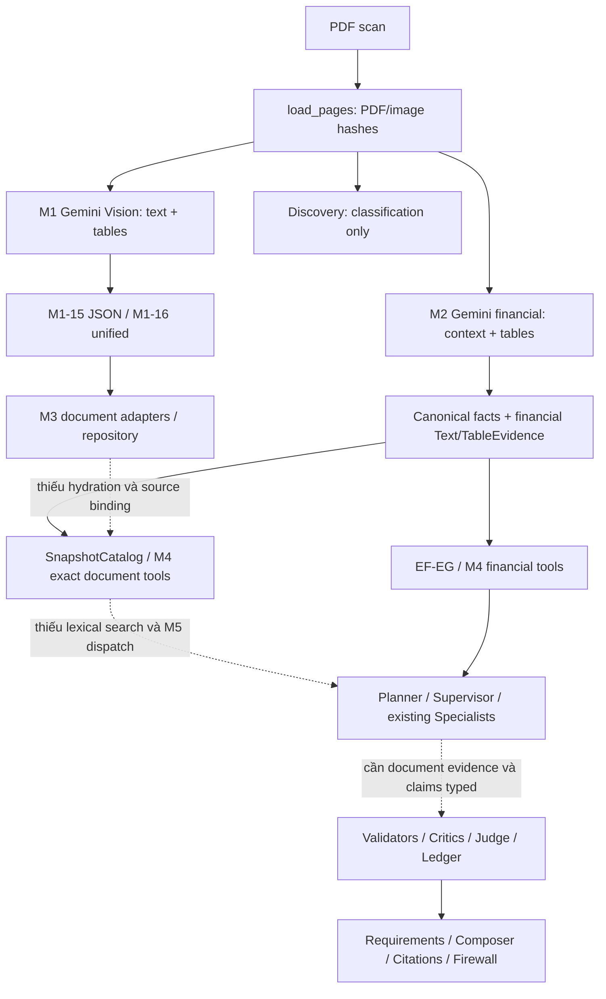

# ARCH-01 — Audit & Integration Plan for Full-Document Grounded QA

Ngày 06/11/2026, Asia/Bangkok. **DONE — Tech Lead APPROVED** theo quyết định cuối
cùng của người dùng. Accepted audit:
`4107a20424f312e8348368f47d8403376f67b127`, đã xác minh trên main/origin/main.
Baseline đã xác minh: `main`, HEAD/origin/main
`713c20e762fa6bb6fc560e2582821ae556cc9d99`. Audit không sửa runtime, không gọi
Gateway/Gemini/OCR, không tiếp tục GEN-01a hoặc chạy M8. Mọi roadmap dưới đây là
đề xuất, chưa được giao triển khai. Phiên nghiệm thu chỉ đồng bộ trạng thái và
chạy planning/diff checks; giữ nguyên kết quả audit, không chạy lại probes/tests/
Gemini/OCR hoặc M8. Không dùng CI GEN-01 cho ARCH-01.

## 1. Executive Summary

Document QA bị chặn ở nhiều tầng, không phải chỉ thiếu OCR hoặc Vector Database:

1. **Có nội dung đã trích xuất nhưng chưa nối vào catalog QA.** M1-15 giữ JSON
   Gemini thật trên BBS 2025 trang 5/7/8/14/15; M1-16/M3 đã materialize 33 text +
   3 table ở trang 5/7/8. Text trang 7/8 có nội dung người lập/kế toán trưởng/giám
   đốc ngoài bảng. Catalog E2E chỉ hydrate nhánh financial D-01/D-04, không hydrate
   snapshot M1 này. B09 trang 14/15 có JSON nhưng chưa có unified/M3 export.
2. **Extraction financial không phải transcription toàn trang.** M2 giữ
   `context` và tables trong response, nhưng prompt giới hạn context vào
   title/form/unit/date; không yêu cầu toàn bộ người ký, kiểm toán, chính sách.
   BCC accepted extraction chỉ bốn trang primary/PDF; discovery không thay thế
   nội dung các trang còn lại.
3. **Retrieval cấp ID/trang đã có; tìm nội dung chưa có.** M3/M4 truy xuất được
   text/table có nguồn, nhưng không query keyword, section hoặc paragraph ranking.
   M5 registry nhận biết document tools ở mức contract, còn Planner không tạo
   thao tác đó và Supervisor không thực thi chúng.
4. **Đầu vào/claim/output vẫn thiên về tài chính.** E2E context và M7 request
   inventory có thể chặn câu document trước M5; specialist evidence chỉ nhận
   fact/metric. M6 đã đọc được text/table references nhưng chưa có đường tạo và
   chứng minh document claims xuyên M5→ledger→M7. Câu mixed thử ở mục 5 bị rơi
   yêu cầu thuyết minh khi parse; chỉ thêm search tool chưa sửa được vấn đề này.

Khuyến nghị: giữ `Canonical Facts → EF-EG → M4` cho financial QA; nối **Document
Evidence có identity riêng** vào retrieval lexical nhỏ, rồi mở rộng typed handoff,
verification và requirements/output. Không hợp nhất hai pipeline, không thêm agent,
không Vector DB ở bước đầu. Chạy bổ sung Gemini hiện có chỉ sau inventory/binding
và ngân sách được duyệt; không OCR lại các trang đã có payload dùng được.

Có hai khác biệt giữa brief và workspace cần giữ minh bạch: accepted GEN-01 có
29 classifications thành công/30 attempts; local GEN-01a đã lưu 71 classifications
thành công nhưng chưa commit/nghiệm thu. GEN-01a vẫn tạm dừng theo Owner. Raw OCR
cũ cũng có BBS 2025 đủ 24 trang và BCC 2024 đủ 41 trang, nhưng PDF binding chưa
được chứng minh; không tính chúng thành coverage của PDF hiện tại.

## 2. M1/M2 Reality Check

### 2.1 Gemini nhận ảnh và trả dữ liệu gì

| Bước | Code thực tế | Nội dung và giới hạn |
| --- | --- | --- |
| Render | `src/document_processing/gemini_ingestion.py::load_pages`, `_page` | Đọc/hash cùng bytes PDF, PDFium render từng trang one-based, mặc định 200 DPI; PNG inline cùng image hash, dimensions, PDF hash, renderer/DPI. Không lấy text layer làm OCR scan |
| M1 Vision | `src/document_processing/vision_ocr.py::extract_structured`, `StructuredOCR`, `quality_schema` | Shared Gateway, PNG inline; `text_elements(text, reading, bbox)`, `tables(rows, columns, cells(text, reading, row, column, bbox))`, disposition/limitations. Component prompt yêu cầu prose ngoài bảng và mọi cell, giữ null/unknown; bbox candidate không phải geometry đã verified |
| M1 adaptation | `gemini_ingestion.py::ingest_page`, `adapt_to_m1`; `understanding_pipeline.py::run_document_understanding`, `_native_page`, `_existing_page` | DU v1 adapter chỉ partial text; UnifiedPage giữ text/table source components, issues, acceptance theo component, source pointers và processing history. UnifiedDocument là tập pages, không phải bằng chứng toàn PDF đã chạy |
| Discovery | `financial_discovery.py::understand_page`, `PagePrediction` | Chỉ statement type/classification/description/flags/uncertainty; prompt ghi rõ không numeric extraction. Description là tóm tắt, không dùng như quote, chữ ký hoặc ý kiến kiểm toán |
| M2 financial | `src/accounting/automated_extraction.py::extract_financial_page`, `ExtractedPage`, `ExtractionTable` | Shared Gateway; `statement_type`, `context: list[str]`, tables có label/code column, headers/cells/reading, limitations. Không bbox, không complete page prose. Prompt chốt bảng trước signatures/footer |
| Validate/normalize | `automated_extraction.py::validate_automated_extraction`, `run_automated_pdf`; `accounting/quality.py::evidence_from_automated_records` | Revalidate image/source/schema, giữ raw label/header/value và Decimal/context/quality, kể cả unmapped; accepted extraction không phải financial verification |

M1/M2 dùng chung renderer, VerifiedPageImage/image_source, Gateway, structured
output validation và request/usage/cost metadata. M2 không gọi Vision OCR hoặc
UnifiedDocument. `accounting/financial_runtime.py::process_financial_pdf` gọi
financial extraction trên selected pages; `api/extraction_sessions.py` bỏ B09
khỏi selection bằng `reason="notes_inventory"`. Đây là chính sách coverage đã có,
không phải chứng minh B09 không xử lý được. M2 schema cho phép B09 nhưng cấu trúc
label/code column thiên về bảng tài chính; prose B09 nên dùng nhánh M1 sẵn có.

### 2.2 Persistence và replay không cần Gemini

- M1-15: `artifacts/gemini-ingestion/M1-15/pdf/page-{5,7,8,14,15}.json`, cùng
  `manifest.json`. Mỗi file giữ source, provenance, **response.output.payload**,
  raw response envelope, validated components/assessment và partial M1 export.
  Tổng **58 text elements, 10 table structures** trên năm trang. Top-level
  `status="unresolved"` không có nghĩa response/text biến mất.
- M1-16: `artifacts/document-understanding/M1-16/native.json` có trang 5/7/8,
  33 text/3 tables; `existing.json` có trang 5, 6 text/1 table từ OCR cũ. Existing
  export thiếu document fingerprint binding nên M3 giữ bảy records ở quarantine.
- W-07/D-01: `result.json` giữ `inventory`, `records[].response.output.payload`,
  source/provenance và items/quality. `api/extraction_sessions.py` persist snapshot
  bằng `atomic_json`; projection `items` không thay thế raw response.
- BCC: `artifacts/evidence/GEN-01/normalized-release/{BCC_2025,BCC_2024}/` giữ
  `result.json`, `evidence.json`, `facts.json`, `descriptor.json`, graph/validation.
  Audit-release giữ reviews/metrics/M4 responses riêng. Không merge recovery vào
  original hoặc sửa accepted snapshots.

`run_document_understanding` hỗ trợ `persisted_results`, mặc định
`allow_live_ocr=False`; `PersistedOCRInput` replay manifest + PNG, kiểm tra image
hash nhưng ghi rõ không rehash PDF ở nhánh này. `run_automated_pdf(cached_records=...)`
render/revalidate đúng PDF/image binding và không gọi Gateway nếu cache có.
Các `DocumentEvidenceRepository`/`CanonicalFactRepository` đọc lại JSON trực tiếp.
ARCH-01 chỉ đọc persisted records; không replay extraction/normalization pipeline.

M1 native trang 7/8 giữ footer người lập/chức vụ mà M2 `context` thường không giữ.
Nếu chỉ dùng M2 như kho text toàn tài liệu thì thiếu các thông tin này; không có
bằng chứng M2 đã nhận chúng rồi đánh rơi khi persist. **G2 chưa được chứng minh**;
đây là extraction scope và integration/modeling gap, không kết luận mất JSON.

### 2.3 Phân biệt các mức bằng chứng

| Thành phần | Implemented | Tested trước audit | Executed / Persisted đã đọc lại | Indexed / QA-accessible |
| --- | --- | --- | --- | --- |
| M1 Vision + unified | Có | `test_gemini_ingestion.py`, `test_vision_ocr.py`, `test_understanding_pipeline.py` | M1-15 năm trang; unified native ba trang | 36 native M3 records có identity/exact lookup; chưa hydrate E2E |
| M2 financial | Có | `test_automated_extraction.py`, financial runtime suites | BBS/BCC records ở mục 5 | Canonical + financial context/table trong M3/M4; M5 financial path có dùng |
| Document adapters/repository | Có | `test_document_evidence.py` | Native, W-07, D-01/D-04, GEN-01 JSON thật | ID/trang có; lexical index chưa có; không tự crawl filesystem |
| M4 document tools | Có | `test_evidence_retrieval_tools.py` | Accepted M4-04 + probes mục 5 | Gọi trực tiếp được trên catalog caller hydrate; M5 không dispatch |
| Document claims end-to-end | Chưa đủ | Không có acceptance document QA trên PDF thật | Chưa thấy persisted M5→M7 document QA proof | Không được tuyên bố hỗ trợ chỉ vì có text contract |

“Tested trước audit” là suites/evidence đã có, không tuyên bố chạy lại toàn bộ
trong ARCH-01. Các checks thực sự chạy lần này ở mục 11.

## 3. Evidence Inventory

`src/evidence/contracts.py::SourceFact` là alias `CanonicalFinancialFact`, không
là kho facts thứ hai. Fact giữ canonical mapping nullable, raw value/context,
sources, quality/resolution; `financial_fact_verified=False`.
`EvidenceAnchor` bọc `FinancialSourceReference → SourceAnchor → RawPageIdentity`,
giữ page/image/source_ref và selectors/IDs/bbox khi nguồn thực sự cung cấp.

`src/evidence/document_adapter.py` có ba adapter thuần:

| Adapter | Nội dung text/table thật | Phần chưa nối |
| --- | --- | --- |
| `evidence_from_understanding` | DU text regions và UnderstoodTable, anchors/metadata | Không tự chạy OCR hoặc bind PDF |
| `evidence_from_unified_page` | `source_component.text` nguyên văn; UnifiedTable/cells; source metadata/candidate issues | M1-15 B09 chưa có unified export; OCR cũ phải qua loader/unified và identity được xác minh |
| `evidence_from_persisted_result` | M2 `payload.context` thành TextEvidence; `payload.tables` thành TableEvidence, cả unmapped cells | Không đọc discovery description, không tạo full prose từ labels/items hoặc response JSON envelope |

`TextEvidence.raw_text` thực sự chứa văn bản, có thể null; `TableEvidence.structure`
là contract bảng nguồn, không chỉ ID. `DocumentEvidenceRepository` giữ
`document-evidence.json` với records/quarantine và exact conflict/idempotence.
Không ghi đè canonical repository. `associate_fact` yêu cầu cùng document/snapshot,
request/source selector; cùng trang không đủ để tạo semantic support.

`src/evidence/graph.py::build_graph` lưu các node `source_fact`, `text`, `table`,
`anchor`, `derived_metric`; edges `from_source`, `associated_with`, `used_in`.
`associated_with` là lineage/association, không chứng minh đoạn văn hỗ trợ claim.
GEN-01 normalized graphs thực có mỗi PDF 204 source facts; 2025 có 22 text/4 table,
2024 có 26 text/4 table. Không có document QA claim graph được chứng minh ở đây.

| Catalog/snapshot đã persist | Text | Table | Khả năng lấy lại và phạm vi |
| --- | ---: | ---: | --- |
| BBS 2021–2025 original D-01 normalized | 116 | 20 | 136 exact lookups PASS trong audit; chỉ 20 primary pages |
| BBS 2022 recovery D-04, riêng snapshot | 23 | 4 | Repo đã đọc; accepted M4-04 inventory ghi 27 records, không chạy lại toàn bộ lookup ở audit |
| BBS M1 native, snapshot export riêng | 33 | 3 | Repo đã đọc; query trang 7 trả 13 text records; chưa nằm trong E2E setup |
| BBS M1 existing | 0 indexed | 0 indexed | 7 records quarantine, không cấp identity bằng filename |
| BCC 2025 GEN-01 normalized-release | 22 | 4 | 26 exact lookups PASS; caller phải hydrate catalog |
| BCC 2024 GEN-01 normalized-release | 26 | 4 | 30 exact lookups PASS; caller phải hydrate catalog |

BBS operational M4 inventory có **163 records = 139 text + 24 tables** khi tính
recovery riêng; không là 163 trang hay nguồn độc lập. Thêm M1-native và hai BCC
là 255 indexed records qua nhiều snapshots; không tự merge thành một QA snapshot.
Metadata/title/date chiếm phần lớn text financial; số TextEvidence không đo coverage
của auditor opinion, revenue policy hoặc người ký.

`src/evidence/retrieval.py::EvidenceRetrieval` tổ chức catalog in-memory từ inputs,
lookup identity và lọc doc/snapshot/page/kind bằng scan lists; repository list/get
không phải full-text index. `find_evidence` từ chối financial filters như company,
period, statement_type/scope. `EvidenceRetrievalTools` đã có
`get_evidence_item`, `find_document_evidence`, `get_evidence_anchor`,
`get_evidence_sources`, `get_metric_evidence_lineage`. Chưa có trường search text,
paragraph boundaries, section index, tokenizer/ranker hay semantic/vector lookup.

## 4. Runtime Data Flow và điểm đứt

Đường `Gemini JSON → TextEvidence → ??? → M5` thực chất có **hai trường hợp**:

- M2 context đã vào M3/M4 và catalog E2E: `???` là content retrieval + M5
  operations/dispatch, không thiếu repository. `scripts/evaluate_m4_05_qa.py::setup`
  hydrate `persisted_evidence` từ D-01/D-04; `scripts/run_e2e_financial_qa.py`
  dùng setup đó. Vì vậy không được nói M5 hoàn toàn không có TextEvidence.
- M1 narrative/footer hoặc B09: `???` còn gồm chưa materialize B09, snapshot binding
  và composition/hydration M1. M3-native đã persist nhưng setup không đọc nó.
  M1 snapshot khác D-01/normalized-v2: cùng PDF không cấp phép giả cùng snapshot.

Ở M5, `agents/contracts.py::TOOL_CONTRACTS` đã đăng ký cả document tools. Tuy nhiên
`agents/planner_contracts.py::PlannerOperation` chỉ cho financial fact/calculation,
sources/lineage/prepare_bundle; `agents/query_planner.py` materialize theo tập này.
`agents/supervisor.py::SUPPORTED_TOOLS` chỉ có bốn tools financial/sources/lineage.
`ExecutionEvidenceBundle`, `specialist_common.py::SpecialistEvidence` và Router
chủ yếu chiếu thành fact/metric. Đăng ký tool trong contract chưa là runtime support.

Điểm chặn còn sớm hơn: `api/financial_qa_pipeline.py::FinancialQAPipeline._context`
gọi financial parser + `outputs/firewall_qa_binding.py::request_inventory`, yêu cầu
year và fact context khả dụng. Pure document QA cần identity tài liệu, nhưng không
nhất thiết có numerical fact/period như financial query.

Ở M6, `verification/evidence_context.py::EvidenceContextBuilder._resolve` **đã có**
nhánh TextEvidence/TableEvidence, trả raw_text/structure và citations qua M4.
Không cần xây lại critic/source lookup. Điểm thiếu là M5 candidate/evidence typing,
document-specific proof/validators và M7 requirement selection; không nên mô tả
M6 hoàn toàn không đọc được text. `VerificationEvidence = SpecialistEvidence`
hiện vẫn kind fact/metric và bắt buộc numeric value/unit/period.

## 5. Real PDF Coverage và question probes

### 5.1 Coverage theo đúng nguồn và snapshot

| PDF | Tổng trang | Discovery có response thành công | Structured Extraction thực có | Text Evidence indexed | QA-accessible hiện tại |
| --- | ---: | --- | --- | --- | --- |
| BBS 2025 | 24 | 24/24 ở D-01 result | M2 p5–8; M1 p5/7/8/14/15; union 6 trang, không cộng lần quan sát trùng | D-01 24 text/4 table p5–8; M1-native 33 text/3 table p5/7/8 riêng | Financial E2E có evidence; M1 footer/B09 chưa được nối; pure document QA unsupported |
| BCC 2025 riêng | 30 | GEN-01: 15 success + 15 chưa gọi; local paused GEN-01a: 30/30 success | M2 p5–8, 4/30; không có Gemini full prose ở các trang còn lại trong scope đã đọc | 22 text/4 table p5–8 | M4 đọc được khi hydrate; chưa có BCC M5–M7 acceptance |
| BCC 2024 hợp nhất | 41 | GEN-01: 14 success + 1 error p2 + 26 chưa gọi; local paused GEN-01a: 41/41 success | M2 p9–12, 4/41 | 26 text/4 table p9–12 | M4 đọc được khi hydrate; metrics còn accounting-basis gate; chưa BCC M5–M7 acceptance |

Các counts GEN-01a được xác minh read-only từ `GEN-01a/{name}/inventory.json`:
71 unique pages, document identity khớp GEN-01 descriptors, response success/stop,
schema_valid, payload fields khớp projection. `summary.json` đồng thời ghi
`document_fully_extracted=false`. Không dùng con số này để nghiệm thu hoặc resume
GEN-01a; accepted GEN-01 artifacts giữ nguyên.

| BBS original filing | Tổng trang | Discovery success | M2 persisted extraction pages ở D-01 result | Indexed D-01 text/table |
| --- | ---: | ---: | --- | --- |
| 2021 | 28 | 28 | 6–9 | 23/4 |
| 2022 | 26 | 24, lỗi p11/18 | 5–8 **và B09 p11/18** | 22/4, chỉ p5–8 |
| 2023 | 29 | 29 | 5–8 | 24/4 |
| 2024 | 26 | 24, lỗi p21/24 | 7–10 **và B09 p21/24** | 23/4, chỉ p7–10 |
| 2025 | 24 | 24 | 5–8 | 24/4 |

BBS 2022/2024 có extraction thành công trên các trang discovery lỗi: payload lần
lượt B09 4 contexts/1 table, 5/1, 5/1, 7/3. Đây là dữ liệu persisted **chưa xuất hiện
trong selected normalized document repository**, cần inventory/materialize trước
khi yêu cầu extraction bổ sung. Không coi discovery lỗi là extraction chưa chạy.

### 5.2 OCR cũ: có dữ liệu, chưa chứng minh đúng PDF

Đọc toàn bộ JSON trong `data/processed/Financial_Report_OCR/{symbol}/{year}/ocr_json`:

| Catalog OCR cũ | Trang JSON | Text elements | Tables | Giới hạn |
| --- | ---: | ---: | ---: | --- |
| BBS 2025 | 24 | 745 | 25 | Có keyword người ký/chức vụ p6–8, kiểm toán p3–4, policy/notes; PDF binding chưa verified |
| BCC 2024 | 41 | 1.151 | 38 | Có kiểm toán p7–8, revenue/policy/notes; chưa chứng minh cùng PDF 41 trang đang dùng |
| BCC 2025 | 2 | 70 | 0 | Kích thước p2 khác PDF hiện tại; không nhận hai trang này là coverage của báo cáo 30 trang |

Raw signature elements có `signer_name`/role nhưng không được xem là danh tính
đã xác minh. `_existing_page` hiện chỉ chuyển text/table, bỏ loại signature/seal;
nên ưu tiên tên/chức vụ **in trong text**, không suy danh tính từ nét chữ ký hoặc
metadata detector. Thống kê keyword chỉ tìm candidate pages, không là QA answer.

Đối chiếu render 300 DPI trong bộ nhớ với local page PNG ở ba mẫu BBS2025/p7,
BCC2024/p8, BCC2025/p2: **0/3 exact RGB pixel matches**. Hai mẫu đầu cùng dimensions,
khác pixels không đủ kết luận khác tài liệu vì có thể khác renderer/compression/
tiền xử lý; BCC2025/p2 còn khác dimensions (2550×3300 so với 2484×3509). Không có
fingerprint manifest để chứng minh association. Binding toàn bộ OCR cũ tới PDF
hiện hành: **NOT VERIFIED**. Chỉ tái sử dụng sau source/page validation riêng;
không thay Gemini primary bằng OCR truyền thống hoặc tự rebind theo tên thư mục.

### 5.3 Các câu hỏi tối thiểu đã đối chiếu

| Loại / câu hỏi | Dữ liệu đã có | Tool/path hiện có và điểm chặn |
| --- | --- | --- |
| Financial: doanh thu | Canonical/raw financial facts BBS/BCC | `FinancialRetrievalTools.find_financial_facts`; BBS E2E accepted evidence, BCC audit-release M4; không chạy lại QA live |
| Financial: biên lợi nhuận | BBS accepted calculations/lineage; BCC2025 computed, BCC2024 blocked basis | `FinancialCalculator.calculate_financial_metric`, `get_metric_evidence_lineage`; giữ nguyên gate 2024 |
| Document: ai ký? | BBS M1 p7/8 có footer text đã persist; OCR cũ có candidates nhưng binding chưa chắc | Native `get_evidence`/page lookup lấy được; E2E chưa hydrate, chưa có document claim routing |
| Document: chức vụ? | BBS M1 p7/8 có role text | Chưa chứng minh pairing tên–role đầy đủ; cần ordered evidence/citations và verification, không chọn một người tùy ý |
| Document: đơn vị kiểm toán? | BBS/BCC2024 OCR cũ có candidates; Gemini primary chỉ discovery trang audit | Current M4 primary p3 trả not_found; không dùng discovery description làm tên đã verified |
| Document: ý kiến kiểm toán? | Raw OCR candidates BBS p4/BCC2024 p7–8, chưa verified binding | Chưa có bound Gemini narrative/M3 QA proof trong scope; không suy loại opinion từ tiêu đề audit |
| Mixed: doanh thu thay đổi và thuyết minh nói gì? | Financial operands có; BBS B09 Gemini p14/15 + B09 persisted 2022/2024; coverage liên quan câu hỏi còn phải xác minh | M4 financial hiện có; document retrieval/routing/requirement coverage thiếu; không biến co-occurrence thành giải thích nhân quả |

Probe `request_inventory` trên bảy câu, với **ledger rỗng có chủ ý**, chỉ để kiểm
tra nhận diện requirements: revenue/gross-margin nhận đúng fact/metric và abstained
vì no_verified_claim; bốn câu document đều unsupported. Câu mixed “Doanh thu BBS
năm 2025 thay đổi thế nào và thuyết minh giải thích ra sao?” chỉ tạo requirement
`b02.net_revenue`, **không giữ nghĩa vụ tìm thuyết minh hay tính thay đổi**. Không
coi đây là kết quả full pipeline hoặc kết luận mixed QA đã trả lời sai số liệu;
đây là bằng chứng parser chưa giữ đủ phạm vi câu hỏi.

Read-only retrieval probes: 136 BBS original + 56 BCC exact lookups = **192/192
found**; M1 native p7 trả 13 text matches. M4 BCC p7/2025 trả 5 text matches,
p11/2024 trả 7; cả hai p3 trả not_found. Nhiều matches được API gọi `ambiguous`,
không nhất thiết nội dung mâu thuẫn; search adapter cần giữ các candidates và rank,
không chọn record đầu tiên hay biến collection thành verified answer.

## 6. Root-Cause Matrix

| Gap | Bằng chứng code/artifact và nguyên nhân | Ảnh hưởng | Giải pháp tối thiểu / module | Kiểm thử cần có |
| --- | --- | --- | --- | --- |
| G1 Extraction Coverage | GEN-01 result chỉ 4 primary pages/PDF; M2 prompt giới hạn context; discovery chỉ classification | Thiếu bound prose audit/policy/B09 và signatures trên nhiều trang; complete discovery vẫn thiếu text | Inventory/replay M1 cache trước; dùng Vision M1 hiện có cho narrative pages còn thiếu; `document_processing`, composition | Coverage page/type manifest; bound prose có source, unreadable/null explicit; budget/cache 0 extra calls khi replay |
| G2 Persistence | Chưa thấy response payload cần thiết bị drop: M1/M2 response và tables/context đều persist | Không được đổ lỗi cho persistence hoặc viết kho mới khi chưa có bằng chứng | Giữ raw response; khi EXT chạy, kiểm tra exact payload retention; `api`/artifact writer chỉ khi phát hiện lỗi | Source response→persist→restart exact, không có synthetic quotes; hiện **NOT ESTABLISHED** |
| G3 Evidence Modeling / materialization | M1 B09 p14/15 chưa unified/M3; BBS2022/24 B09 có payload nhưng selected repository loại khỏi scope; OCR signature type bị skip; M1 existing 7 quarantine | Có JSON thật chưa thành evidence indexed/đủ identity | Reuse `run_document_understanding` + document adapters; materialize đúng export snapshot; identity/source binding OCR cũ trước; `evidence`, composition | B09 text/cells preserved; missing binding quarantine; không tạo role/name bằng suy đoán; financial facts unchanged |
| G4 Retrieval | `EvidenceQuery`/M4 request không query text/section; find_evidence chỉ page/kind/doc/snapshot, từ chối financial filters | Không tìm đúng đoạn kiểm toán/notes từ câu hỏi tự nhiên; context metadata không đủ | Lexical document lookup có source isolation, rank và neighboring regions; `evidence`, `tools` | Exact/keyword/diacritics/section hint; wrong snapshot/doc không rò rỉ; table cell references giữ nguyên |
| G5 Agent Integration | PlannerOperation không document retrieval; Supervisor allowlist 4 tools; SpecialistEvidence chỉ fact/metric; E2E setup bỏ M1-native | Tool contract có nhưng agent không gọi; evidence không vào candidate | Mở operations/dispatch/bundle và routing ba specialists hiện có; plain document selection ở Supervisor/orchestrator; `agents`, `api` | Document-only không ép numeric fact gate; mixed hai nhánh; trace gọi tool thật, không tool giả/new agent |
| G6 Verification / Output | EvidenceContextBuilder đã đọc text nhưng VerificationEvidence vẫn numeric; ledger ClaimKind/period ràng buộc; request_inventory từ chối document hoặc làm rơi mixed clause | Không có đường claim tên–role/opinion và source-bound release; nguy cơ bỏ yêu cầu khi trả partial | Document claim extension có proof, Judge/ledger admission và M7 requirements/slots/citation/firewall phù hợp; `verification`, `outputs`, `api` | Tên sai, role swap, wrong page/snapshot, incomplete opinion và causal overreach bị chặn; thiếu một phần luôn partial/abstain |

Các gap đồng thời: BBS footer đã có → G4/G5/G6 (và hydration G3 theo snapshot);
BBS B09 → G3/G4/G5/G6; BCC audit prose → G1/G4/G5/G6; OCR cũ → source-binding
prerequisite trước G3, không tự ghi “đã có data đúng PDF”. Không có một root cause
duy nhất áp dụng mọi câu hỏi.

## 7. Minimal Integration Architecture

Giữ Offline → Online → Output. Offline vẫn persist immutable source observations;
online chọn tools/bằng chứng; output chỉ đọc admitted claims.

1. **Financial lane giữ nguyên:** canonical facts/EF-EG/metrics/source reviews →
   M4 retrieval/calculator. Không đưa toàn văn vào financial facts hoặc tự tạo
   canonical IDs cho tên người/chính sách.
2. **Document lane:** M1 UnifiedPage hoặc M2 persisted tables/context → adapters
   TextEvidence/TableEvidence → document repository/caller-selected catalog.
   Dùng `EvidenceIdentity`, anchors và raw text/table structure hiện có; index là
   projection có thể rebuild, không nguồn chân lý mới. Không cần OCR JSON schema mới.
3. **Identity composition:** giữ snapshot extraction/export riêng, không sửa
   snapshot_id M1 thành D-01 để “nối được”. Cần một composition manifest nhỏ liên
   kết financial snapshot và document-evidence snapshot được duyệt, cùng PDF hash,
   company/reporting scope, source page/image. Mỗi citation giữ identity nguồn
   nguyên bản; request pin manifest, không latest/parent fallback. Chính sách
   cross-source snapshot này cần duyệt trước implementation, không giả hệ thống
   hiện hỗ trợ mixed snapshots hoặc nới D03-B10 cross-document gate.
4. **Bắt đầu bằng lexical retrieval:** exact text/id/page lookup trước; Unicode
   normalization/casefold chỉ trên search projection, thêm accent-insensitive
   fallback cho query tiếng Việt. Token/phrase ranking trên text và table cell text,
   bounded top-k và neighbors theo reading/source order, không ghép raw quotes
   khác nguồn thành một câu. Có thể dùng in-memory index cho corpus local nhỏ;
   SQLite FTS chỉ khi số đo/coverage cho thấy cần persistence/ranking tốt hơn.
5. **Section-aware nhẹ:** title/form/page/heading có sẵn làm optional hints;
   thiếu heading thì fallback lexical. `structural_role="context"` không là section
   taxonomy. B09 continuation phải giữ trang, không tự suy mọi trang sau B03 là B09.
6. **Semantic/vector là tùy chọn sau:** chỉ thử nếu bộ câu hỏi PDF thật cho thấy
   lexical bỏ sót paraphrase. So sánh lexical và hybrid trên cùng nguồn/gold/budget,
   chưa chọn Vector DB hoặc embedding provider. Không biến vector score thành
   confidence financial/document claim.

Phương án này cần adapter/hydration và mở tool/handoff; chưa có bằng chứng lợi ích
để hợp nhất M1/M2 hoặc chạy cả hai trên mọi trang. Nếu một trang cần cả bảng
financial và prose thì tái sử dụng cache trước, chỉ gọi nhánh phù hợp cho phần thiếu.
EF-EG tiếp tục giữ financial relationships/calculations và lineage; document
retrieval có thể đứng ngoài graph với source references cùng contract.

Mixed query phải tạo requirements độc lập: financial value/delta (M4 công thức đã
duyệt), related notes (Document Evidence), interpretation nếu nguồn hỗ trợ. So
sánh đúng company/PDF/year/scope; BCC2025 riêng và BCC2024 hợp nhất không tự là cặp
tương thích. Thuyết minh chỉ mô tả chính sách hoặc khoản mục thì chỉ dẫn lại nội
dung đó, không khẳng định nguyên nhân doanh thu/lợi nhuận biến động. Có số nhưng
không có giải thích → partial, chỉ rõ phần thiếu và source cho từng phần.

## 8. M5/M6/M7 Changes cần thiết

### M5 và application context

- `FinancialQAPipeline._context`, query/requirement parsing phải nhận financial,
  document, mixed; không yêu cầu numeric fact để tìm người ký của một bound PDF.
  Document request vẫn phải pin document/source selection; không tự suy năm/kỳ
  từ tên file. Các financial gates hiện hành giữ cho financial lane.
- `PlannerOperation`, QuerySpecification/EvidenceRequirement, planner prompt và
  validation: thêm document-search/lookup operation + phần evidence cần có. Giữ
  nguyên thứ tự dependencies và bounded calls. `get_evidence_item`/
  `find_document_evidence` đã có contract nên dùng lại trước khi thêm wrapper search.
- Supervisor dispatch/bundle cần truyền TextEvidence/TableEvidence và citations,
  giới hạn lượng text gửi LLM. Router/orchestration projection không được bỏ
  document requirements vì không canonical_item/formula. Với plain document QA,
  Supervisor/orchestrator dùng retrieved observations tạo candidate được kiểm tra;
  mixed explanations do specialists hiện có trong domain xử lý. Không tạo agent
  mới; nơi đặt candidate builder chốt ở QA-01 sau contract review.

### M6: document claims là nguồn nói gì, không tự là sự thật đã kiểm chứng

Tái dùng EvidenceContextBuilder, deterministic validators, Evidence/Logic Critic,
Judge, bounded revision và proof replay admission. Cần extension phân biệt claim
document với financial fact/metric, không nhét tên người vào numeric value/unit.
Giữ schema M1/M2; thay đổi typed handoff M5/M6/ledger ở task QA-01 sau duyệt.

Proof tối thiểu cho claim “tên X được in tại mục người ký với chức vụ Y”:

- Exact text hoặc table cells chứa tên và role; identity evidence + source pointer,
  PDF hash/page/image và original snapshot. Tên–role phải có relation từ vùng đọc
  liên quan, không nối hai từ xuất hiện bất kỳ trong báo cáo.
- Đối chiếu identity/request/citations với **nguồn lấy lại từ repository**, không
  tin bản evidence do candidate tự gửi; giữ reading/quality/limitations từ M1.
- Bảo toàn quote boundaries và OCR uncertainty. Không nhận diện người bằng chữ ký
  viết tay. Tên thiếu dấu/mờ hoặc role ambiguous → INVESTIGATE/ABSTAIN; nếu chỉ
  một phần rõ thì tách claims và partial. Không tự đặt probability/threshold mới.
- Auditor opinion cần đoạn opinion và giới hạn/qualification liên quan; không
  trích một câu thuận lợi rồi đổi nghĩa opinion. Claim nên diễn đạt “báo cáo nêu…”.
  Causal explanation cần câu nguồn hỗ trợ quan hệ; số giảm và một đoạn notes cùng
  trang không đủ chứng minh nguyên nhân.
- ACCEPT vẫn cần đúng policy/proof/context và admission vào Verified Claim Ledger.
  `financial_fact_verified=False` của extraction giữ nguyên; source-bound verified
  claim không chứng nhận mọi nội dung tài liệu đúng ở ngoài đời.

`ledger_contracts.py::VerifiedClaimIdentity` và QA context hiện bắt period/kind theo
financial contract. Đề xuất versioned document claim/context extension, có report
identity và optional claim applicability khi đúng nghĩa; **không** tự gán kỳ số
liệu cho người ký. Migration/compatibility chi tiết là quyết định QA-01, không
tạo contract mới trong ARCH-01.

### M7: giữ requirement coverage và Firewall

`qa_composer.py::understand_requirements`, `firewall_qa_binding.py::request_inventory`
phải giữ document/mixed requirements và biểu đạt missing coverage. QA Composer/
Report Writer chọn admitted document claims như protected slots; không lookup
nguồn mới hoặc thêm tên/role/opinion ở output. M7 Report Outline hiện theo financial
targets cũng cần chọn document claims nếu output có mục kiểm toán/chính sách.

Tái dùng `CitationRenderer`, `validate_rendered_citations`,
`InformationFirewall` với extension typed source/context phù hợp. Page-level vẫn
page-level, không tạo bbox/cell provenance giả. Validation phải kiểm tra document
claim IDs/content/citations/source-snapshot binding và toàn bộ requirements ban đầu;
không cho đủ phần số liệu che mất phần thuyết minh. Ledger không có claim tương ứng
thì partial/abstain có lý do; không đưa candidate text trực tiếp ra người dùng.

## 9. Implementation Roadmap đề xuất

Đây là backlog thiết kế, **chưa thêm các task implementation vào registry**, chưa
READY/chưa bắt đầu. Các IDs INT/EXT/QA/CHAT/PERF cần đối chiếu registry tại lúc giao.
M8 vẫn dành benchmark chính thức, nằm ngoài đợt triển khai này.

| Thứ tự / task | Dependencies | Output tối thiểu và acceptance trên PDF thật |
| --- | --- | --- |
| INT-01a — Existing Evidence Binding & Materialization (S) | ARCH-01 được duyệt; accepted M1/M3/GEN-01 | Manifest pin financial/document snapshots cùng PDF; materialize M1 B09 p14/15 và BBS2022 p11/18, BBS2024 p21/24 từ cache vào output riêng. Kiểm tra original text/cells/anchors + missing binding/quarantine; 0 Gemini calls; accepted facts/reviews không đổi |
| INT-01b — Lexical Document Retrieval Tool (S) | INT-01a | Tool search/ID/page/source/section hint trên Text/TableEvidence; BBS signer p7/8 và B09 cache tìm được đúng source; BCC financial context đọc được; p3 BCC thiếu narrative trả coverage thiếu. Wrong doc/snapshot/recovery không lẫn; raw text immutable |
| EXT-01 — Missing Narrative Coverage (chia theo PDF, S mỗi lát) | INT-01a inventory và Owner duyệt pages/budget | Dùng M1 Vision hiện có cho BBS audit p3/4, BCC2025 audit p3/4 và BCC2024 audit p7/8 nếu cache/binding chưa đủ; B09 BCC p9–30/p13–41 và BBS notes còn thiếu theo coverage manifest. Chọn policy/debt notes bằng evidence, không đoán page. Giữ table cells/prose, exact provenance, cache/restart không gọi lại; không cần đợi full notes để nghiệm thu một lát |
| QA-01a — Document Candidate & Verification (S) | INT-01b; source-bound samples INT/EXT; duyệt contract | M5 tool dispatch/bundle + document claim proof/ledger extension; BBS signer tên/role, một auditor/opinion case BCC có source. Sai tên/role/page/doc, OCR unknown, partial opinion bị chặn; numeric validators cũ vẫn chạy |
| QA-01b — Hybrid Requirements & Grounded Output (S) | QA-01a; EXT slices cho câu được chọn | E2E context/Planner/Router + M7 QA/report/citation/Firewall: câu signer, role, auditor, opinion, revenue policy, debt note; một mixed query giữ tất cả requirements. Thiếu notes → partial, không tự chứng minh nhân quả; chưa bound PDF → clarify/abstain |
| GEN-02 — Generalization E2E (S theo bộ câu) | QA-01b và coverage EXT đủ cho bộ câu; Tech Lead quyết định cách xử lý GEN-01a paused | BBS + BCC2025 riêng + BCC2024 hợp nhất: financial/document/mixed grounded answers, explicit partial/abstain, source pages đúng; giữ accounting-basis2024/D03-B10 gate. Đây là targeted research acceptance, không M8 benchmark |
| CHAT-01 — Conversational QA (S) | GEN-02 được nghiệm thu | Follow-up người ký/“chức vụ của người đó”/năm đó: giữ doc/snapshot/year/scope, đổi tài liệu cần resolve lại; không dùng hội thoại làm evidence |
| PERF-01 — Measured QA Latency (S) | Sau khi chốt chức năng; có thể giao độc lập cho ledger bottleneck đã đo | Dùng số đo E2E-01 cold lookup44,145s/cache74,525s làm vấn đề đã biết; đo lại đúng đường cần sửa, giữ proof/citation/firewall. Chưa chạy benchmark hiệu năng trong ARCH-01 |

INT đi trước EXT để tránh OCR trùng và chứng minh integration từ nguồn đã có.
EXT và QA chỉ có thể xen kẽ theo các lát source-bound được giao; không cần đợi
toàn PDF mới kiểm thử signer, nhưng không gọi sản phẩm “full-document QA” khi
coverage còn thiếu. Không tự resume GEN-01a chỉ vì EXT có thể dùng discovery local.

Acceptance tập trung cho GEN-02/QA-01: ít nhất hai financial, bốn document, một
policy/debt-note và một mixed question trên mỗi PDF khi nguồn thực sự có; expected
answer/quote/page do người review đối chiếu ảnh PDF độc lập trước scoring. Có
negative cases missing page, ambiguous signer, same company khác scope/year và
unsupported cause. Báo riêng retrieval hit, extraction fidelity, claim support,
citations, completeness/abstention; không gộp synthetic PASS thành accuracy tài chính.

## 10. Tech Lead Decisions

| Quyết định cần duyệt | Khuyến nghị Codex | Lý do |
| --- | --- | --- |
| Có hợp nhất/xây lại M1/M2? | Không; adapter/hydration trước | Hai nhánh giữ nội dung khác nhau, dùng chung renderer/Gateway; chưa chứng minh lợi ích rewrite |
| Có dùng toàn bộ raw OCR ngay? | Chỉ sau PDF/page binding; ưu tiên Gemini bound caches | Raw BCC2025 khác kích thước; BBS/BCC2024 fingerprint chưa verified; signature metadata không là visible-name proof |
| Snapshot source binding | Manifest composition có explicit source snapshots, không rewrite IDs | Financial D-01 và M1-native khác snapshot; policies hiện không tự cho phép join |
| Search engine | Lexical/exact/page + hints/neighbor context trước | Corpus nhỏ; thiếu search API đã rõ, chưa có phép đo cần vector |
| Plain document candidate placement | Supervisor/orchestrator helper + existing specialists cho mixed | Thêm tool/handoff đủ cho bước đầu; không cần agent mới |
| Claim/proof extension | Versioned document context/proof, giữ financial validators và ledger admission | Current numeric evidence không biểu diễn tên–role/opinion đúng nghĩa; M6 source resolver dùng lại được |
| Extraction bổ sung | Duyệt từng PDF/pages và call budget sau inventory | BBS B09 đã có nhiều caches; BCC narrative còn thiếu; discovery complete không cấp phép OCR full PDF |
| GEN-01a | Giữ tạm dừng; quyết định riêng có dùng/duyệt local discovery hay không | Local71/71 chỉ evidence chưa commit, không được tự DONE hoặc tiếp tục task |

**Next action duy nhất:** Chờ Owner/Tech Lead giao task triển khai tiếp theo;
không tự bắt đầu INT-01a hoặc tiếp tục GEN-01a.

## 11. Validation và Git handoff

Audit read-only thực chạy, output riêng ignored:
`artifacts/evidence/ARCH-01/audit_read_only.py` → `audit.json`. Script không inject
Gateway, không gọi extraction hoặc `put` repository; đọc catalog đã persist,
thực hiện exact/page/requirement probes ở mục 5. Lần chạy đầu gặp inventory GEN-01a
là object thay vì list, đã sửa reader local; lần hoàn tất exit 0. Output giữ
91 input hashes và 8 hashes của file implementation/Web thay đổi từ trước task.
Đối chiếu cuối **91/91 inputs + 8/8 inherited files unchanged**; phạm vi này không
là hash toàn dataset.
Render pixel probes ba trang trong bộ nhớ, không ghi/đổi ảnh nguồn.

Planning checker chỉ mở rộng nhận ID/milestone ARCH, giữ toàn bộ validations;
test existing registry được mở rộng cho ARCH. Checks local: planning checker
**PASS, 108 tasks** (gồm GEN-01a pending local); **5 planning tests PASS**,
Ruff lint/format hai file tooling **PASS**, `git diff --check` **PASS**.
Planning checker trên bản export Git index **PASS, 107 tasks**; phần GEN-01a
pending local không nằm trong commit. 71 persisted discovery payloads cũng đã
parse lại bằng `PagePrediction` và đối chiếu schema_ref, không gọi discovery.
SHA bàn giao được ghi trong thông báo cuối;
không chạy runtime tests,
frontend build, live QA, CI/full regression hoặc benchmark để nghiệm thu docs audit.

Workspace đầu task có pending GEN-01a runtime/CI/tests và `web/next-env.d.ts`;
giữ nguyên, không đưa vào commit ARCH-01. Registry/spec GEN-01a cũng chưa có trong
baseline commit; giữ phần đó ở working tree, không commit lại đề bài/implementation
đang tạm dừng. Commit ARCH chỉ thêm audit và phần planning/tooling của audit;
staged registry có 107 tasks, còn working tree có 108 do GEN-01a local.
Planning local ghi GEN-01a BLOCKED
(tạm dừng theo Owner, vì enum không có PAUSED), không tự nghiệm thu task đó.
Artifacts/dataset/OCR/PDF/ảnh/normalized/canonical, secrets và đường dẫn cá nhân
không được stage. Báo cáo chỉ ghi code paths, relative artifact paths và thống kê;
không chép corpus OCR hay tên người ký từ dữ liệu riêng vào Git.
