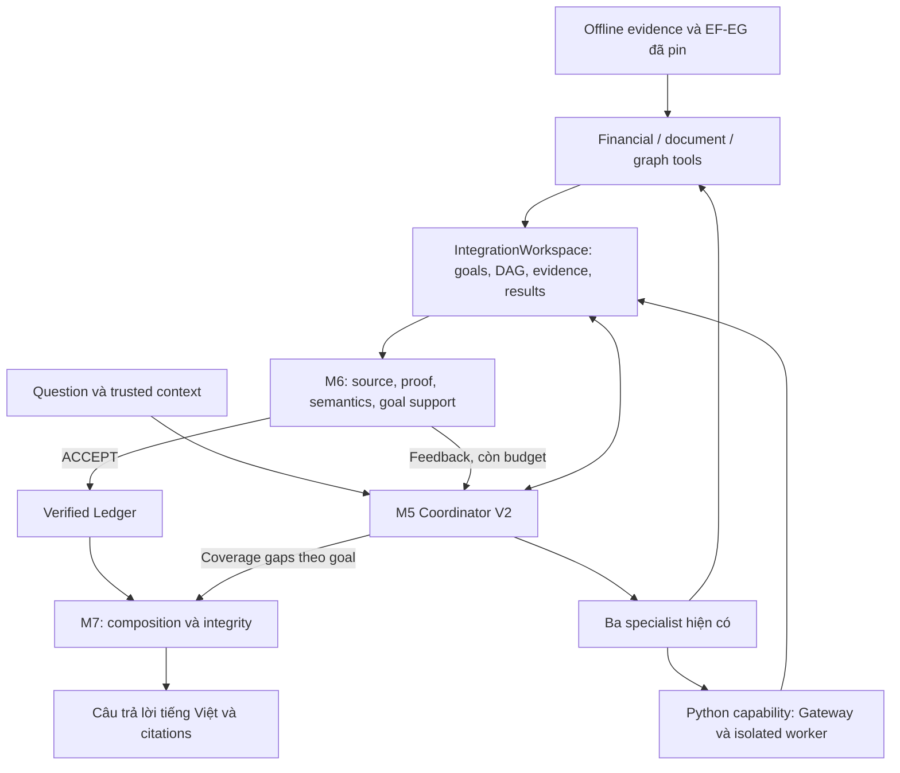

# ARCH-02 — Technical Architecture Specification

Ngày 17/11/2026 (Asia/Bangkok). **DONE — Owner/Tech Lead APPROVED.**
Đầu vào được duyệt: [ARCH-01a](arch-01-adaptive-multi-agent-review.md), bản
publish `3dbb48c969567b01197ec18f4b6adac03e0aee05`, nghiệm thu tại remote main
`5eea640d7c1955f7a7454c4c9c5d29fede247d57`. Đối chiếu runtime trực tiếp tại
working tree HEAD `966b73a17dcf1a573f485ccc67f2ffb3be4bee0d` **cộng local edits**;
remote main chưa chứa toàn bộ runtime đó. Tài liệu là thiết kế triển khai tiếp
theo, không xác nhận capability đã chạy hoặc chất lượng tài chính đã đạt.

## 1. Quyết định và phạm vi

Mở rộng coordinator V2, giữ pipeline **M5 → Financial Tools / EF-EG → M6 →
Verified Ledger → M7** và ranh giới [module](module-boundaries.md),
[architecture](architecture.md), [contracts](data-contracts.md). Offline extraction,
canonicalization và corpus đã pin giữ nguyên. Online không tự gọi OCR/Gemini.

- Dùng lại ba specialist `profitability`, `liquidity_and_leverage`,
  `cash_flow_and_earnings_quality`; Python là capability chung, không thêm
  specialist domain, planning judge, framework orchestration hay case memory.
- Task DAG và kết quả có phiên bản nằm trong `IntegrationWorkspace` hiện có.
  EF-EG tiếp tục biểu diễn nguồn/lineage; ledger chỉ chứa claims được M6 ACCEPT.
- Qwen sinh proposal nhỏ; backend cấp identity, hydrate context/provenance,
  dựng contracts nội bộ. Metadata chưa có căn cứ vẫn unresolved.
- M6 xuất obligations/feedback từ checks hiện có; coordinator có tối đa một
  vòng repair cục bộ, dùng budget chung. M6 giữ quyền quyết định ACCEPT.
- Câu tiếng Việt mang nghĩa tài chính được hoàn thiện trước M6. M7 tổ chức các
  mệnh đề đã xác minh và citations, có một lượt kiểm integrity, không semantic lại.

Thiết kế giải quyết schema quá nặng, retrieval chưa đi đến selection/join,
dependency chưa tạo truy vấn tiếp theo, proof/binding đứt đoạn và lỗi một nhánh
làm mất đáp án độc lập. Không tối ưu theo doanh nghiệp, ID hoặc bốn câu E2E-05.

## 2. Điểm mở rộng trên code thực tế

| Thành phần hiện tại | Quan sát trong working tree | Thay đổi cần triển khai |
| --- | --- | --- |
| `src/agents/lite_orchestrator.py`: `LiteTask`, `LitePlan`, `SupervisorLite.plan`, `integration_plan`, `FinancialLiteOrchestrator.run` | Có `task_id`, requirements, dependencies; chỉ cho tham chiếu task đứng trước; retrieve mọi task rồi generate theo danh sách | Adapter wire nhỏ; kiểm DAG độc lập thứ tự JSON; retrieve/execute khi task ready; bổ sung patch hữu hạn |
| `src/agents/integration_workspace.py`: `IntegrationWorkspace.merge/export`, `answer_coverage` | Đã chia sẻ evidence và statements/proofs; technical errors đang ảnh hưởng coverage toàn cục | Lưu result refs/version và lỗi theo task/goal; coverage từ M6 bindings và admission của phiên bản hiện hành |
| `src/agents/specialist_common.py`: `AnalysisProposal`, `ReasoningProof` | Có operations, assumptions, ba loại reasoning; computation có thể đi kèm prose/limitations | Giữ đường Calculator; tách numerical result, proposition phân tích và metadata nguồn; thêm execution proof có version khi bật Python |
| `src/tools/financial_calculator.py`: `execute_dynamic`, `calculate_dynamic`, `validate_operation_contexts` | Decimal, operations/context guards và replay đã có; `DynamicOperand.reference.kind` phải là `fact` | Fast path giữ nguyên; Python/table proof riêng, không ép document cell thành fact để qua guard |
| `src/tools/note_evidence.py`, `src/tools/evidence_retrieval.py`, graph tools | Có bảng/văn bản, headers/grid/provenance; graph trả relations cấu trúc | Dùng nguyên tools/IDs; backend tạo observation gắn ô nguồn và selection/join record request-local |
| `src/verification/lite_runtime.py`: `verify`, `_semantic`, `decide`; `lite_contracts.py` | Một deterministic pass, semantic batch khi cần; có ACCEPT và requirement support riêng; `lite_single_pass` | Giữ một pass/candidate version, thêm feedback và input binding đầy đủ; verify thêm frontier thay đổi sau repair |
| `src/verification/ledger_contracts.py`, `ledger.py`, `ledger_repository.py` | `VerifiedClaim` chứa lịch sử typed; v1 chỉ hiểu proof hiện tại | Bổ sung reader/admission cho proof/history mới có version, giữ đọc v1; không chỉ thêm Python vào sidecar rồi admission bằng proof cũ |
| `src/api/financial_qa_pipeline.py`: `_m5`, `_run`, admission, `release_lite` | Gọi M5 → M6 rồi admission/output; chưa có repair trong V2 | API wire coordinator với callable M6/admission; scheduling thuộc `agents`, checks thuộc `verification` |
| `src/outputs/qa_lite.py`: `compose_lite`, `_verified_text`, `_group_verified_segments` | V2 đã grouping mệnh đề có thật; không phát hành prose tài chính tự do của Answer Agent | Giữ grouping/citation projection; cải thiện proposition trước M6 và renderer cho proof mới |
| `src/core/llm_gateway.py`, `qwen_adapter.py`, `llm_contracts.py` | Có schema/local validation, usage/cost; adapter gửi `strict` khi caller đặt | Mọi LLM vẫn qua Gateway; xác minh endpoint capability riêng, không đồng nhất local reject với constrained decoding |

Các path là điểm đọc của working tree nêu ở đầu tài liệu; bản GitHub publish có
thể cũ hơn. Migration phải kiểm tra lại baseline runtime trước implementation,
không cherry-pick/push toàn bộ local edits chỉ để khớp tài liệu.

## 3. Luồng E2E và ownership



1. Resolve trusted company/document/snapshot/scope một lần bằng logic hiện có;
   giữ composition binding khi có. Câu hỏi không tự cấp period/unit authority.
2. Supervisor đề xuất answer goals và tasks. Backend validate, cấp IDs, lập DAG.
   Goal là đầu ra người dùng cần; bước tìm bảng/tính trung gian chỉ là task.
3. Chạy task ready theo topo, tuần tự; retrieve sát lúc thực thi. Specialist
   nhận câu hỏi gốc, local goal, evidence projection và dependency results.
4. Kết quả mới có thể yêu cầu retrieval/task tiếp theo. Coordinator patch phần
   liên quan; synthesis do một trong ba specialist nhận ownership rõ.
5. M6 nhận candidate frontier đủ closure; trả truth decision, goal support và
   feedback. ACCEPT độc lập được admit qua repository hiện có.
6. Nếu còn issue sửa được và budget, patch một lần rồi chạy closure bị ảnh
   hưởng; M6 kiểm phiên bản mới. M7 đọc ledger/current selection sau vòng này.

Ví dụ tổng quát: T1 chọn đối tác đứng đầu theo cột/kỳ được hỏi; T2 dùng entity
và selector do T1 trả về để tìm nghĩa vụ với đúng đối tác ở bảng khác; T3 tổng
hợp. Một task nhận xét thanh khoản độc lập không chạy lại khi join của T2 sai.
Tên đối tác là result có nguồn, không phải literal coordinator tự điền.

## 4. Giao diện tối thiểu: wire nhỏ, contracts nội bộ đủ căn cứ

### 4.1 Plan proposal và adapter

Ví dụ cấu trúc, không phải dữ liệu tài chính thật:

```json
{
  "goals": [{"text": "Xác định đối tác lớn nhất và nghĩa vụ tương ứng", "mode": "value"}],
  "tasks": [
    {"goal_indexes": [0], "role": "profitability", "objective": "Chọn đối tác theo cột và kỳ được hỏi", "input_handles": ["S1"], "after": []},
    {"goal_indexes": [0], "role": "liquidity_and_leverage", "objective": "Tìm nghĩa vụ của đối tác do task đầu chọn", "input_handles": ["S2"], "after": [0]}
  ]
}
```

`goal_indexes` và `after` là indexes **0-based** trong hai arrays gốc; tham chiếu
task phía sau được phép nếu DAG hợp lệ. `role` dùng đúng ba enum đang có; `mode`
chỉ `value` hoặc `analysis` (bao gồm yêu cầu tổng hợp/giới hạn trong `text`).
`input_handles` chỉ chứa source handles backend đã cung cấp; không dùng T/G IDs.
`[]` nghĩa là chưa chỉ định nguồn, task phải retrieval; không nghĩa là không có
nguồn. Các trường trên required, không nhận null để đoán ý; giới hạn giữ 16 goals,
6 task identities/request và 16 input handles/task như biên hiện có.

Backend cấp G1…/T1… theo vị trí gốc, ánh xạ G IDs sang `requirement_id` hiện có.
Giữ text/câu hỏi gốc; map value/analysis sang `IntegrationRequirement` theo dữ
liệu đã resolve, không ép đủ `QARequirement` bằng metadata suy đoán. Nếu chưa
bind được target/period/unit, lưu unresolved trong sidecar và chỉ bind khi có
authority. Lookup chuẩn có thể tận dụng resolver hiện tại; metric mới phải đi
qua kiểm formula/goal support của M6.

Goals vẫn là inventory do model nhận diện, chưa bảo đảm hiểu đủ mọi ý câu hỏi.
Coverage hiển thị theo inventory này; M6 đối chiếu goal với câu hỏi gốc nhưng
không hứa phát hiện mọi omission. Research completeness dùng gold goals độc
lập, không lấy `complete=true` của workspace làm nhãn đáp án đầy đủ.

Validate envelope/refs/DAG/bounds tại adapter; không sửa aliases/IDs theo phỏng
đoán. Envelope sai hoặc goals không parse được: lỗi planning, không tạo M6
verdict. Với envelope đã parse, giữ task độc lập hợp lệ; task sai và dependents
bị chặn, goal thiếu owner vẫn hiện unresolved. Không compact arrays rồi đổi nghĩa
indexes; không cắt một cycle để giả DAG hợp lệ.

### 4.2 Specialist, Calculator/Python và semantic wire

| Call site | Model cần sinh | Backend sở hữu |
| --- | --- | --- |
| Specialist | `claims: [{type, text, inputs}]`, `needs: [{capability, objective, inputs}]` | Candidate IDs, origins, local goal IDs, provenance/citations, caveats nguồn; `inputs` là handles đã cấp, có thể trỏ result |
| Calculator mode | Operations theo `DynamicOperation` hiện có, dùng handles được đưa vào prompt | Hydrate `DynamicOperand`, chạy Calculator, render numerical proposition và tạo `DynamicCalculation`; không bắt model sinh lại giá trị/proof |
| Python mode | `{code, outputs}`; `outputs` là tên output keys cần lấy | Input manifest, execution, numeric results, traceback và execution proof; model không trả số làm authority |
| M6 semantic | `{verdicts: [{claim_id, verdict, reason, supported_requirement_ids, issues}]}` | Deterministic checks, final decision, obligation IDs, normalization của issues và repairability |

Trong specialist proposal, `type` là `observation`, `computation`,
`interpretation`, `conditional`; adapter map sang claim kinds/reasoning types
hiện có. `computation` chỉ tham chiếu kết quả đã execute; claims chưa có result
đi qua `needs` trước, không lấy số trong prose thay output. `capability` chỉ
`retrieve`, `calculate`, `python`; reuse query/tool contracts hiện tại để resolve
nhu cầu, không mở arbitrary tool dispatch. Backend truyền goal assignment của
task, M6 xác nhận binding; model không phải lặp requirements/provenance.

`needs` là yêu cầu công việc, không phải claim thiếu dữ liệu trong toàn tài liệu.
Qualification/nhận định tài chính của model phải là proposition riêng để M6
kiểm; source-quality caveats giữ ở backend. Conditional chỉ dùng assumptions
có origin từ người dùng hoặc nguồn, chưa có thì unresolved, không tự tạo giả định.

Prompt mỗi mode có field descriptions, vocabulary/handles thật và một ví dụ ngắn
cùng schema. Tái dùng Gateway local validation; không thêm lớp sửa JSON hậu kỳ.
Capability probe sau này gồm valid case, yêu cầu cố ý phá required/enum và các
schema keywords thực sự dùng; ghi riêng endpoint enforcement/adapter forwarding/
Gateway rejection. Chưa gọi probe trong ARCH-02, không giả định `strict=true` đủ.

### 4.3 Internal records dùng chung

Các tên sau mô tả phần bổ sung tối thiểu trong workspace/proof, không yêu cầu
thêm toàn bộ top-level schemas hay model sinh những records này.

| Record | Nội dung cần giữ |
| --- | --- |
| Goal | Existing requirement identity/text, original question, mode, resolved target/context hoặc unresolved reason; tasks được giao và verified bindings |
| Task | Stable ID, owner role, objective, goal IDs, dependencies, input handles, revision, state |
| TaskResult | Task ID/revision, input refs kèm version/digest, output handles, candidate IDs/versions, execution/proof refs, missing inputs/error category |
| Evidence handle | Existing reference và document/snapshot/composition identity, selector, digest, raw value/text, context có authority, quality/caveats; không clone nguồn |
| Candidate | Existing claim contract cộng result/proof ref; immutable version, proposed goal binding, natural proposition đã render; M6 decision riêng |
| Verification feedback | Candidate/version, task, goal, failed obligation/check, reason code, input refs, action, repairability; truth và goal support riêng |

Result handles do backend cấp, khác source handles; resolve tới task revision cụ
thể. Prompt chỉ nhận projection hữu hạn, backend giữ closure đầy đủ. Thiếu field
authority khác với field không áp dụng; không tự lấp bằng năm trong tên file.

## 5. Task DAG, workspace và local repair

### 5.1 Scheduler và plan patch

State nội bộ: `pending → ready → running → completed/partial/blocked/failed`.
`stale` đánh dấu revision không còn current; không dùng trạng thái này làm trạng
thái task registry. `completed` nghĩa execution hoàn tất, chưa có nghĩa M6 ACCEPT.

Task ready khi dependencies có đúng **outputs cần dùng** ở revision hiện hành;
không chỉ kiểm nhãn `generated/partial`. Partial có thể cung cấp một output hợp
lệ; thiếu selected entity thì task join vẫn blocked. Chọn ready task theo thứ tự
goal gốc rồi stable task order. Không chạy song song LLM ở prototype một GPU.

Patch chỉ append/update tasks và input/dependency/owner của nhánh cần sửa; không
delete/đổi goal gốc hoặc trusted scope. Backend cấp trước IDs còn trống cho
additions, model dùng các IDs đó và task IDs đã tồn tại trong `after`; adapter
validate toàn patch atomically, gồm cycles/bounds/refs. Update giữ task ID và tăng
revision. Unsupported goal giữ gap; đổi cách hỏi để được ACCEPT không là repair.

Một expansion patch theo kết quả retrieval được phép trong initial execution;
một repair patch theo lỗi execution/schema hoặc M6 được phép sau đó. Cả hai dùng
chung cap 6 task identities; replacements không cấp budget mới. Nhu cầu phát
sinh thêm sau các giới hạn này đi ra partial/gap, không mở đệ quy planner.

### 5.2 Chia sẻ evidence và kết quả

Giữ `IntegrationWorkspace.merge` và bundle hiện có; mọi specialist có thể dùng
evidence chung trong trusted request scope, domain chỉ quy định ownership nhận
định. Mỗi projection giữ row/column headers, heading, đơn vị và caveats cần hiểu
nguồn; thiếu token thì gửi trang/hàng mục tiêu và handle để retrieve phần còn lại.
Không cắt bảng rồi coi tập đã cắt là toàn bộ comparison domain.

Canonical facts vẫn do evidence/accounting sở hữu. Với bảng chưa canonical,
backend tạo **source-bound observation request-local** bằng parser hiện có:
reference bảng + row/column selector, raw string, normalized Decimal, dấu/scale,
header/unit/period anchors, parser version, quality và digest. Không tự map
canonical item hoặc ghi ngược corpus. Unit/kỳ/entity chưa có căn cứ thì observation
chưa eligible cho computation. M6 replay selector/parser trước khi dùng số.

Giữ cả hai giá trị khi conflict; không chọn latest/confidence cao nhất. Selection
proof giữ domain, excluded rows và lý do, column/period, comparator (`max` khác
`max_abs`), ties. Join proof giữ hai phía, source-backed keys, normalization,
cardinality/unmatched rows. Không fuzzy join theo lời model; key mơ hồ giữ blocked.
Ties trả tập đồng hạng; chỉ chọn một khi câu hỏi/quy tắc có căn cứ cho phép.
Null/blank không thành zero; total/subtotal loại theo evidence hàng/heading,
không loại chỉ vì làm đổi kết quả. Domain chưa đầy đủ chỉ hỗ trợ phát biểu hẹp
“trong các hàng đã kiểm”, không hỗ trợ “lớn nhất toàn bảng”.

Raw observations/computations chưa verify có thể làm numerical premise nếu toàn
source/proof closure đi kèm để M6 kiểm; interpretation chưa ACCEPT không được
dùng như fact. Synthesis dùng interpretations đã ACCEPT hoặc đưa từng premise
vào cùng frontier M6 và chỉ admit khi tất cả premise cần thiết đã ACCEPT.

### 5.3 Invalidation và giữ kết quả đã đúng

Khi T2 đổi output, so input refs/version/digests để đánh stale đúng consumers và
descendants thực sự dùng output đó. Dependency chưa khai đủ consumption thì
invalidate bảo thủ toàn descendants của T2, không tuyên bố lineage tối thiểu.
Nhánh độc lập và quyết định M6 có cùng inputs giữ nguyên; không gọi lại để “chắc”.

Candidate sửa có ID/version mới, trỏ parent; một version có một quyết định M6.
ACCEPT lịch sử không bị sửa/xóa. Request current selection loại claims dùng input
stale; admission mới lưu proof mới, không mutate ledger cũ. Hai ACCEPT mâu thuẫn
chưa resolve thì không chọn một bằng thời gian; giữ gap liên quan. Reuse verdict
chỉ khi claim, sources, code/proof, context, goal binding và policy digests không đổi.

### 5.4 Budget và điều kiện dừng

Default engineering ban đầu, cấu hình tại coordinator (chưa calibration):
`max_provider_calls=12`, `max_total_tokens=90000`, `deadline_seconds=240`,
`max_expansion_patches=1`, `max_repair_rounds=1`. Giữ source/tool limits hiện có;
không cho hơn 6 task identities, mỗi task thêm tối đa một retrieval batch theo
request contract đang dùng. Caps không cam kết trả đủ mọi câu hỏi.

Mọi planner/specialist/code/semantic/output call, failed generation và adapter
retry đều trừ budget chung. Tắt nested retry ở đường coordinator. Trước khi mở
nhánh mới phải reserve M6 cho frontier hiện tại, M6 sau repair nếu thực hiện, và
tối đa một output grouping call; thiếu budget output dùng deterministic grouping.
Timeout mỗi call không vượt deadline còn lại; timeout worker cũng nằm trong đó.

Token reservation tính input đã serialize theo tokenizer của model cấu hình và
max output trước call; usage thật dùng để settle. Tokenizer/capability chưa có
thì chưa tuyên bố hard token cap đã enforce: cần preflight trước live acceptance.
Usage unknown được ghi unknown, dừng các LLM expansion/repair tùy chọn và dùng
phần M6 đã reserve/deterministic output; không quy unknown thành 0 hay đổi provider.

Dừng khi required goals có admitted/current support, không còn action sửa được,
patch không đổi evidence/code/selection, hết vòng/calls/tokens/deadline, hoặc lỗi
cũ lặp lại không có tiến triển. Giữ `schema_mismatch`, `provider_unavailable`,
`source_missing`, `ambiguous_context`, `execution_error` theo task/goal; không
gắn lỗi kỹ thuật một nhánh cho toàn bộ goals hay dựng feedback M6 khi chưa có claim.

## 6. Python execution

### 6.1 Backend cô lập và hợp đồng thực thi

Chọn **Linux container dùng Docker Desktop/WSL2 trên Windows**, image worker
Python 3.11+ pin digest, chỉ standard library và helpers Calculator đóng gói sẵn.
Đây là phương án implementation được đề xuất, không phải worker đã sẵn sàng:
phiên này chỉ thấy Docker CLI, chưa kiểm daemon/backend/image/isolation. Nếu
preflight không đạt, trả `python_unavailable`, giữ Calculator/lookup khả dụng;
không fallback sang `exec` trong API hoặc subprocess host.

Runner nhận code và JSON manifest qua stdin; không nhận host paths từ model,
không mount repository/raw corpus/credentials/Docker socket. Backend quyết định
command/image/options, chạy dưới UID không root, `--network none`, `--read-only`,
`--cap-drop ALL`, `--security-opt no-new-privileges`, giữ seccomp mặc định. Giới hạn
ban đầu: 1 CPU, 256 MiB memory (memory+swap cap bằng memory), 32 PIDs; tmpfs 16 MiB
nếu harness cần; 10 giây wall time/execution; code 12 KiB, manifest 256 KiB,
stdout/stderr tổng 64 KiB. Vượt giới hạn: terminate **container**, không chỉ CLI;
cleanup trong finally. Không cài package/pull image khi đang trả lời request.

Các cơ chế namespace/resource/privilege dựa trên
[Docker run](https://docs.docker.com/engine/containers/run/) và
[Docker security](https://docs.docker.com/engine/security/); deployment preflight
phải xác nhận chúng trên Linux backend thực tế. Container là biên cô lập được
chọn cho local prototype, không phải tuyên bố sandbox tuyệt đối.

Worker trusted harness hydrate số thành Decimal theo context `prec=34`,
`ROUND_HALF_EVEN`; chạy hàm `solve(data)` và serialize result có giới hạn. Code
không import, I/O/network/process, clock/random hoặc packages; AST precheck báo
lỗi sớm, isolation vẫn do container. Tables truyền dưới dạng rows có stable row
IDs, cell handles và Decimal/null, chưa cần pandas hoặc Python DSL mới.

### 6.2 Calculator và proof

Metric/operations chuẩn vẫn đi `FinancialCalculator`. Worker có helper mỏng dùng
lại `execute_dynamic` cho **canonical operands hợp lệ** và sinh `DynamicCalculation`
hiện có. Không đưa source-bound observations vào `DynamicOperand` giả `fact`.
Filter/rank/join và computation ngoài contract cũ dùng execution proof mới.

Manifest pin inputs/authority trước chạy: canonical refs hoặc observations, raw
strings/normalized values, unit/scale/period, table domain, user assumptions có
origin và constants thuật toán có purpose. Không lấy số tiền/tỷ lệ dữ liệu từ
literal trong code/prose. Constants như 2 để lấy trung bình, 100 để đổi phần trăm
phải xuất hiện trong code và được giải thích trong computation specification;
constant khác cần căn cứ. Code dùng sai constant dù replay khớp vẫn không đủ ACCEPT.

Giá trị trong `data` được backend chuẩn hóa về đơn vị cơ sở bằng scale đúng một
lần; raw value/scale vẫn giữ trong manifest. Calculator helper nhận raw operands
theo contract cũ và tự áp scale như hiện tại; không áp lần hai lên `data` đã chuẩn
hóa. Kết quả phải có output-unit specification và M6 kiểm dimensional context.

Ví dụ cấu trúc hàm, không phải định nghĩa chỉ tiêu kế toán đã duyệt:

```python
def solve(data):
    base = (data["opening"] + data["closing"]) / 2
    return {"ratio_percent": data["flow"] / base * 100}
```

Backend lưu `PythonExecutionProofV1`: code nguyên văn/hash, worker image/helper/
parser versions, input manifest/digests, constants/assumptions, output keys và
Decimal strings/unit/rounding, selection/join descriptors, execution status,
bounded traceback. Domain/keys/units là proposed specification cần M6 kiểm,
không lấy output labels làm authority. Backend kiểm output handles thuộc manifest;
không để code tự cấp source identity hoặc `verified=true`.

Lineage mặc định giữ **toàn bộ manifest** đã đưa code, gồm hàng thua/excluded khi
selection cần chúng. Trace từ helpers có thể chính xác hơn; chương trình Python
tổng quát chưa có tracing đáng tin thì chỉ công bố lineage bảo thủ. Stdout/trace
do generated code trả không phải bằng chứng độc lập; backend rehydrate nguồn và
M6 replay qua trusted harness, không tin proof tự khai của code.

### 6.3 Traceback, sửa và replay

Syntax/runtime failure trả exception type, line và traceback giới hạn, inputs
handles và execution status; loại host paths/environment khỏi lỗi gửi model.
Một lần sinh code sửa được phép **trong repair round chung**; cùng task và inputs
bất biến, execution mới có version mới. Nếu đã dùng round cho schema/M6 repair
thì không thêm code repair round. Code sửa do chính patch M6 chỉ được execute và
verify một lần; lỗi tiếp thì dừng. Timeout/OOM ghi category riêng, không retry mù.

M6 rehydrate inputs từ pinned storage, đối chiếu selector/parser/context, chạy
lại cùng code/image/Decimal để so output; selection/join khai comparator/domain/
keys thì deterministic checks đối chiếu kết quả trên tập nguồn tương ứng.
M6 semantic xem local goal, proposition, code, computation specification và
selection/premises khi nghĩa chưa có typed authority. Replay chứng minh tái lập,
không chứng minh chọn đúng cột, đúng công thức hoặc ý nghĩa tài chính.

Không replay được vì worker unavailable thì candidate Python không ACCEPT;
các claims độc lập vẫn có thể phát hành. Rounding chỉ ở display, giữ exact
Decimal output; zero denominator/null/context conflict thành explicit issue,
không tự bù zero hoặc đổi công thức để code chạy.

## 7. M6 Evidence Obligations và feedback

### 7.1 Obligations từ checks hiện có

Obligation là check có target/input/goal, không là agent hoặc ledger thứ hai.
Backend tạo từ claim/proof type và yêu cầu gốc; dùng `ValidationResult.checks`
và reason codes hiện tại, chỉ thêm check chưa biểu diễn được selection/Python.

| Loại claim | Nghĩa vụ deterministic | Phần semantic khi cần |
| --- | --- | --- |
| Canonical scalar / approved metric | Identity/pin, provenance, value/sign/unit/scale/period/scope, quality; metric replay theo registry | Goal/item binding chưa resolve; exact typed alias có authority không cần gọi lại |
| Table/text observation | Replay cell/span, row/column/header/unit/period anchors, raw→normalized fidelity; giữ source caveats | Ý nghĩa nhóm/hàng/cột/entity; observation chưa canonical không được bỏ bước này |
| Pure computation | Toàn operands/closure, context compatibility, operation/code replay, output unit/rounding, constants/assumptions | Formula/definition và đúng goal; không gọi kết quả quotient bất kỳ là ROE |
| Selection/rank/join | Domain completeness, filters/comparator/ties, exact selected rows; keys/normalization/cardinality và missing rows | Group/entity semantics, target câu hỏi và authority của cách join |
| Interpretation/synthesis | Premise refs/version/currentness và ACCEPT của premises mang nghĩa phân tích; số nêu ra phải bound | Entailment, chiều quan hệ, mức chắc chắn; causality cần evidence riêng |
| Absence / conditional inference | Search scope và coverage record, assumptions có origin; conditional không thành observation | Retrieval miss không chứng minh corpus absence; điều kiện/giới hạn phải giữ trong proposition |

Claim ACCEPT và goal satisfied độc lập: đúng số giá vốn không đáp ứng goal lợi
nhuận; đúng các operands không đáp ứng goal tỷ suất chưa có calculation. Không
cấp coverage cho goal lệch ý câu hỏi gốc. M6 kiểm local goal trong cùng pass,
không thêm judge kiểm toàn câu hay semantic lại tại M7.

### 7.2 Feedback contract và action mapping

Backend trả ví dụ nội bộ sau; các IDs minh họa, không là schema Qwen phải lặp:

```json
{
  "candidate_id": "C7",
  "candidate_version": 1,
  "task_id": "T2",
  "decision": "INVESTIGATE",
  "supported_requirement_ids": [],
  "issues": [{
    "obligation_id": "C7:entity_join",
    "requirement_id": "G1",
    "check": "entity_join",
    "reason_code": "ambiguous_join_key",
    "input_refs": ["E-left", "E-right"],
    "action": "resolve_entity",
    "repairable": true
  }]
}
```

Semantic wire chỉ cần issue `{check, reason_code, input_refs}` bên cạnh verdict
hiện có; enums/handles giới hạn trong prompt. Backend gắn obligation/task/goal và
action, không để model tự đặt authority/repair budget. Check thiếu bằng chứng
phải có target; text reason giữ để chẩn đoán, không dùng regex prose điều khiển DAG.

| Check / reason family | Action nhỏ nhất của coordinator |
| --- | --- |
| Missing source/operand/authority | Retrieve trong scope, hoặc giữ unresolved/clarification nếu nguồn không đủ |
| Wrong row/column/period, incomplete rank domain, ambiguous join | Sửa selection/join owner và đúng consumers phụ thuộc |
| Code syntax/runtime/replay mismatch | Sửa code đúng task với manifest pin; không đổi source để khớp output cũ |
| Formula/goal mismatch | Sửa computation specification/candidate/binding; verify version mới |
| Unsupported interpretation/causality/absence | Thêm premise có nguồn hoặc đề xuất proposition hẹp hơn rồi M6 kiểm lại; không chỉ đổi lời để né check |
| Provider/schema/worker unavailable, hết budget | Giữ technical category và gap theo goal; chỉ repair nếu có thay đổi hợp lệ và quota còn |

Lite giữ final decisions đang dùng: ACCEPT, INVESTIGATE, ABSTAIN; không thêm
REVISE làm quyền override. Non-ACCEPT có structured issues; ACCEPT thiếu goal
binding cũng tạo **goal-support issue** riêng mà không thu hồi truth decision.
Backend chỉ cho actions ánh xạ từ checks/budget; không tự nâng INVESTIGATE lên ACCEPT.

### 7.3 Proof binding, admission và tương thích

Semantic input digest phải bind đúng payload thực sự dùng: claim/version/text,
question/local goals/proposed bindings, trusted context, source values/headers/
selectors/quality, calculation/code/manifest/specification và policy version.
Lưu supported requirement IDs cùng proof/history. Hiện V2 còn support sidecar và
`semantic_payload` chưa chứa đủ local bindings; implementation phải sửa điểm này
trước khi reuse quyết định/admit proof mới, không chỉ hash thêm một ID ngoài payload.

Giữ v1 `DynamicCalculation`, `LiteVerificationHistory`, `VerifiedClaim` đọc được.
Khi dùng proof Python/source observations hoặc saved goal-support inputs mới,
thêm tagged proof/history v2 và entry version tương ứng qua union có discriminator;
reader v1 không mặc định rằng binding còn thiếu đã verified. Admission replay
M6 proof/context mới, giữ policy/source hashes; không giả `approved_metric` hoặc
nhét code vào string `limitations` để qua v1. Chỉ write v2 khi mode mới bật;
không rewrite ledger cũ/corpus hay tự nâng `financial_fact_verified` của nguồn.

M6 verify frontier theo dependency: source/pure computations có closure được
kiểm trực tiếp; interpretations phụ thuộc interpretations phải có ACCEPT trước
khi admit downstream. Repaired frontier có thể có semantic batch thứ hai, vẫn
một pass trên mỗi candidate version và budget request chung. Không có terminal
semantic audit sau M7.

## 8. M7: câu tiếng Việt tự nhiên từ verified propositions

M5 tạo proposition ngắn, đủ chủ thể, chỉ tiêu/quan hệ, kỳ và đơn vị; backend
render số từ Calculator/worker output. M6 kiểm **chính câu sẽ phát hành** cùng
goal binding. Observation, computation, nhận định và qualification là các mệnh
đề riêng khi có nghĩa độc lập; model notes không tự thành caveat tài chính.

M7 nhận admitted current claims + M6 bindings + scoped gap metadata. Dùng lại
`compose_lite`, grouping/citation projection; optional Answer Agent chỉ chọn
thứ tự/nhóm claim IDs, không viết lại câu tài chính. Ghép các câu đã verify thành
đoạn tiếng Việt, giữ dấu/đơn vị/precision, qualifiers và citations. Renderer cho
typed proof mới chỉ hiện dữ liệu đã admit, không tính thêm tại output.

Ví dụ hình thức: “[Mệnh đề kết quả chọn đối tác đã ACCEPT] [1]. [Mệnh đề nghĩa
vụ của cùng đối tác đã ACCEPT] [2].” Dùng heading ngắn để nhóm theo nội dung;
không tự chèn “do đó/vì vậy” khi quan hệ suy luận chưa có claim. Câu thiếu nguồn
hiển thị “Chưa xác minh được phần … trong lượt xử lý này”, không đổi thành
“Báo cáo không có dữ liệu”. Metadata kỹ thuật không trình bày như nhận định nguồn.

Một integrity pass kiểm current/admitted membership, đủ claims đã chọn để đáp
ứng bindings, số/units/qualifiers giữ nguyên, citation mapping và closure. Citation
closure giữ operands và căn cứ headers/selection/join; giao diện gộp refs trùng
theo mệnh đề, không dump mọi evidence trong workspace. Grouping lỗi thì deterministic
grouping giữ claims hợp lệ. Không semantic lần hai; không hứa paraphrase tự do.

## 9. Migration và kế hoạch task tiếp theo

Giữ `integration_v2` là entry hiện có; thêm opt-in cấu hình
`adaptive_coordinator=false` ban đầu, `python_execution=false` độc lập. Không đổi
legacy/document/fusion routing trong task đầu. Pure financial V2 đi coordinator
mới khi bật; tools tài liệu vẫn dùng trong workspace cùng pin. Child fusion chỉ
bật sau smoke tương thích với composition bindings, không tự hợp nhất các lane.

Các ID dưới đây là **đề xuất để giao việc sau review**, chưa đăng ký READY hoặc
bắt đầu implementation; không đổi các task lịch sử. Khi giao task, tạo spec ngắn
và đăng ký ID trước triển khai; nếu đã có ID ở thời điểm đó thì dùng suffix mới.

| Thứ tự / task đề xuất | Phạm vi chính và dependency | Output/criteria để REVIEW |
| --- | --- | --- |
| 1. **M5-COORD-01** (S) | Sau ARCH-02 DONE: wire plan adapter + Task DAG/result versions trên V2; Calculator cũ, chưa feedback/Python | Qwen không sinh internal requirements; forward dependency/topo đúng; invalid branch không làm mất task độc lập; opt-out giữ đường cũ |
| 2. **M5-COORD-02** (S) | Sau 01: demand retrieval, result handles/shared workspace, observation/selection/join records request-local và expansion patch | Downstream dùng entity/output đã tìm để retrieve; đủ input closure; không promote raw cells; errors/coverage theo goal |
| 3. **M6-OBL-01** (S) | Sau 02: obligations/structured feedback và saved goal-support binding; mở rộng history reader/admission tối thiểu | Wrong target vẫn không có goal support dù fact đúng; non-ACCEPT có check/input/action; stale binding không reuse; v1 vẫn đọc được |
| 4. **M5-COORD-03** (S) | Sau M6-OBL-01: feedback loop/budget/invalidation | Một repair round, sửa đúng closure; ACCEPT độc lập được giữ; no-progress/exhaustion dừng và trả gap đúng loại |
| 5. **M5-PY-01** (S) | Sau 02: worker/preflight và code mode, reuse Calculator helper; có thể làm sau đường Calculator đã hoạt động | Code chạy cô lập hoặc unavailable rõ ràng; traceback/caps; manifest và execution record; chưa phát hành Python claim bằng proof v1 |
| 6. **M6-PY-01** (S) | Sau M5-PY-01 và M6-OBL-01: execution proof, observation replay, v2 admission/output projection | Replay exact inputs/code; bác wrong column/domain/formula; đọc ledger v1 và round-trip proof mới; chưa có proof thì không ACCEPT |
| 7. **M7-ANSWER-01** (S) | Sau M5-COORD-03; thêm Python projection sau M6-PY-01 | Proposition tự nhiên được kiểm trước M6; grouping giữ số/nghĩa/qualifiers/citations và verified coverage, không semantic lại |
| 8. **E2E-ARCH-02** (S) | Sau các capability được chọn ở trên, gồm M6-PY-01 nếu thử Python | Smoke luồng thật, capability probes và báo cáo scan-backed pilot trong scope/budget được giao; quyết định readiness cho held-out evaluation |

Mỗi task chỉ thay phần cần thiết và dừng REVIEW. Nếu proof/admission ở task 3/6
thực tế vượt S, tách phần persistence bằng suffix mới trước READY; không gộp
refactor ledger/pipeline lớn. Baseline runtime chưa publish và Docker readiness
là preflight phải làm rõ khi giao implementation, không kéo code ngoài task vào ARCH-02.

## 10. Tiêu chí kiểm thử và bằng chứng thực tế

### 10.1 Engineering controls khi triển khai

Mỗi task chọn 1–3 targeted tests cho logic chính, cộng một integration smoke khi
đổi luồng; không mặc định full regression. Các controls ưu tiên theo rủi ro:

| Nhóm | Case và điều cần quan sát |
| --- | --- |
| Wire/DAG | Plan tasks đảo thứ tự vẫn topo đúng; cycle/unknown ref chỉ chặn closure liên quan; goal đã nhận diện nhưng thiếu owner/output vẫn là gap |
| Coordination/repair | Entity từ T1 được T2 dùng thật; một join/column sai nhận feedback, sửa T2/consumers; task độc lập và ACCEPT count không bị mất, rounds/calls không reset |
| Grounding/M6 | Giá trị đúng nhưng sai item/period/goal không có coverage; observation đổi raw cell hoặc mất unit anchor không ACCEPT; retrieval miss không thành corpus absence |
| Python/proof | Decimal/result đúng với operands có nguồn; syntax lỗi nhận traceback và tối đa một repair; timeout terminate worker; network/host mounts không có; replay mismatch và unavailable không admit |
| Selection/join | Negative values phân biệt max/max_abs; tie/null/total/unmatched keys có xử lý khai báo; domain bị cắt không chứng minh toàn bảng; provenance giữ cả tập so sánh |
| Ledger/M7 | Đọc saved v1, v2 proof round-trip; sửa goal/code/source làm invalid digest; không chọn stale claims; câu tiếng Việt giữ số/qualifier/citation và bindings, grouping failure không làm mất independent ACCEPT |

Đây là các tiêu chí cho từng task, không yêu cầu viết toàn bộ tests trong task
đầu hay chạy benchmark ở ARCH-02. Schema/provider probe và worker preflight là
checks riêng; generation hợp schema hoặc code execution PASS không là answer đúng.

### 10.2 Smoke trên dữ liệu thật và research evaluation

Smoke đầu tiên dùng một câu phụ thuộc selection → retrieval/join → computation
trên PDF scan có quyền truy cập và corpus đã pin, cộng một nhánh độc lập hoặc
failure injection offline để chứng minh local repair. Gold/hàng/ô đúng chỉ do
evaluator mở sau answering; không truyền vào prompts/tools. Trace phải thấy
task result được downstream dùng, feedback dẫn đến patch cụ thể, M6 verdict và
ledger admission/citations thực tế; `use_graph=true` hoặc nhiều role không đủ.

Người đánh giá đối chiếu PDF/ảnh cho exact cell, header/kỳ/unit/entity và từng
proposition phát hành. Imported JSON-only smoke phải ghi giới hạn chưa PDF-verified.
Ghi extraction errors riêng với selection/formula/verification/presentation
errors; đồng thuận giữa agents không sửa được OCR cùng sai.

Research pilot theo [ARCH-01a §5](arch-01-adaptive-multi-agent-review.md): tập
held-out dự kiến 30 câu (10 lookup/text, 10 selection/join/synthesis, 10 numerical),
freeze trước tuning theo filing/company và mẫu suy luận; có missing/ambiguous
cases. Development E2E03/04/05 chỉ là regression set. Chưa chọn mẫu/chưa cấp
live budget trong task này; full 600 và repeated runs cần giao riêng.

So B1 generalist, B2 fixed DAG/shared evidence, P adaptive obligations/local
repair với cùng model, tools/Python/M6, corpus và total budget. Ưu tiên ablation
bỏ obligation guidance; không lấy live-v6 lỗi schema làm baseline công bằng duy
nhất. Đo accuracy toàn câu, grounded required-goal completeness theo gold độc
lập, M6 false accept/reject, provenance trang/ô/closure, abstention, repair đúng
nhánh/regression, calls/tokens/latency kể cả failures/unknown usage.

Engineering acceptance: không vi phạm source/proof/admission boundaries trong
controls và có trace E2E chạy đúng luồng. Research conclusion chỉ có khi held-out
cho thấy chất lượng/completeness tốt hơn ở cùng budget mà không tăng unsupported
release; công bố paired differences/uncertainty, không lấy synthetic PASS làm
chứng cứ chất lượng tài chính hoặc khẳng định novelty.

## 11. Validation và bàn giao ARCH-02

Phạm vi thay đổi chỉ tài liệu này và tracking ARCH-02; runtime/schema/tests và
local edits ngoài scope giữ nguyên. Publish dựa trên remote main nêu ở đầu tài
liệu bằng checkout riêng; không push bốn commit local hoặc dataset/artifacts.
Kiểm bắt buộc: planning checker tại working tree và cây publish, `git diff
--check`, đối chiếu fingerprint code/schema và tập file commit. Kết quả thực sự
ghi tại registry/spec task sau khi chạy; không chạy Qwen/Gemini/OCR, pytest,
benchmark hoặc CI lớn/thủ công. Commit docs dùng `[skip ci]`.

Các quyết định đã được Owner/Tech Lead chấp thuận ngày 17/11/2026: wire/internal split, caps và một repair
round; Docker Linux worker với fallback unavailable; source-bound observations
và proof/history versioning; natural realization trước M6/composition sau M6.
Formula/accounting definition chưa được duyệt vẫn TBD theo từng yêu cầu; không
đưa định nghĩa benchmark thành registry rule.

Nghiệm thu áp dụng cho đặc tả kiến trúc tại commit
[`cb65c927fe2fc719d06fdd82cf904e3323a941cf`](https://github.com/VuongQuocAn/vietnamese-financial-multi-agent/commit/cb65c927fe2fc719d06fdd82cf904e3323a941cf),
đã publish lên main và xác minh remote SHA. Phiên đóng chỉ cập nhật trạng thái/
tài liệu và kiểm planning/diff; không triển khai runtime, chạy lại tests/model/
benchmark hoặc CI thủ công. Worker readiness, caps calibration và chất lượng
thực nghiệm vẫn cần kiểm chứng trong các task implementation được giao sau.

**Next action duy nhất:** chờ Owner/Tech Lead giao M5-COORD-01.
