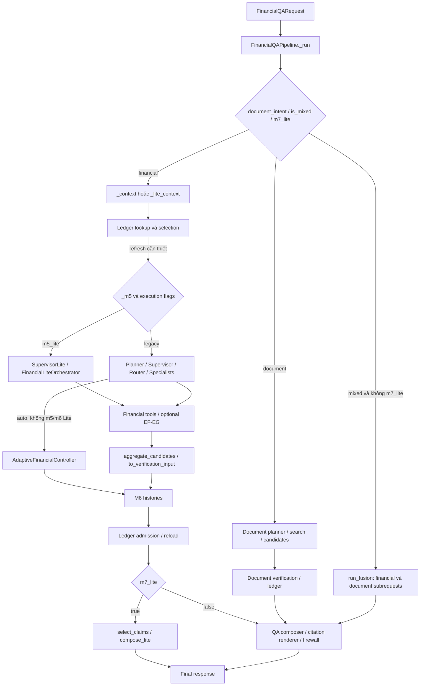
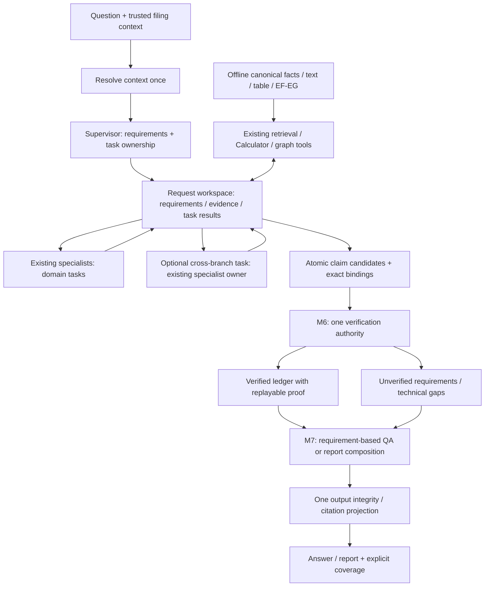

# ARCH-RESET-01 — Rà soát và đơn giản hóa kiến trúc Multi-Agent

**REVIEW — WAITING FOR TECH LEAD / OWNER APPROVAL** — 13/11/2026, Asia/Bangkok.
Audit + design; baseline kiểm toán trên Git `main`, HEAD `a5ebc21` được xác minh;
working tree có thay đổi từ trước, không coi HEAD riêng lẻ là runtime đã đánh giá.

## 1. Executive summary

**Đề xuất:** giữ EF-EG, ba financial specialists và Claim Verification; thay phần
tích hợp bằng một coordinator trong modular monolith: **một bộ requirements → một
workspace evidence theo request → specialists có nhiệm vụ cụ thể → một quyền quyết
định M6 cho từng claim → ledger → composition theo requirement bindings**.
Financial, document và mixed là các loại nhu cầu bằng chứng trong cùng request,
không phải ba pipeline có quyền diễn giải lại câu hỏi và quyết định coverage riêng.

**Observed:** E2E-GEN-01 có 0/12 PASS, 7/35 required points đầy đủ và 19/22 released
claims grounded theo rubric đã lưu. Audit này xác nhận cả 22 ledger entries trong
12 execution artifacts đều tới final release; không thấy entry bị mất ở final M7.
C01/C04 có raw M7 omission nhưng fallback đã phục hồi. Vì vậy “M7 làm mất mọi kết
quả đúng” không giải thích được lượt E2E này. Ba claim thiếu hỗ trợ ở C04 đã được
M6 ACCEPT trước khi M7 phát hành. [E2E report](e2e-gen-01-multi-agent-integration.md),
`execution/C01.json`, `execution/C04.json`, `inspection.json#/cases` [E0–E3 bên dưới].

**Observed:** Lite bỏ requirement IDs tại task boundary; evidence bị chia theo
role và source handles; không có bước tạo kết luận liên nhánh; M6 còn dựa grammar
văn bản để đọc lại premises đã có cấu trúc. Một câu hỏi được diễn giải lại tại
context parser, document/fusion router, Lite supervisor, specialist, semantic M6,
claim selector và M7 coverage. Chúng không dùng một mục tiêu chung có identity.

**Inferred:** lỗi có tính hệ thống là thiếu sự liên tục của nhiệm vụ và phạm vi
bằng chứng, cộng với nhiều nơi có quyền từ chối/đổi nghĩa. Qwen sinh sai schema,
nguồn và số thật; kiến trúc hiện tại khuếch đại lỗi cục bộ thành mất cả nhánh, hoặc
để thiếu retrieval trở thành “nguồn không có dữ liệu”. Chỉ đổi model/prompt chưa
giải quyết các điểm này. Chưa có ablation để phân chia tỷ lệ lỗi model/architecture.

V2 là phương án có thể triển khai bằng thay điểm tích hợp và contracts biên; không
viết lại OCR, canonical facts, EF-EG, financial tools hay ledger lịch sử. Hiệu quả
QA của V2 **chưa được chứng minh**; offline inspection chỉ xác nhận cơ chế lỗi và
khả năng tái sử dụng phép tính. Không mở task FIX hoặc implementation tiếp theo.

### Phạm vi bằng chứng và cách đọc

- **Observed:** đọc trực tiếp code hoặc artifact; **Inferred:** suy luận từ bằng
  chứng; **Proposed:** thiết kế chưa triển khai. Các mục V2/migration/acceptance
  dưới đây đều là Proposed, không phải kết quả thực nghiệm.
- **E0:** [báo cáo E2E](e2e-gen-01-multi-agent-integration.md) và local ignored
  `artifacts/evidence/E2E-GEN-01/`: `freeze.json`, `provider-events.json`,
  `references.json`, `manual-audit.json`, `execution/C01.json`…`C12.json`.
- **E1:** `provider-events.json`: lọc `case` và `request.request_id` theo prefix
  `m5-lite-supervisor-`, `m5-lite-<role>-`, `m6-lite-`, `m7-lite-`,
  `document-planner-`; đọc `response.output.payload/raw_text`.
- **E2:** `execution/<case>.json`: `request`, `response.trace.financial_execution`,
  `agent_stages`, `tool_calls`, `m6_lite.findings`, `m7_lite`, `document_release`.
- **E3:** mỗi `ledger[]` của execution có `identity`, `history`, `payload_sha256`;
  financial verdict ở `history.outcome.attempts[-1]`, không có root `content`.
- **E4:** inspection script local `artifacts/evidence/ARCH-RESET-01/inspect_offline.py`
  và kết quả local `artifacts/evidence/ARCH-RESET-01/inspection.json`.
  Script không gọi pipeline/model, không ghi vào E0; đọc saved JSON, kiểm schema,
  hash và replay hai dynamic proofs. Artifacts không đưa vào Git.

Đã đối chiếu 171/171 runtime hashes và 778/778 protected hashes với freeze, không
có khác biệt; năm frozen inputs khớp digest. Các source citations dưới đây vì thế
áp dụng được cho runtime của traces, dù một số source chưa commit. Không đọc
credentials; không gọi API/OCR/GPU/full CI hoặc chạy lại 12 case.

## 2. Kiến trúc hiện tại dựa trên code

Observed — sơ đồ chỉ ra các nhánh thật, không phải kiến trúc mong muốn:

Nguồn chính: [financial_qa_pipeline.py](../src/api/financial_qa_pipeline.py),
`FinancialQAPipeline._m5` (89), `_lite_context` (276), `_run_document` (369),
`_run` (669), route (818–834), refresh (888 trở đi);
[fusion_pipeline.py](../src/api/fusion_pipeline.py), `run_fusion`.

| Thành phần thực tế | Quyết định và giới hạn quan sát được |
| --- | --- |
| API composition root | Chọn financial/document/fusion trước M5; resolve company/document/snapshot/scope; cache/refresh; chọn M5/M6/M7 theo ba cờ riêng. `FinancialQARequest` mặc định các cờ Lite=false, trong khi E2E bật true. Không suy execution của API mặc định từ traces Lite. |
| Legacy M5 | `EvidenceAwareQueryPlanner` tạo proposal/plan; `RiskAwareSupervisor.execute` chạy tools và evidence requirements; `AdaptiveSpecialistRouter` chọn role; `FinancialMultiAgentOrchestrator` kiểm assignment rồi aggregate. Có contracts chi tiết và coverage projections. |
| Lite M5 | `SupervisorLite.plan` chọn task/role/source handles một lần. `LiteTask` chỉ có specialist/objective/sources/use_graph. `SpecialistExecution.assigned_requirement_ids=[]`. Inventory lấy facts/metrics theo filing; không có requirement graph hay shared specialist results. |
| EF-EG/tools | Facts qua `FinancialRetrievalTools`, metric qua `FinancialCalculator`, sources qua `EvidenceRetrievalTools`. Graph chỉ gọi nếu graph_enabled và task.use_graph; graph relation không có quyền ACCEPT. Flags graph=true trong E2E không chứng minh graph đã được dùng. |
| Lite M6 | `LiteVerificationRuntime.verify`: deterministic/source checks từng claim, tối đa một semantic batch cho phần cần ngữ nghĩa, rồi `decide`; không critics/revision loop. Vẫn kế thừa `DeterministicFinancialValidator`. |
| Legacy M6/adaptive | `VerificationRuntime._checks`: validator → EvidenceCritic → FinancialLogicCritic → judge/bounded revision. Auto financial controller còn AdaptiveJudge và tối đa ba vòng planner; document controller có judge/revision riêng. Đây là các path khác, không phải tất cả chạy trong E2E. |
| Ledger | `build_verified_claim` replay policy/proof và bind digests/identity; repository lưu; retrieval validate. Replay chứng minh tính nhất quán của quyết định đã lưu, không phải một lần nhận thức ngữ nghĩa độc lập. |
| M7 Lite | Model chỉ đề xuất nhóm/thứ tự claim IDs và gaps; backend dùng `_verified_text` giữ nội dung ACCEPT. Bổ sung claims bị bỏ, render nguồn; `_coverage` hiểu lại câu hỏi bằng parser/matcher. |
| M7 legacy/document/report | `VietnameseQAComposer`, citation renderer, InformationFirewall; report có outline planner/writer/protected validation riêng. Traces C07/C08 dùng legacy document release dù request bật M7 Lite. |

Ngoài source ở sơ đồ: [orchestrator.py](../src/agents/orchestrator.py),
`_check_assignment`, `aggregate_candidates`, `FinancialMultiAgentOrchestrator`;
[adaptive_controller.py](../src/agents/adaptive_controller.py), `run`;
[runtime.py](../src/verification/runtime.py), `_checks/verify`;
[ledger.py](../src/verification/ledger.py), `build_verified_claim/validate_entry`;
[qa_lite.py](../src/outputs/qa_lite.py), `compose_lite`;
[report_outline_planner.py](../src/outputs/report_outline_planner.py), `plan`;
[grounded_report_writer.py](../src/outputs/grounded_report_writer.py), `write`.

## 3. Execution paths, điều kiện bỏ qua và trạng thái

| Path | Khi được gọi | Dữ liệu và bước bỏ qua | Evidence |
| --- | --- | --- | --- |
| Financial Lite | `_m5`: m5_lite=true, không injected orchestrator; `_context` dùng Lite nếu m5 hoặc m7 Lite | Resolve filing → ledger lookup → supervisor inventory → tools theo task → specialist bundle riêng → M6 Lite nếu m6_lite → ledger → M7 Lite nếu m7_lite. Không chạy AdaptiveFinancialController nếu m5 hoặc m6 Lite. | C01–C04/C09/C10, E2 `financial_execution`; pipeline `_m5/_run`. |
| Financial legacy/deterministic | m5_lite=false hoặc injected orchestrator; gateway bị bỏ khi deterministic/no permission | Planner/supervisor/router contracts; auto + allow_gateway + cả m5/m6 không Lite mới dùng adaptive controller. M6 runtime chọn riêng; M7 chọn riêng. Cờ cho phép tổ hợp, không phải một profile duy nhất. | pipeline `_m5`, `_run.refresh.execute` 927; source-observed, không có execution mới. |
| Document/B09 | `document_intent` trả document | `_document_context` cần composition/source pins; adaptive document planner nếu cho gateway; document tools → source-bound candidates → document verification → ledger → legacy composer/citations/firewall. Không financial Lite specialists. | C07/C08; pipeline `_run_document`, `document_controller.run_document_adaptive`. |
| Mixed legacy | `is_mixed` true **và** m7_lite=false | `run_fusion` bind composition với financial snapshot và document snapshots riêng; lập lane requirements; gọi subrequests; gom ledger vào output chung. Có lexical/context restrictions riêng. | `fusion_pipeline.run_fusion`; không được chạy ở C07/C08. |
| Mixed dưới cờ Lite | Fusion bị bỏ khi m7_lite=true | Nếu lexical intent=document thì chỉ document; nếu intent=mixed thì cũng không vào hai guard mixed của legacy và tiếp tục financial context. Không có một mixed Lite coordinator đầy đủ. | pipeline 822–834; C07/C08 intent=document. |

Observed: Lite loop chạy tuần tự, mỗi lần tạo `ExecutionEvidenceBundle()` mới,
copy vào upstream cho specialist; chỉ sau specialist mới append facts/calculations
vào aggregate bundle. Task sau lại nhận bundle mới. Aggregate là thu gom kết quả,
không phải cơ chế chia sẻ cho specialist tiếp theo, cũng không sinh synthesis.
`aggregate_candidates` dedup và giữ conflicts/origins, không suy kết luận liên nhánh.
[lite_orchestrator.py](../src/agents/lite_orchestrator.py), `run` (553),
`_specialist` (412); E2 C02/C03 `specialist_executions[].result.missing_evidence`.

Observed: clarification xảy ra trước M5 khi company/document/snapshot/period/scope
không resolve, ví dụ C05. Thiếu candidates làm Lite orchestration blocked; pipeline
chuyển qua `stop`/`release_lite` nếu đã có ledger. Gap A/B/C là thiếu nguồn/chưa đủ
kết luận/lỗi kỹ thuật trong composer; `source_available` hiện chỉ kiểm có fact của
filing, không kiểm coverage của từng requirement. Có released claims + gaps thành
`partial_verified_coverage`; không released thành `verification_blocked` hoặc
`provider_unavailable`. Legacy firewall có thể chặn cả release khi binding sai.
Nguồn: pipeline `stop` (755), `release_lite` (684); `qa_lite.compose_lite` (471).
Các trạng thái này là engineering disposition, không đồng nghĩa câu trả lời đúng.

## 4. Root cause analysis từ execution traces

### R1 — C01: plan ba nhánh bị thay bằng một nhánh do envelope

**Observed input:** E1 C01 `m5-lite-supervisor-*`, status success/json_valid:
`{tasks:[profitability,liquidity_and_leverage,cash_flow_and_earnings_quality],
use_graph:false}`. **Observed output:** E2 `agent_stages[0].reasons` có
`supervisor_invalid_json_fallback`; effective plan chỉ profitability với
S15/S16/S35. E4 replay `LitePlan.model_validate` báo đúng một lỗi
`loc=['use_graph'], type=extra_forbidden`; bỏ root field trong bản copy cho ra
ba task hợp schema. Không chạy lại tasks hay chứng minh ba task đó đúng hết.

**Cơ chế:** `FinancialModel.extra='forbid'`; `LitePlan` chỉ có tasks, use_graph thuộc
LiteTask. `SupervisorLite.plan` catch ValidationError và thay **toàn plan** bằng
`fallback_plan`; fallback khớp label/alias nên không bảo toàn phân rã gốc. Lỗi do
model đặt field sai cấp, được policy all-or-nothing khuếch đại thành mất hai nhánh.
Nguồn: [contracts.py](../src/accounting/contracts.py), `FinancialModel`;
[lite_orchestrator.py](../src/agents/lite_orchestrator.py), `LitePlan`, `plan`,
`fallback_plan` (174–364). **Inferred:** field phụ mới hoặc một task hỏng tiếp tục
có thể làm mất task đúng. **Proposed:** một boundary decode/typed validation, giữ
task hợp lệ và báo task lỗi gắn requirement; không dùng fallback làm plan tương đương.

### R2 — C02/C03: nhiều specialist nhưng không có hợp tác đủ mục tiêu

**Observed:** cả ba role được gọi. C02 profitability có invalid reasoning branch,
không phát hành LNST; liquidity lấy cash/current liabilities ra 0,21 lần dù objective
là current ratio; CFO statement đúng 314.097.335.438 so với 201.870.668.494 nhưng
semantic verdict đòi cả profit/liquidity của câu hỏi toàn cục, trả INSUFFICIENT.
Candidate CFO `candidate:93d70ee9236a807474fdc58d` chỉ nói CFO và source caveats;
lý do verdict đưa thêm nội dung ngoài claim. Đây là semantic model scope error,
không phải deterministic M6 có rule bắt mỗi claim giải toàn câu hỏi.

C03 liquidity có hai balance dates 2025-12-31 và 2025-01-01 nhưng operation dùng
period_relation=same, bị `invalid_reasoning_branch:op001` rồi
`no_valid_reasoning_branch`. Opening date không được tự đổi thành 31/12/2024.
Profitability còn khẳng định cả ba chỉ tiêu tăng trên evidence doanh thu; CFO prose
có số viết hỏng và thiếu context nhánh khác. Semantic JSON fenced bị malformed:
không lấy nội dung verdict chưa parse làm quyết định đã thực thi.

**Cơ chế:** `_specialist` gửi cả user_question và objective nhưng không có typed
requirement boundaries; `semantic_payload` cũng gửi whole question với evidence
của một claim. `generate_candidates` chỉ có thể tính trên evidence_ids được giao;
claims=[] kèm missing không tự emit hết facts hợp lệ. `assigned_requirement_ids=[]`
và không có cross-branch synthesis nên không ai chịu trách nhiệm nhận định chung.
Nguồn: `FinancialLiteOrchestrator._specialist/run`,
[specialist_common.py](../src/agents/specialist_common.py), `generate_candidates`
(593), [lite_runtime.py](../src/verification/lite_runtime.py), `semantic_payload`
(34). E1 C02/C03 specialist/m6 events; E2 candidates và per-specialist trace.

**Inferred:** tăng số specialist không tự tăng completeness. **Proposed:** giữ
atomic numeric candidates độc lập với prose; tasks nhận requirement IDs; cấp shared
evidence có scope; một existing specialist nhận nhiệm vụ synthesis liên nhánh khi
cần. M6 chỉ xét claim/local requirement, không dùng thiếu nội dung nhánh khác để veto.

### R3 — C04: thiếu retrieval bị nâng thành sự thật “không có thông tin”

**Observed:** task liquidity được giao S31 thuộc role khác, loop loại bằng
`unknown_or_foreign_source:S31`. Nó chỉ còn B01 cash, nhưng tạo ba analyses nói thiếu
B03/đầu tư/toàn bộ đối chiếu. Semantic M6 trả SUPPORTED vì bundle không có số đó;
ba claims được ACCEPT và final M7 phát hành. Trong corpus/reference có dữ liệu;
task cash-flow khác còn đã retrieve dòng tiền đầu tư -7.672.311.772 và tài chính
-5.438.868.172. Không thể suy toàn corpus từ evidence hẹp của liquidity.

**Cơ chế:** trong `FinancialLiteOrchestrator.run`, source role membership vừa là
routing vừa thành rào cản truy xuất; mỗi task nhận bundle riêng. `semantic_payload`
không có coverage/search scope proof cho absence. `decide` tin verdict SUPPORTED
nếu deterministic checks/digests hợp lệ. Ledger replay giữ nguyên false positive;
M7 không có nhiệm vụ sửa M6. E2 C04 candidates
`132b0639d72899aa754133e4`, `ecb5eb3d9cacdc6d38725547`,
`e1a18014d7a0431fa6466df3` (đều prefix `candidate:`), E1 m6 event.

**Proposed:** role là chủ nhiệm phân tích, không cấm đọc evidence hợp scope của role
khác. Task result có trạng thái retrieval riêng; “chưa tìm thấy trong lượt truy xuất”
không là absence claim về tài liệu. Absence chỉ kiểm chứng nếu scope/search coverage
có căn cứ; nếu không, là gap có giới hạn, không ACCEPT một phát biểu vắng dữ liệu.
Đây là sửa semantics của contract, không thêm absence-verifier agent.

### R4 — C05: normalize làm mất nghĩa “quy”

**Observed:** câu hỏi có “Không quy chênh lệch thành gian lận”, không hỏi quý.
`understand` normalize bỏ dấu; regex `\b(quy|thang|ban nien)\b` (chỉ trừ “quy dinh”)
trả `non_annual_period_unsupported`. `_lite_context` đổi thành
`clarification_required/requested_period_unresolved`, 0 API. E4 tái hiện parser;
E0 `context-diagnostic.json`; E2 C05. Source:
[question_understanding.py](../src/tools/question_understanding.py), `normalize`,
`understand` (117); pipeline `_lite_context`. Legacy query planner còn regex
non-annual riêng (1165), không được coi sửa parser đơn lẻ là đủ hợp nhất.

**Inferred:** các từ đa nghĩa sau bỏ dấu tiếp tục tạo false clarification.
**Proposed:** resolve period một lần trên span/ngữ cảnh tiếng Việt còn dấu; chỉ
clarify constraint thực sự mơ hồ, không dùng single-target QA parser làm gate toàn câu.

### R5 — C06: lỗi serialization bị trình bày như thiếu verified evidence

**Observed:** E1 supervisor có fenced JSON; gateway trả malformed/payload=None.
`SupervisorLite.plan` dùng fallback lexical, E2 effective tasks=[] với
`supervisor_provider_failure`; không tools, không M6, final verification_blocked,
gap B. E4 bỏ đúng outer fence của bản copy: JSON chứa ba task hợp LitePlan. Không
kết luận routing của chúng đúng: raw plan vẫn có nguồn lẫn role; FX canonical là
giới hạn nguồn riêng, chưa tới bước đo ở C06. C11/C12 cũng dừng từ supervisor;
safe non-answer không chứng minh reasoning về giới hạn tài chính thành công.

**Cơ chế:** transport error → fallback → zero candidate → evidence gap; lỗi còn
trong stage metadata/caveat nhưng mất nghĩa khi chọn public status. Nguồn:
`SupervisorLite.plan`, pipeline `stop/release_lite`, `compose_lite`.
**Proposed:** boundary decode có quy tắc hữu hạn, deterministic, trace raw đầy đủ;
JSON còn hỏng thì task technical_error, giữ sibling results. Không retry vô hạn,
không đổi provider, không ACCEPT văn bản chưa parse. Phân biệt lỗi kỹ thuật với
missing evidence từ task result tới output.

### R6 — C07/C08: mixed QA mất financial/table lane trước verification

**Observed:** E4 `document_intent` trả document cho cả hai. C07 document planner
thậm chí sinh requirement “LNST BBS năm 2025” nhưng kind=source_excerpt; tools tìm
text, không gọi financial facts. Final trích được chính sách chi phí đi vay nhưng
không LNST. C08 yêu cầu B01 + thuyết minh mục 5, cộng tiền mặt/ngân hàng; tool request
`evidence_type='text'`, không table, không phép cộng/financial branch; final không
có claim. E2 `tool_calls[].request`, `document_release`; E1 document-planner events.

**Cơ chế:** lexical `document_intent` không nhận đủ conjunct và m7_lite ngăn
`run_fusion` bất kể model planner có nhận ra nhu cầu financial. Trong
[document_qa.py](../src/agents/document_qa.py), `document_operations` (102), chỉ
kind=table_labels mới chọn table, còn source_excerpt luôn text. Hai lỗi cộng hưởng,
không thể quy thành “B09 không có dữ liệu”. **Proposed:** route từng requirement,
financial/table/text là evidence kinds; composition manifest bind các snapshot
riêng. Tái dùng search/source verification hiện có; không thêm document agent.

### R7 — C09: phép tính hợp lệ nhưng không trả đúng đại lượng yêu cầu

**Observed:** operation ratio tạo 0,07/0,10 lần, subtract ra -0,03 ratio; yêu cầu
biên % và thay đổi điểm phần trăm không được đáp ứng. `OP005` bị loại; các phần
còn lại được chuyển thành derived_fact, M6 deterministic ACCEPT, semantic_calls=0.
E2 C09 `specialist_executions[].result.trace`, `candidates`, `m6_lite`.

**Cơ chế:** [financial_calculator.py](../src/tools/financial_calculator.py),
`execute_dynamic` (69) định nghĩa ratio → ratio, percentage_change → percent;
không có output requirement percent/percentage_point truyền xuyên các bước.
`generate_candidates` khi có failed operations giữ phép tính hợp lệ và đổi claim
thành derived_fact: bảo toàn arithmetic nhưng đánh rơi phần diễn giải/output còn
thiếu. `deterministic_state` nhận derived proof không qua semantic. Đây là ACCEPT
cho biểu thức số học đúng, không phải xác nhận đúng tên chỉ tiêu/đủ câu hỏi.

**Proposed:** requirement ghi rõ result meaning/unit; calculation có output binding
và operand roles; ratio, percent, percentage point khác nhau. Chuyển đổi display
phải được ghi trong proof, không để M7 tự nhân 100. Giữ phần tính đúng dưới tên
thực tế và đánh thiếu required result; không xóa proof hợp lệ hoặc tự gọi nó là margin.

### R8 — C10: typed proofs đúng bị chặn bởi đọc lại prose

**Observed:** M5 chỉ chọn liquidity, thiếu CFO; thêm metric debt_to_assets không
trả mục tiêu chính. Arithmetic model nói -599.656.455.132 bị chặn đúng. Backend
dynamic proofs có -600.656.455.132 VND và 0,560933688… ratio, nhưng M6 INVESTIGATE
hai derived candidates `9b36f2a651a2399a6351b6e0`, `56dbd146a346b8bf7ec20259`
và current assets fact `493da2d1bacb2ceaa9341529` (prefix `candidate:`), lý do
`content_period_unbound/numeric_assertion_not_unambiguously_bound`.

E4 replay hai proofs bằng chính `execute_dynamic`: exact equality=true; parser
không bind câu “A - TÀI SẢN NGẮN HẠN tại ngày 2025-12-31 là …”. Trong
[numeric.py](../src/verification/numeric.py), `extract_assertion` (57) chỉ strip
ordinal số/Roman, sau đó match labels đầu câu; không strip “A -”.
[validators.py](../src/verification/validators.py), `_reasoning` (211) dựng lại
premise claim và gọi `_fact(...extract_assertion(statement))`; `_context/_numeric`
(395/545) trả undetermined khi parser không bind. Vì vậy các phép tính đúng cũng
kế thừa failure của premise; vấn đề không nằm ở Decimal executor.

**Proposed:** M6 hydrate/replay structured assertion/operand identity từ canonical
source, không bắt numerical proof phụ thuộc label prose đã render rồi parse lại.
Văn bản thêm nhận định phải semantic-check trong M6; không bỏ kiểm value/period/
unit/item. Số sai và định nghĩa sai vẫn phải bị chặn. **Inferred:** thêm alias theo
từng câu chỉ dời điểm hỏng sang source labels/cách diễn đạt mới.

## 5. Contracts/data flow và nơi thông tin bị mất

Observed — không có bằng chứng mất tất cả provenance. Các losses chính là mục
tiêu, nghĩa và scope; exact financial IDs/proofs phần lớn vẫn giữ qua M5→M6.

| Boundary | Contract hiện tại / dữ liệu còn giữ | Loss hoặc diễn giải lại có bằng chứng |
| --- | --- | --- |
| Question → context | `QAUnderstanding`, request filing/snapshot/scope | Parser đơn mục tiêu làm authority gate; C05 “quy” thành period error. Filing year, operand year và as-of date phải phân biệt; opening date C03 không tự là năm trước. |
| Supervisor plan → task | `LitePlan/LiteTask`; legacy có EvidencePlan/requirements | Lite không có requirement IDs, target unit hay cross-branch owner; C01 toàn plan bị thay khi field root sai. |
| Task → tool result | S handles resolve backend records; typed fact/metric requests | S là handle request-local, không provenance ID. Role membership chặn nguồn khác role C04. C02 sources chọn cash cho current ratio. |
| Tool → specialist | `SpecialistEvidence` có reference, value/unit/scale/period, calculation/citations | E IDs cục bộ mỗi specialist; chỉ evidence bundle riêng, không thấy sibling results. Legacy source_metadata/graph projection không chứng minh absence hoặc nhân quả. |
| Specialist → candidate | `AnalysisProposal`, `SpecialistCandidate`, ReasoningProof; backend dynamic proof | Model statement/operations có thể không đồng nhất. Một reasoning branch invalid làm mất analysis (C02/C03); salvage arithmetic C09 giữ số nhưng mất semantic output. Facts được giao chưa chắc thành candidate khi model claims=[] và báo missing. |
| Aggregate → M6 | `AggregatedCandidate` giữ origins; `to_verification_input` copy references/evidence/proofs/digest | Adapter không tự mining claims thiếu từ raw specialist. Không tự tạo requirement binding bị thiếu từ trước; whole question vẫn vào semantic payload. Không thấy adapter làm mất hai dynamic proofs C10. |
| M6 → ledger | Histories/decision/source digests, claim identity và citations | Ledger replay bảo toàn verdict; false ACCEPT C04 cũng được bảo toàn. Không phải nơi sửa phạm vi semantic hoặc sửa bad retrieval. |
| Ledger → selection | `select_claims`: scope/period/citations + lexical relevance cho historical claims | `current_ids` bỏ qua một số relevance/period filters trong cùng filing; useful nhưng không có requirement binding để chọn đúng. Historical alias match có thể bỏ claim liên quan; source-observed risk, không có false-drop historical replay trong lượt này. |
| Selection → M7 | `_coverage` → `understand_requirements/_lite_requirements/_matches_target` | Requirements được dựng muộn và lại suy từ text; C02 nhiều unsupported goals. `limitations` goal có thể được coi covered bằng caveat bất kỳ; caveat không tự đáp ứng giới hạn phân tích cụ thể. |
| M7 → final | claim IDs, backend nguyên văn, citation projection | C01/C04 raw omission được restore. 22/22 saved ledger entries phát hành; full answer vẫn thiếu vì candidates/meanings/requirements chưa đầy đủ. Không có chứng cứ final-drop trong 12 case. |

Nguồn bổ sung: [adapter.py](../src/verification/adapter.py), `to_verification_input`;
[claim_selection.py](../src/api/claim_selection.py), `periods_for/select_claims`;
[qa_composer.py](../src/outputs/qa_composer.py), `understand_requirements` (312),
`planned_requirements`, `matches_financial_target`;
`qa_lite._coverage` (188), `_lite_requirements` (303).

Inferred: contracts không cần gộp hết thành một object khổng lồ. Cần một identity
chung cho requirement/evidence/claim và giữ typed fields xuyên boundary; role,
retrieval status, evidence quality, correctness và answer completeness là các
thông tin khác nhau. Không dùng cùng một “missing” cho tất cả.

## 6. Validators, gates và fallbacks: giá trị và tác hại

Observed về hành vi code; tác động sau đơn giản hóa là Proposed. “Chưa quan sát”
nghĩa là không có trace xác nhận false rejection ở E2E này, không phải tầng vô ích.

| Lớp / source | Ngăn lỗi và bằng chứng | Trùng lặp / false rejection / mất kết quả | Hướng và tác động khi đổi |
| --- | --- | --- | --- |
| Filing/composition/pin/context | Pipeline context, document verification: ngăn trộn company/snapshot, nguồn chưa được chọn | C05 false context refusal do parser; kiểm identity bản thân vẫn cần | KEEP identity/pins; MERGE resolution một lần, bỏ lexical period veto toàn câu. Nếu xóa pins sẽ mất authority nguồn. |
| Gateway JSON + schema | Gateway parse; FinancialModel/LitePlan: ngăn malformed/unknown references | C01 root field loại ba task; C06 fenced JSON không tới tools. Document structured_call còn singleton unwrap riêng | MERGE transport normalization ở biên, SIMPLIFY schema cho task nhỏ; reject nội dung/ID không hợp lệ theo task. Không parse bằng cách đoán số hoặc tự chữa semantics. |
| Plan/assignment/source selection | Legacy `_check_assignment`, Lite source-role filter, `select_evidence` | Ownership/source checks lặp; role filter C04 làm rơi B03; source quality rejection cụ thể chưa được chứng minh là sai trong audit | KEEP provenance/quality; REPLACE role-as-access-rule bằng task evidence binding trong scope. Không cho task đổi filing. |
| Analysis schema + dynamic executor | `generate_candidates`, `execute_dynamic`: operation dependency, unit/date/context/zero divisor | C03 sai period_relation bị chặn có lý; all-analysis exclusion có thể làm mất facts độc lập C02. C09 salvage chưa giữ trạng thái phần hỏng | KEEP executor; SIMPLIFY claim atomicity, giữ fact/proof độc lập; failed dependency chỉ chặn phần dùng nó. |
| Numeric/context grammar | Validator `_reasoning/_fact/_numeric`, numeric.extract_assertion | Chặn số model sai C10; cũng chặn đúng proof/current assets C10 do renderer label không đọc lại được | REPLACE prose round-trip bằng typed assertion/source replay. Giữ grammar cho legacy/unstructured input khi chưa có binding; bỏ check value là không chấp nhận. |
| Canonical/provenance + EvidenceContextBuilder/lite_sources | Rehydrate nguồn, kiểm value/citation/context; C10 proof replay dùng source identity | Có phần source equality trùng ở selection, validator, builder. Chưa chứng minh xóa check nào vẫn giữ nguyên mọi invariant | MERGE hydration một lần trong M6/request, reuse verified bindings; giữ trust check lúc admit/retrieve. Không dùng cache để bỏ current source policy. |
| Lite semantic batch | `semantic_payload/_semantic/decide`: meanings, causality, caveats | C02 false insufficiency ngoài phạm vi; C04 false support absence; C01/C03 JSON malformed giữ INVESTIGATE | KEEP một semantic authority trong M6, scope theo claim và requirement cụ thể. Không auto ACCEPT khi verdict lỗi. |
| Legacy critics + revision + AdaptiveJudge | `VerificationRuntime`, `AdaptiveFinancialController.run` | Có nhiều nơi đánh correctness/coverage; controller có thể lọc native ACCEPT khỏi final histories khi judge gắn affected. Source-observed; không phải nguyên nhân runtime Lite của C01–C10 | REPLACE quyền veto correctness ngoài M6 bằng task feedback. Không bỏ legacy trước khi V2 qua parity; không chuyển quyết định cũ thành ACCEPT. |
| Document judge/revision | `document_controller.run_document_adaptive` | Nếu reasoning_required và feedback không PASS: `histories=[]`, có thể mất exact quotes đã ACCEPT. Chưa xảy ra judge-veto này ở C07/C08 | REMOVE quyền clear toàn histories; coverage feedback không hủy quote đúng. KEEP document source-fidelity/quality/complete-list checks. |
| Ledger admission/retrieval replay | `ledger.build_verified_claim/validate_entry`, repository | Lặp quyết định deterministic từ proof có chủ đích, bảo vệ stored integrity; không phải semantic critic thứ hai. C04 replay không chữa false verdict | KEEP policy version, digests, immutable history/current source checks. Có thể cache trong request có pin; không bỏ replay bằng cách tin caller. |
| M7 requirement matcher/Gap B | `qa_lite._coverage`, composer matchers | Dựng lại mục tiêu, projected metric/operation rules tăng nhánh; Gap B không còn là veto Lite claim. C09 thiếu đúng unit thật, không gọi mọi gap là false | REPLACE bằng requirement→supported claim→rendered binding; giữ factual correctness ở M6. Gap báo thiếu phần cụ thể, không chặn phần đúng. |
| Legacy QA validation + renderer + Firewall | `validate_qa_response`, `CitationRenderer`, `InformationFirewall._evaluate` | Cùng kiểm claim/segment/citation bindings ở nhiều tầng; whole-release blocker. Chưa thấy firewall false rejection cụ thể trong 12 case | MERGE thành một output integrity pass trên IDs/content/citations; giữ source policy và membership. Không bỏ mà để model tự viết facts mới. |
| Fallbacks | Supervisor lexical; specialist numeric; document exact-source; M7 restore | Supervisor có thể mất nhánh; numeric fallback giữ facts nhưng không thay analysis; M7 restore hiện bảo toàn ACCEPT. C06 lỗi bị che thành gap B | SIMPLIFY fallback thành kết quả có provenance + technical status, cùng verification; KEEP deterministic rendering. Bỏ fallback không thay thế sẽ giảm số kết quả đúng. |

Phê bình quyết định cũ: giảm plan/coverage contracts trong Lite đã giảm orchestration
overhead nhưng cũng bỏ identity của các nghĩa vụ trả lời; bù bằng prompt dài và M7
parser không khôi phục được identity. Ngược lại, legacy đem judge/coverage vào nhiều
tầng khiến nguồn quyết định khó theo dõi. V2 giữ ít contract có ý nghĩa hơn, không
quay lại toàn bộ legacy và không xóa toàn bộ validators.

## 7. Vai trò Multi-Agent và ranh giới M5/M6/M7

**Observed:** ba role chuyên biệt có vocabulary/renderers/metric families khác nhau;
supervisor phân rã được C02/C03, specialist sinh claims độc lập, lỗi một specialist
được catch trong Lite loop. Đây là phân công thật ở mức domain, nhưng chưa đủ cơ
chế phối hợp: không shared task/evidence view, không trách nhiệm synthesis, không
requirement tracking. Chạy tuần tự không tự làm hệ thống mất tính Multi-Agent;
thiếu phối hợp giữa các tác nhân mới là vấn đề. Chưa có số đo lợi ích so với single-agent.

**Proposed — tổ chức ít nhất có ý nghĩa nghiên cứu:** dùng đúng ba role hiện có.
Supervisor hiểu yêu cầu và giao ownership; specialists chọn evidence, tính/diễn
giải theo chuyên môn, cùng đọc workspace có provenance. Một task so sánh cashflow
với profitability được giao owner cash-flow với inputs từ hai domain; owner có
thể tạo candidate từ shared evidence, không cần agent “synthesizer” mới. Coordinator
theo dõi dependencies/trạng thái, không thay chuyên môn bằng hardcoded conclusions.
Một tra cứu/metric đơn giản gọi một specialist; nhiều mục tiêu chuyên môn độc lập
gọi roles cần thiết; multi-hop trong một domain vẫn có thể chỉ một specialist.
Document retrieval là tool capability của task/owner, không phải lý do thêm agent.

| Boundary V2 | Có trách nhiệm | Không có trách nhiệm |
| --- | --- | --- |
| M5 | Requirements/assignments, retrieve financial/text/table/graph, tạo atomic facts/calculations/analysis candidates, synthesis liên nhánh trước M6 | Không ACCEPT; không biến retrieval miss thành corpus absence; không tự đổi kỳ, scope hay định nghĩa chỉ tiêu gần giống |
| M6 | Kiểm từng proposition: canonical source/value/period/scope/unit, operations/operand roles, meaning và support. Xác nhận binding với local target khi nó là một phần nghĩa của claim | Không yêu cầu claim giải toàn câu; không làm coverage judge; không đồng nhất grammar prose với correctness typed proof; không sửa thiếu retrieval bằng suy đoán |
| Ledger | Chỉ admit proof ACCEPT hợp policy/version, giữ nguyên source lineage/current trust khi đọc | Không chứng minh lại QA completeness; không sửa nghĩa sai của claim đã ACCEPT |
| M7 | Gom và sắp xếp supported claims theo requirements; giữ nội dung và nguồn; nêu uncovered/technical gaps; QA hoặc report sections | Không verifier thứ hai, không tools/new calculations, không sinh phân tích mới chưa qua M6, không hủy ACCEPT vì câu hỏi còn thiếu nhánh |

M7 trước đây có raw omission; cơ chế hiện tại đã restore ở E2E. Gap B lịch sử từng
false thiếu theo [QWEN-QA-01](qwen-qa-01.md) và
[QWEN-GEN-01](qwen-gen-01-generalization.md); audit hiện tại xác nhận M7 còn tái
phân tích text, không tái hiện một V2 coverage fix. C02/C09 gap thiếu có nội dung
thật. Không đánh đồng mọi PARTIAL với lỗi phát hành.

## 8. Target Architecture V2

Proposed — một coordinator trong `agents`; `api` chỉ wire request/context/budget,
không tiếp tục tăng nghiệp vụ ở `FinancialQAPipeline._run`. Tuân thủ Offline →
Online → Output và [module boundaries](module-boundaries.md).

### Thành phần, input/output và quan hệ

| Thành phần | Input → output | Trách nhiệm / điều cấm |
| --- | --- | --- |
| Context resolver | Question + trusted selected filing/composition → RequestContext | Resolve company, filing, source versions, operand dates, requested scope một lần. Không tự đoán report scope, không normalize mất nghĩa; ambiguity có thật mới clarify. |
| Supervisor | Question + context + compact capability inventory → requirements/tasks | Phân rã mục tiêu và loại evidence, chỉ định owner/dependencies/result meaning. Không tạo source identities, số hay verdict; mục tiêu chưa map ghi unresolved thay chỉ tiêu gần giống. |
| Coordinator/workspace | Requirements/tasks + exact tool outputs → evidence map/task states/candidates | Request-local memory, không database/framework mới. Mỗi evidence ID bind canonical reference; mọi branch nhìn được evidence phù hợp scope. Theo dõi lỗi từng task, thực thi dependency nhỏ có giới hạn, không approve claims. |
| Tools/EF-EG | Scoped evidence requests/operations → typed results/proofs/source status | Giữ M3/M4 retrieval, arithmetic, graph relations, composition namespace. Không coi structural/contextual edge là semantic support. |
| Specialists | Assigned requirements + relevant shared evidence/task outputs → candidates và missing inputs | Đóng góp độc lập theo domain; task liên nhánh do role hiện có làm. Không tự certify sibling claim; candidate statements của nhánh khác chỉ là input chưa xác minh. |
| M6 | Candidate + local target + canonical evidence handles → verification result/proof | Một deterministic source/calculation pass, một semantic batch nếu cần. Có thể mở rộng nội bộ thành chunks theo token bound, cùng một policy; không đẻ verifier thứ hai hoặc vòng revise mặc định. |
| Ledger adapter | ACCEPT result + history → immutable verified entry | Reuse storage/replay, gắn policy version mới khi contract thay đổi; requirement mapping ở sidecar, không thay hash entry cũ. |
| M7 QA/report | Requirements + admitted claims/bindings + task gaps → segments/sections + coverage | Dùng cùng composition logic; report section là nhóm requirement IDs. Không tạo facts/nhận định mới; tổ chức ngôn ngữ tự nhiên qua câu đã verified và câu nối phi nội dung tài chính. |

### Trình tự thực thi và bảo toàn kết quả

1. Resolve context; supervisor lập requirement list ổn định. Mỗi requirement có
   original span, purpose, target/meaning, kỳ và requested unit. Không cần DAG DSL:
   task dependency list nhỏ đủ biểu diễn source → calculation → interpretation.
2. Retrieve evidence cho các task cần thiết vào cùng workspace, dùng caches theo
   canonical references. Task có thể yêu cầu financial/text/table cùng lúc;
   approved composition nối các snapshot khác namespace, không ép bằng nhau.
3. Chạy domain tasks, lưu result từng task. Numeric candidates từ fact/tool có thể
   render deterministic trước prose; model analysis thất bại không xóa chúng.
4. Nếu câu hỏi có mục tiêu liên nhánh, sau primary tasks giao tối đa một synthesis
   pass cho existing specialist owner, dùng evidence/proofs trong workspace. Có
   thể bổ sung retrieval đúng phần thiếu trong budget; không lặp sửa toàn request.
5. M6 verify candidates độc lập theo dependency: evidence và arithmetic hydrate
   từ nguồn, không trust model values; semantic chỉ xét statement cùng mục tiêu
   local. Synthesis trước M6 phải tự có nguồn cho từng mệnh đề, không lấy một
   candidate chưa ACCEPT làm authority. Claim phụ thuộc claim bị bác thì chưa
   được hỗ trợ, không tự coi sibling prose là bằng chứng.
6. Admit từng ACCEPT. Coordinator giữ kết quả đúng của task khác dù có JSON/tool/
   semantic error. Requirement complete chỉ khi đủ các output slots đã định và
   có admitted bindings; chưa đủ vẫn phát hành phần đúng kèm thiếu cụ thể.
7. M7 render QA hoặc report theo bindings; một pass kiểm IDs/content/citations.
   Coverage là phép chiếu các IDs đã verified và đã render, không model tự chấm
   toàn bài; không dùng coverage để đổi verdict. Historical claim reuse cần
   match typed target/context, không kế thừa binding của câu hỏi cũ.

Để câu trả lời tự nhiên mà không có verifier thứ hai, V2 giai đoạn đầu giữ nguyên
claim sentences, gộp đoạn và bỏ lặp, thêm headings/connectors không tạo kết luận.
Cho phép paraphrase tài chính tự do sẽ cần đi lại M6 cho proposition mới: chưa
đề xuất trong migration tối thiểu. Thiếu synthesis phải xử lý ở M5, không để M7
được phép tự suy để che lỗ hổng.

## 9. KEEP / SIMPLIFY / MERGE / REMOVE / REPLACE

Proposed; đây là quyết định thiết kế chờ duyệt, chưa xóa file hoặc đổi flags.

| Decision | Thành phần | Evidence / lý do | Tác động và điều kiện thay thế |
| --- | --- | --- | --- |
| KEEP | Canonical facts, EF-EG, financial/document tools, source quality/pins, Decimal executor | E0 60 retrieved facts/133 source bindings khớp; E4 C10 arithmetic replay khớp | Không đổi offline data hoặc graph semantics; mapping/corpus thiếu vẫn là giới hạn thật. |
| KEEP | Ba domain specialists, một M6 authority, ledger/proof integrity | C02/C03 có role specialization; C10 chặn số model sai; ledger giữ lineage | Không thêm agent, không xóa verification. |
| SIMPLIFY | Supervisor/task schemas, prompts và analysis envelope | R1/R2; goal nằm trong objective text nên phải nhắc nhiều lần | Giữ compact typed requirements/output slots; tách fact/proof với prose và task failures. Không làm schema tùy tiện bỏ unknown IDs. |
| MERGE | Financial/document/fusion routing và context resolution | R4/R6; ba cờ khiến route phụ thuộc composer | Một coordinator theo requirement kinds; thay route sau parity, giữ legacy path như compatibility adapter trong migration. |
| MERGE | Source hydration trong M6; output binding/citation integrity | R8 và bảng gates; nhiều source-equality/QA checks lặp | Reuse typed source checks, một output pass; giữ admission/retrieval/current policy checks đúng trust boundary. |
| REPLACE | Role-restricted isolated bundles → shared request workspace | R2/R3; unknown_or_foreign_source:S31 và cross-branch missing | Role giữ ownership, access vẫn ghim company/composition/snapshot; không broadcast toàn corpus vào mọi prompt. |
| REPLACE | Prose→grammar→numeric validation cho typed assertions | R8 C10; parser không đọc label A - nhưng proof đúng | Replay source/value/operands trực tiếp. Legacy grammar chỉ cho input chưa typed; không bỏ semantic check text mới. |
| REPLACE | M7 requirement reconstruction/heuristic Gap B | R2/R7, `_coverage/_lite_requirements` | Coverage từ stable IDs/output slots + admitted/rendered bindings; không để model tự đánh dấu complete bằng claim_id bất kỳ. |
| REMOVE | Quyền judge coverage xóa ACCEPT ở ngoài M6 | Adaptive controller affected filtering; document controller histories=[] | Chỉ bỏ quyền veto duplicate sau khi feedback chuyển về task gaps và M6 vẫn kiểm correctness; giữ exact quotes/facts hợp lệ. Không xóa document quality checks. |
| REMOVE | Fallback coi empty plan/provider error là evidence conclusion | R5 C06/C11/C12 | Thay bằng typed technical_error + retained partial results; giữ safe failure và deterministic facts đã có. |
| REMOVE | Duplicate active execution profiles sau migration | Financial legacy/Lite/document/fusion tự phân tích lại goals | Chỉ ngừng branch integration đã có parity; giữ readers/policy replay cũ. Không xóa module chỉ vì tên legacy; hỗ trợ lịch sử là giá trị có thật. |

Không merge M5/M6/M7 thành một prompt hoặc một module. Đơn giản hóa ownership của
quyết định, không làm mờ research boundaries hoặc cho phép outputs truy xuất mới.

## 10. Data contracts logic tối thiểu

Proposed; tái dùng source/calculation contracts, chỉ thêm IDs/typed meaning/status
ở boundary cần thiết. IDs do backend cấp; model chỉ chọn handles đã được cấp.
Không giả định schema kế toán mới hoặc tự approve công thức chưa có policy.

| Contract | Trường tối thiểu | Invariants / provenance |
| --- | --- | --- |
| RequestContext | request_id, question, company_id, logical_document_id, composition_id/digest nếu có, financial_snapshot, document_source_pins, requested_reporting_scope, filing_year | Scope unknown phải giữ unknown; filing_year không ghi đè operand period. Snapshot financial và document không bắt buộc giống nhau; manifest xác nhận quan hệ. |
| UserRequirement | requirement_id, original_span, purpose=`value/calculation/interpretation/document/limitation`, evidence_kinds[], target (canonical item/formula hoặc unresolved semantic target), operand_periods/roles, requested_unit, required_output_slots[], dependencies[] | IDs ổn định trong request; phân biệt %/ratio/percentage_point, as-of/fiscal period; không map gần đúng khi thiếu. Slots mô tả nội dung cần có, không chỉ số claim. |
| SpecialistTask | task_id, owner_role, requirement_ids[], objective, input_evidence_ids[], depends_on_task_ids[] | Không empty requirement assignment cho task thực thi. Role không phải quyền cấm đọc evidence của domain khác. Có thể một task đáp ứng nhiều requirements nếu bindings rõ. |
| Evidence/ToolResult | evidence_id, kind, canonical_reference, tool/request_id, status, value/unit/scale hoặc exact text/table selector, company/document/snapshot hoặc composition pins, statement_type, period/type, reporting_scope, anchors/citations, quality/caveats, calculation_proof nếu có | Shared ID namespace theo request, resolve về immutable source identity/digest; không reuse E001 của hai branch như một nguồn. Page/cell/region chỉ ghi mức thực có; graph structural edges không thành support. |
| Claim | claim_id, task_id, requirement_bindings[{requirement_id,output_slot}], proposition_type, structured_assertion hoặc statement, evidence_ids[], calculation/output_step bindings, operand roles/periods, assumptions/limitations, dependent_claim_ids[] nếu có | Claim atomic; numerical values lấy backend/proof, không tin model text. Mỗi statement phải có evidence; target binding đề xuất chưa là coverage proof. Actual output unit giữ nguyên dù khác yêu cầu. |
| VerificationResult | claim_id + content/input digest, decision theo policy đã chọn, check results/reasons, supported_requirement_bindings[], evidence/proof digest, policy_version, semantic verdict nếu cần | M6 có một quyền quyết định. Binding supported chỉ khi statement/typed assertion thật sự hỗ trợ output slot; không đánh complete toàn question. Error semantic không ACCEPT. Native statuses/history cũ vẫn đọc nguyên version. |
| TaskResult/gap | task_id, requirement_ids, execution_status, produced_claim_ids, missing_inputs, search_scope/result_refs, technical_error | Retrieval miss/unsupported/unverified/technical failure phân biệt; chỉ phát biểu absence trong scope có chứng cứ, không lấy một bundle rỗng chứng minh corpus thiếu. Đây là cùng result contract, không một policy engine mới. |
| AnswerCoverage | requirement_id, slot→verified_claim_ids/rendered_segment_ids, state=`satisfied/partial/missing_evidence/unverified/technical_error/unsupported`, reasons; overall complete | Tính deterministic từ admitted bindings và output. Mỗi required slot phải có supported claim hoặc gap cụ thể; gap không hủy slots đã đúng. Không dùng enum này thay registry statuses. |

Ví dụ logic: requirement R-current-ratio có numerator=current_assets,
denominator=short_term_liabilities, period=2025-12-31, unit=ratio. Cash/current
liabilities có thể là arithmetic claim đúng nhưng không bind slot này; không
được đổi tên thành current ratio. R-margin-change yêu cầu hai margin output
percent và difference percentage_point; hai ratios chưa qua conversion proof
không đủ slot. Quy tắc/accounting formula mới phải được Tech Lead duyệt, không
tự gán policy approval cho dynamic expression.

Ledger requirement bindings nên ở request sidecar tham chiếu verified_claim_id +
content/proof digest, không chèn vào proof lịch sử để tránh thay SHA. Nếu một
assertion/policy mới bắt buộc wire change, dùng version mới và reader tương thích;
không nâng historical entries sang chuẩn mới bằng cách đổi nhãn.

## 11. So sánh hiện tại và V2, trade-offs

| Tiêu chí | Current Architecture — Observed | Proposed V2 | Lợi ích kỳ vọng / trade-off |
| --- | --- | --- | --- |
| Requirement decomposition | Legacy requirements, Lite objective text, M7 tái hiểu câu | Một requirement list/IDs/output slots xuyên suốt | Dễ truy dấu thiếu nhánh; supervisor cần schema nhỏ nhưng rõ hơn. |
| Specialist coordination | Loop theo roles, isolated bundles, aggregate không synthesis | Shared task results; cross-task do existing owner làm | Có phối hợp liên domain thật; thêm tối đa một synthesis pass khi cần. |
| Evidence sharing | Aggregate sau task; role-source restriction | Scoped request workspace, projections theo task | Tái dùng EF-EG/provenance; phải giới hạn prompt để tránh đổ toàn bộ corpus vào model. |
| Claim verification | Lite/legacy policies, grammar premises; adaptive coverage veto ngoài M6 | Một policy authority, structured source/calculation checks + semantic khi cần | Giảm prose round-trip; thay đổi policy cần versioning và parity. Không bảo đảm model verifier không còn sai. |
| Answer coverage | Text parser/matchers/projections/fallbacks | IDs + supported output bindings + rendered slots | Gap có phần cụ thể; typed binding sai vẫn là rủi ro nên không tin self-tagging của model. |
| Mixed QA | Legacy fusion có sẵn nhưng Lite có thể bỏ, document planner text-only | Route từng requirement, dùng financial/text/table trong same workspace | Không mất financial branch; số trong B09 cần selector/value binding thật, không tự parse số thành canonical fact. |
| Error handling | Một số schema errors thành empty fallback/evidence gap; legacy judge có global veto | Task failure độc lập, retain siblings, technical status riêng | Dễ demo/debug; còn partial khi retrieval/model thực sự lỗi. |
| Latency/cost | E2E 33 eval calls/94.806 tokens, median51,82s; không có ablation | Calls theo task need, deterministic render mặc định; shared tool caching | Có thể bỏ reorder/judge lặp, synthesis có thể thêm call. Không có % cải thiện đã đo. |
| Report generation | Outline/writer contracts riêng, ledger-only generation | Reuse ledger/renderers; sections nhóm requirements | Ít khác QA hơn; outline/report adapter vẫn cần kiểm nội dung dài, chưa triển khai REPORT-01. |

Thiết kế calls cho model nhỏ: `1 supervisor + n domain calls + s synthesis + v
semantic batch + p optional presentation`, với s/v/p là 0 hoặc 1 trong request
nhỏ phù hợp payload cap; không mặc định gọi tất cả. Với budget hiện có 6 và n=3,
s=v=1 phải p=0. Report dài cần budget/chunking riêng được duyệt; không âm thầm
vượt 6 bằng multi-batch. Deterministic lookups/rendering và reuse không cần call.
Qwen vẫn có thể không hiểu đúng targets/periods; schema task nhỏ và bounded shared
context giảm gánh output, không chứng minh đã làm model tốt hơn.

Complexity chính là coordinator + thin adapters, không microservice/graph DB/agent
framework mới. Shared workspace giúp test invariant/reference binding bằng offline
fixtures; đánh giá reasoning vẫn cần model/PDF real evidence trong task được duyệt.

## 12. Feasibility và migration tối thiểu

Proposed — ba bước có đầu ra và điểm dừng, không mở hàng chục task mới.

| Bước | Thay đổi tối thiểu nếu được duyệt | Tái dùng / bằng chứng trước khi tiếp tục |
| --- | --- | --- |
| 1. Chốt contracts và coordinator offline | `agents/lite_orchestrator.py`, orchestration contracts/projection; thin wiring trong `api/financial_qa_pipeline.py`/fusion adapter. Một request profile, requirement/task IDs, workspace, per-task status; route evidence kinds, không đổi tools | Reuse inventory, three specialists, aggregate origins, document search/candidates và composition binding. Replay saved tool results/claims để chứng minh giữ IDs/sibling results và mixed lane requests; không model. Dừng nếu cần đổi offline contracts vượt thiết kế. |
| 2. Thay boundary M5→M6→ledger→M7 | `specialist_common.py`, `verification/adapter.py`, `validators.py`/Lite runtime; `api/claim_selection.py`, `outputs/qa_lite.py` và legacy QA/fusion adapters. Typed assertions, local semantics, supported requirement bindings, composition chung | Reuse calculator/source builder/M6 semantic gateway/ledger repositories/citation renderer. Thêm policy/contract version khi cần; giữ legacy readers. Replay false positive/negative controls và all accepted→rendered invariants. Không rewrite historical ledgers. |
| 3. Validate hành vi rồi ngừng duplicate integration | Offline parity trước; sau đó một lượt live đã duyệt với held-out questions và PDF references; chỉ retire các execution branches đã có thay thế | Dùng bộ acceptance dưới đây, report latency/calls/grounding/completeness. Report adapter chuyển sections sang cùng coverage sau khi QA đạt; không bắt đầu CHAT-02/REPORT-01/M8 từ audit này. Nếu không đạt, báo failed criterion/root cause, không tự vòng FIX. |

**Không cần đổi dữ liệu đã lưu để đọc lịch sử:** giữ raw/canonical/EF-EG/snapshot
và policy readers cũ. New request mappings/caches ở output mới riêng, không write
vào E2E artifacts. Historical ledger replay giữ nguyên; current source trust vẫn
lọc ở retrieval. Không tái dùng ACCEPT cũ để chứng minh policy V2 đúng hơn, không
chuyển false absence C04 thành trusted historical evidence cho câu hỏi mới.

**Điểm có thể tác động provenance:** đổi evidence_id namespace phải có alias map
về canonical identity; composition phải giữ financial/document snapshot riêng;
claim splitting làm IDs mới nhưng giữ origins/dependent proof; policy digest mới
không được đổi historical source_result_sha256. Request sidecar phải bind content
hash để không gắn cùng ID vào statement đã đổi. Source quality/approval không
được hạ chỉ để tăng completeness.

**Đã kiểm khả thi bằng offline inspection E4:** C01 schema root-field là nguyên
nhân tái hiện được; C06 fenced body parse được (chưa chứng minh semantic đúng);
C10 hai dynamic proofs replay bằng executor hiện có khớp exact. Đây là bằng chứng
có thể thay boundary mà tái dùng core, không phải offline implementation của V2.

Offline replay migration sau này cần hai lớp rõ ràng: (a) exact saved I/O để kiểm
bảo toàn và kiểm policy, (b) counterfactual fixtures sửa assignment/binding có gắn
nhãn để kiểm thiết kế. Không lấy b để tuyên bố Qwen tự tạo được synthesis. Claims
chưa được model sinh không thể “khôi phục” chỉ bằng replay; C02/C03/C07/C08 cần
retrieval/claim generation thực sự sau khi được phép, còn FX mapping C06 có giới
hạn riêng. V2 không giải quyết OCR/canonical coverage bằng kiến trúc tích hợp.

## 13. Acceptance criteria đầu cuối, rủi ro và giới hạn

Proposed — tiêu chí thiết kế, chưa chạy V2. Chốt gold và supported scope trước
live, giữ nguyên failures/probes; không đổi rubric sau khi thấy kết quả.

| ID | Tiêu chí đo | Regression thật / cách đánh giá |
| --- | --- | --- |
| A1 | 100% requirements có stable ID, task owner và trạng thái output; mọi required slot là supported+rendered hoặc gap cụ thể, không biến mất | C01–C03; kiểm request→task→claim→coverage trace, không chỉ đếm specialist calls. |
| A2 | Câu ba nhánh trong phạm vi nguồn đã có phải đủ cả ba nhóm facts và kết luận; 3/3 coordination cases đạt đầy đủ sau implementation | C01–C03, gold theo `references.json/manual-audit.json`; kiểm hướng/kỳ/độ chắc chắn từng kết luận. |
| A3 | 0 released claims thiếu hỗ trợ nội dung; 100% numeric claims truy về đúng source/period/scope và phép tính | C04 absence controls, C09/C10; đối chiếu PDF/known references, không dùng M6 verdict làm gold. |
| A4 | 100% accepted claims cần cho output slots được render hoặc có lý do relevance/supersession rõ; thiếu requirement khác không làm mất chúng | C01/C04 omission và C10 false negatives; so accepted→selected→rendered IDs, không ép phát hành mọi claim ngoài mục tiêu. |
| A5 | C07 có LNST và đầy đủ nội dung chính sách có nguồn; C08 lấy cả B01 và table B09, cộng đúng và đối chiếu có nguồn | 2/2 mixed cases; kiểm có financial và document tool results, không chấm chỉ theo route label. B09 số chưa bind phải explicit gap, không giả đạt numerical comparison. |
| A6 | 0 lỗi ý nghĩa ratio/%/điểm phần trăm; 0 sai numerator/denominator khi gắn tên chỉ tiêu | C02 current ratio, C05 CFO/LNST ratio, C09 gross margin/pp, C10 working capital/current ratio. Kiểm full precision proof và rounded display riêng. |
| A7 | M6 không ACCEPT global absence từ branch retrieval miss; số/công thức/period/item sai controls không ACCEPT; đúng structured C10 proofs không bị grammar loại | C04 ba absence claims; C10 số trừ sai và hai proofs đúng; localized verification, không bỏ guard. |
| A8 | JSON/one-specialist failure giữ 100% sibling ACCEPT độc lập; technical_error không giả thành source absence/valid QA | C01/C06, injection tại boundary offline cho C02/C03; raw error + public coverage đúng nghĩa. |
| A9 | “Không quy … thành gian lận” không tạo quarter clarification; kỳ/as-of thật vẫn resolve hoặc clarify có căn cứ | C05, C03 opening/closing date; thêm paraphrase còn dấu và câu quý thật, không hardcode whole question. |
| A10 | C11/C12 giải thích đúng giới hạn bằng chứng, 0 số/trang bịa, không chỉ safe non-answer do JSON hỏng | Phân biệt actual 2026 với báo cáo 2025; không yêu cầu nhiều agents cho negative lookup. |
| A11 | Một nơi quyết định correctness (M6); coverage không veto ACCEPT; một output integrity pass giữ citations/claim membership | Source review + traces; document exact quotation chưa đủ câu vẫn giữ quote, gap riêng. Không chỉ đếm số class validator. |
| A12 | Bộ 12 case giữ 35 required points làm diagnostic: đích 12/12 và 35/35 khi mọi capability đã xác nhận; capability chưa hỗ trợ phải công bố và chưa được tính đạt đích đầy đủ | Giữ C06 FX/mixed probes; không hạ yêu cầu để tăng PASS. Thêm ≥4 câu held-out cùng patterns với chỉ tiêu/kỳ/cách diễn đạt khác, frozen gold trước chạy. Model/API budget cần được duyệt riêng. |

Trước khi nhận kiến trúc mới là tốt hơn về nghiên cứu, cần so single-specialist/
single-agent baseline với phối hợp trên cùng evidence/questions, cùng budget và
same model khi task evaluation được giao: completeness, groundedness, cross-branch
conclusions, latency/calls. Không chạy ablation/M8 trong ARCH-RESET-01. Chỉ chứng
minh invariant offline không đủ tuyên bố Multi-Agent tăng chất lượng.

Rủi ro còn lại: decomposition sai target/đơn vị; evidence shared quá dài; semantic
verifier model vẫn false accept/reject; source scan/canonical mapping không đủ;
table selector không tương đương canonical financial fact; cross-document scope
compatibility chưa được phê duyệt; naturalness của immutable claim rendering;
report dài vượt batch/budget. Không cho V2 tự nới source trust để che các hạn chế.

Giới hạn audit: đọc code và saved traces, không rerun live, không human gold mới,
không chứng minh accuracy toàn PDF/dataset, không xác minh weights/revision Qwen,
không đo causal benefit/latency V2. Legacy judge/firewall risks được đánh dấu
source-observed hoặc inferred, không quy thành nguyên nhân E2E Lite chưa gọi chúng.

## 14. Quyết định cần phê duyệt và bàn giao

Tech Lead/Owner cần quyết định trên thiết kế cụ thể này:

1. Duyệt một coordinator + requirement/task/evidence workspace làm luồng online
   đích cho financial/document/mixed, dùng ba specialists hiện có và không thêm agent.
2. Duyệt M6 là authority correctness duy nhất; coverage không hủy ACCEPT; chuyển
   numeric typed checks khỏi prose grammar, giữ source/calculation/semantic checks.
3. Duyệt contracts tối thiểu, policy version/sidecar strategy, meaning của absence
   và output units; các formula/accounting mappings mới vẫn phải duyệt riêng.
4. Duyệt migration ba bước với offline parity trước; chỉ sau đó cấp phạm vi/budget
   validation thật và điều kiện retire legacy. Không phê duyệt implicit bởi tài liệu.

**Trả lời câu hỏi cuối:** tổ chức hệ thống quanh một tập nghĩa vụ trả lời có ID,
cho specialists cộng tác trên evidence/proofs chung, giao rõ owner của kết luận
liên nhánh, kiểm từng proposition một lần ở M6, rồi M7 tổ chức các kết quả ACCEPT
và chỉ rõ phần thiếu. Đơn giản hóa các nơi diễn giải lại và veto cùng thông tin;
không đơn giản hóa bằng cách xóa EF-EG/Multi-Agent/Verification hoặc nới ACCEPT.

Validation thực tế: offline inspection E4 như mô tả; `git diff --check` PASS.
`python scripts/check_planning.py` **FAIL** duy nhất ở bước nhận diện ID:
`Invalid Task ID: ARCH-RESET-01`. Checker có regex whitelist chưa bao gồm dạng
ARCH-RESET; không sửa code hoặc đổi immutable task ID để né lỗi. Chạy chính
`check()` với regex thêm đúng `ARCH-RESET-01` **chỉ trong bộ nhớ**: PASS 142 task,
bao gồm dependency/status/dashboard/spec/link checks. Đây là inspection bổ sung,
không phải PASS của lệnh chuẩn và không phải CI. Không runtime changes, không
model calls/full regression mới. Các kết quả trên được ghi tại checkpoint audit
trước commit; commit bàn giao chỉ chứa báo cáo này, không gồm planning/runtime/artifacts.

**Next action duy nhất:** Tech Lead/Owner review và phê duyệt hoặc điều chỉnh Target
Architecture V2 cùng migration plan trước mọi thay đổi runtime.
