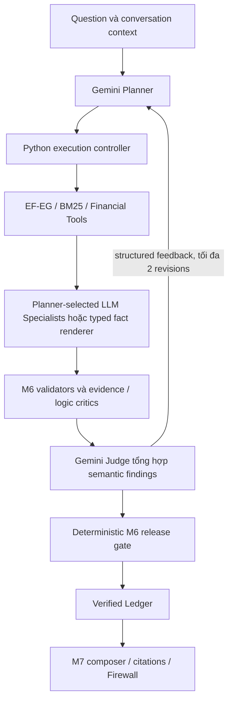

# FIX-02 — Adaptive LLM Agents và bounded Judge feedback

Ngày09/11/2026; baseline `20694b2`. **REVIEW, chưa đủ điều kiện DONE.**
Implementation ban đầu [`b7eb2bf838c6c194cb7a55910a4937bfc043e731`](https://github.com/VuongQuocAn/vietnamese-financial-multi-agent/commit/b7eb2bf838c6c194cb7a55910a4937bfc043e731) đã push main, SHA đã xác minh.
[CI42600674784](https://github.com/VuongQuocAn/vietnamese-financial-multi-agent/actions/runs/42600674784)
completed/SUCCESS đúng implementation SHA:27Python/9Web PASS, lint/format/planning/
typecheck/build đạt; full regression SKIPPED. Checkpoint sau chỉ docs, không gán CI
implementation cho SHA checkpoint.
Không nghiệm thu financial accuracy từ engineering tests hoặc từ status completed.

## Thay đổi kiến trúc

E2E-02 ép deterministic/allow_gateway=False; document lane tắt Gateway, Router
tự chọn minimum specialist cover, specialist grammar chỉ cho phép restatement/
sign templates. Hai M6 critics có semantic support nhưng Judge cuối là policy
Python, revision chỉ sửa claim, không trở lại Planner. Vì vậy0Gemini không phải
bằng chứng cho adaptive Multi-Agent.

Runtime mới giữ Modular Monolith và reuse các contracts/M4/M6/M7 hiện có:

`auto` là default; có Gateway thì Planner hiểu/lập kế hoạch bằng Gemini.
Không có Gateway thì baseline có event PROVIDER_DEGRADED; deterministic vẫn là
baseline tường minh, gemini là diagnostic. Không tự đổi model/key hoặc retry
để chọn output đẹp. Mọi provider call qua shared Gateway.

`PlannerProposal` có reasoning_required, selection_reason, assignments theo role,
task/indicators/formulas/dependencies, completion_conditions và stop_reason.
Planner chọn tool-only cho fact/calculation, hoặc phân công đúng Specialist.
Router chỉ dispatch trong capabilities/evidence closure đã đăng ký; dependency
có thể là role hoặc tool operation đã hoàn thành, không chạy arbitrary tool.
Các tasks độc lập chạy tuần tự trong prototype; chưa parallel execution.

Profitability, Liquidity/Leverage, Cash Flow dùng model được request chọn.
Nhánh tool-only dùng typed numeric renderer, không ghi Python renderer thành
LLM Specialist. Reasoning có analyses do Gemini viết trên evidence_ids, không
bị khóa vào numeric prose templates. Backend tạo numeric premises và M6 replay
từng fact bằng Decimal/source/context/citation/quality checks. Analysis prose
không chứa số mới hoặc ratio; formula claims vẫn đi qua approved calculator.
Evidence/Logic Critics phải chấp nhận phần suy luận; kiểm tra numeric premises
không tự làm conclusion trở thành ACCEPT.

## Judge, feedback và release

Typed `JudgeFeedback`: assessment thuộc PASS/REVISION_NEEDED/REJECT/
INSUFFICIENT_EVIDENCE/JUDGE_ERROR, issues, revision_required, explanation.
Issue có claim_id hoặc null cho coverage, issue_type, explanation,
required_evidence và suggested_action. Contract không thay thế native decisions.

Gemini Judge đọc summaries từ hai critics, candidates và numeric evidence để
phản biện coverage/mâu thuẫn/thiếu tiền đề; không lặp toàn bộ source validation.
Fact/calculation tool-only đã kiểm đầy đủ có thể bỏ semantic Judge call.
Document Planner dùng BM25; literal claim vẫn giữ exact user-bound requirement,
M6 replay quotation/provenance độc lập. Document Judge không sửa OCR bằng suy đoán.
Mixed Planner tạo typed FusionPlan; M7/Firewall dùng cùng obligations đã bind,
không dùng fixed decomposition làm nguồn quyết định duy nhất. Provider/schema
failure chỉ cho phép source-bound baseline fallback, có degraded trace rõ ràng.

Planner nhận feedback, previous proposal, tool/specialist summaries và M6 decisions.
Supervisor cache theo exact typed tool request; Specialist cache theo question,
task, evidence và dependency results, chỉ trong request. Replan giữ phần hợp lệ;
không execute lại tool/agent không đổi. Không tiến triển substantive, thiếu nguồn,
provider failure, stop_reason hoặc hết budget thì dừng và giữ phần verified.

Mỗi controller tối đa2revisions/3rounds; shared request Gateway còn giới hạn
tổng2revisions/3semantic Judge calls cho cả child lanes. M6 internal revision
được tắt khi adaptive controller sở hữu loop. Default16provider calls/180s;
live runner dùng20calls/180s, tổng runner không quá100calls. Timeout là deadline
cho calls/checkpoints; không hard-kill một deterministic CPU operation đang chạy.

Judge PASS chỉ là semantic recommendation. Chỉ native M6 ACCEPT với proof replay
mới được admit Ledger; semantic veto có thể bỏ claim nhưng không tạo ACCEPT.
Sai Decimal/formula/company/period/snapshot/provenance vẫn bị chặn. Native
INVESTIGATE/ABSTAIN/REVISE không bị đổi tên thành PASS. Không sửa proof để hợp thức
hóa verdict. Các field mới rỗng không đổi serialization của historical M6 inputs.

## Files chính

- `agents/planner_contracts.py`, `query_planner.py`, `adaptive_router.py`:
  assignments, annual/as-of operation periods và dynamic materialization.
- `agents/specialist_common.py`, `orchestrator.py`, `supervisor.py`:
  Gemini analyses, source-bound projection/cache, dependencies và trace.
- `agents/adaptive_controller.py`, `document_controller.py`, `qa_planning.py`:
  bounded financial/document loops và typed document/fusion planning.
- `verification/adaptive_judge.py`, `runtime.py`, `validators.py`,
  `evidence_critic.py`, `financial_logic_critic.py`: semantic synthesis,
  one-pass M6 gate, multi-premise validation và bounded reasoning context.
- `core/request_gateway.py`, `data_config.py`: request budget/actual usage và
  explicit project root cho frozen runtime/storage.
- Hook conditional recovery hiện có nhận cùng request Gateway; deterministic/
  allow_gateway=False không khởi tạo OCR call. Không đổi thuật toán OCR hoặc chạy
  lại REC-01; source-quality blockers vẫn giữ nguyên nếu recovery không khả dụng.
- `api/financial_qa_pipeline.py`, `fusion_pipeline.py`, `conversations.py`,
  `qa_pipeline_contracts.py`; M7 request inventory/contracts/target matching.
- `scripts/evaluate_adaptive_agents.py`, `evaluate_real_pdf.py`, focused tests,
  planning checker/registry và issue log. Không Web UI/OCR/raw dataset changes.

## Engineering validation

Mock tests kiểm tra dynamic Planner/tool-only/assignments, feedback về Planner,
hai revisions, tắt nested M6 loop, Judge không nâng native rejection, Decimal/
source premises, year echo/same-filing periods và shared call/revision/Judge caps.
Compatibility suites kiểm tra baseline, reuse, conversation, document, fusion,
orchestrator và financial validators. Local:78compatibility PASS;47focused PASS
sau các sửa integration;28local smoke (CI nhẹ +1recovery guard) PASS;9adaptive tests PASS trên code
cuối sau sửa ordering/trace/gates. Các nhóm có overlap, không cộng thành tổngtests.
Ruff/planning/diff checks ghi trong registry; CI remote chỉ kết luận khi đúng SHA.
Không chạy full1000+tests hoặc coi mock là live acceptance.

## Gemini live và so sánh baseline

Inputs/reference lấy nguyên E2E-02; chọn Q01,Q11,Q21,Q08,Q22,Q33,Q34 và F08
follow-up phân tích “Như thế có đáng lo không?”. Freeze trước chạy, ledger riêng,
force_refresh cho reasoning; source-location fast path trace CACHE_HIT rõ ràng.
Giữ tất cả lỗi của hai lượt8ca; không gộp các phiên bản thành một accuracy score.
Artifacts riêng, không commit private source/prompts/responses/PDF/ledgers.

| Case | E2E-02 deterministic | Live quan sát trong FIX-02 |
| --- | --- | --- |
| Q01 direct fact | Có answer,25,425s/0calls | Lượt đầu63,040s/1Planner/5158tokens,không Specialist; lượt sau lỗi period echo đã sửa offline |
| Q11 calculation | Có answer,36,271s/0calls | Lượt đầu76,022s/1Planner/5052tokens,tool-only calculator; lượt sau lỗi period echo đã sửa offline |
| Q21 complex analysis | Partial,37,804s/0calls | Hai Specialists Gemini thực sự; lượt bổ sung có Judge feedback/replan,partial114,672s/13calls/133034known tokens |
| Q08 document / I001 | Answer đảo nghĩa,14,673s/0calls | Corrected composition,2native ACCEPT,PDF16,giữ từ “khó”;8,469s/2calls/1809tokens |
| Q22 mixed | Partial,74,486s/0calls | Fusion Planner +financial/document calls;partial42,013s/4calls/8960tokens; chưa kết luận completeness |
| Q33 source lookup | Answer,1,454s/0calls | Completed_with_caveats,1,421s/1Planner/631tokens |
| Q34 follow-up source | Blocked,19,332s/0calls | Completed_with_caveats,165ms/0calls,current verified-source replay,PDF21 |
| F08 analytical follow-up | Không có baseline cùng câu | Context tới Gemini Planner; phát hiện dependency op_id/role dispatch bug,đã sửa; chưa live xác nhận câu cuối |

Lượt `live`:16actual calls/125537known tokens; Q21 rate_limit, Q08 singleton
JSON envelope và F08 alias lỗi. Lượt `final-live`:13actual calls/74242known tokens;
Q01/Q11 period echo lỗi, Q21 provider_unavailable, F08 dependency dispatch lỗi.
Tên thư mục `final-live` là tên phase, **không có nghĩa implementation cuối đã đạt**.
Một diagnostic schema call riêng lưu raw response; singleton envelope được unwrap
chỉ khi đúng một object, sau đó vẫn strict typed validation.

Hai lượt8ca dùng cùng frozen questions/reference; bổ sung chỉ Q21 sau sửa code.
Không retry 503/rate limit để chọn response khác. Mỗi phase có414protected inputs
hash unchanged và reference unchanged. Q08 dùng approved correction có đối chiếu
PDF trước đó, không để Judge chứng nhận lại OCR cũ. Source/correction policy không
được sửa trong FIX-02. Không nâng kết quả sampled thành accuracy toàn PDF.

## Trace live có feedback

`post-fix-reasoning/results.json`,Q21,request total114,672s:

1. Planner Gemini gọi Profitability và Cash Flow;4financial/source tools chạy.
2. M6 có2facts ACCEPT, các analyses thiếu tiền đề bị INVESTIGATE.
   Gemini Judge trả REVISION_NEEDED, yêu cầu CFO/PAT cho analysis bị ảnh hưởng.
3. Planner Gemini nhận đúng feedback và sửa assignment.4tools CACHE_HIT;
   Profitability CACHE_HIT/0calls; chỉ Cash Flow gọi Gemini lại.
4. Judge Gemini lần2 yêu cầu tiếp CFO cho claim còn thiếu evidence.
5. Planner revision lần2;4tools tiếp tục CACHE_HIT. Provider failure ở Specialist
   khiến dừng trước Judge lần3. Không revision lần3, không nested M6 repair.
6. M6 histories chưa đạt không được nâng ACCEPT; Ledger/M7 phát hành2facts đã
   xác minh và giữ unanswered/limitations. Kết quả partial_verified_coverage.

Trace chứng minh actual Gemini feedback → Planner → affected execution và dừng
có giới hạn. **Chưa chứng minh Judge PASS sau một revision thành công.** Source
binding giữ nguyên; không có evidence mới từ ngoài snapshot được tạo ra.

| Stage Q21 bổ sung | Timing quan sát |
| --- | ---: |
| Planner,3calls | 17,433s wall stages;9,912s provider |
| Financial/source tools,bao gồm cache lookup | 7,016s |
| Specialist executions | 8,301s |
| Gemini Judge,2calls | 3,438s |
| M6 validators | 2,188s |
| M6 evidence critic | 7,258s |
| M6 logic / deterministic decision | 0,160s /0,193s |
| End-to-end | 114,672s |

Stage timings có phần lồng nhau, không cộng thành end-to-end. Replanning provider
token overhead lớn: Planner tổng99398tokens, trong đó hai replans53781/39801.
Đã rút gọn reusable/conversation context sau phép đo; chưa live đo lại nên không
khẳng định tối ưu thành công. Round wall latency instrumentation bổ sung sau run;
chưa có số wall overhead riêng hoàn chỉnh cho live trace này. Cost của Gateway
unknown; không suy giá tiền từ tokens. Một call thất bại có unknown token usage.

## Chín issues và giới hạn bàn giao

[Issue log](e2e-02-issue-log.md#phân-tích-fix-02--09112026) ghi root cause từng issue;
tất cả giữ OPEN chờ Tech Lead. I001 và I009 có bằng chứng cải thiện trên đường
đã chạy; I004 có targeted same-filing validation; I006 có reasoning/feedback thật
nhưng chưa đủ final analysis. I002/I003/I005 coverage, I007 latency và I008 prose
vẫn còn. Không hardcode names/financial values theo một PDF để đóng issues.

Các source hashes và `freeze.json.runtime_files` xác định runtime của từng live
phase. Sau live còn sửa period/dependency handling, request-wide caps, compact
context/cache bookkeeping, dynamic fusion inventory và actual-call trace; các
delta này được focused offline validation, **chưa full live lại trên final SHA**.
Không chạy lại tám ca lần thứ ba chỉ để có bảng đẹp.

Mixed output vẫn là independent verified components; chưa có semantic proof cho
quan hệ nhân quả xuyên document/financial lanes. Không có source đáng tin thì
abstain/partial. Specialist reasoning chưa hỗ trợ số mới trong prose hoặc công
thức chưa duyệt. Các hạn chế source/quality cũ và PDF quarantine còn nguyên.

Next action: Tech Lead review FIX-02 và quyết định nghiệm thu phần đã có bằng
chứng hoặc giao phạm vi kiểm chứng bổ sung; không tự chuyển DONE/Web/M8.

## Hoàn thiện REVIEW — 09/11/2026

Owner yêu cầu giải quyết ba P1 trong cùng task và một lượt live Q21→F08,
Q01/Q11/Q08 sau khi code ổn định. Status vẫn REVIEW.

Đối chiếu trace cũ xác định CFO/PAT **đã được tools truy xuất**. Vòng đầu chỉ giao
PAT cho Profitability và CFO cho Cash Flow. Vòng sửa đã giao thêm PAT cho Cash
Flow, nhưng một analysis có14limitations vượt contract tối đa8 làm toàn bộ
SpecialistResult failed, kể cả các numeric claims đúng. Judge chỉ thấy candidates
còn lại nên lại gọi đó là thiếu CFO. Đây là lỗi sử dụng/truyền evidence, không
phải bằng chứng PDF thiếu số liệu CFO.

Sửa đổi tiếp theo: inventory từ Supervisor độc lập với Specialist/claims; Judge
nhận cả facts đã truy xuất, assigned_roles và native M6 status. Feedback được đối
chiếu inventory để phân biệt NOT_RETRIEVED/RETRIEVED_NOT_USED/VALIDATION_BLOCKED/
MIXED; không tự nâng claim ACCEPT. Evidence đã có thì REVISE_ANALYSIS thay vì
REQUEST_ADDITIONAL_EVIDENCE cho cùng nguồn. Lặp cùng yêu cầu sau revision thì dừng
với retrieved_evidence_not_used_after_revision, không thêm vòng truy xuất vô ích.
Numeric claims hợp lệ được giữ khi một analysis lỗi schema; raw output/error trace
vẫn lưu nguyên. Replay offline output cũ đã giữ2facts, loại analysis sai,0provider calls.

Replan prompt riêng chỉ nhận schema/IDs/boundaries và compact state: inventory,
analyses, generation issues, previous proposal, feedback. Không lặp formula policy
provenance, citations hoặc full SpecialistResult; prior-agent context cũng chỉ giữ
candidate summaries. Runtime của lượt xác nhận được xuất từ commit, có SHA và
hash manifest, không import pending GEN-01a từ working tree.

### Hai lượt xác nhận được cho phép, không retry

Lượt đã thống nhất đầu tiên chạy source commit `c6add554e7a6445fb06f1691f0c9fda140614549`,
archive riêng, thứ tự Q21→F08→Q01→Q11→Q08,17calls/61071known tokens:

| Case | Kết quả | Giây | Actual calls | Known tokens |
| --- | --- | ---: | ---: | ---: |
| Q21 | PARTIAL; Judge PASS vòng0,không provider error | 87,343 | 7 | 29221 |
| F08 | PARTIAL; không dependency/context error | 88,404 | 6 | 24732 |
| Q01 | Completed_with_caveats,tool-only | 80,215 | 1 | 5235 |
| Q11 | Provider_unavailable,http_503 trước planning | 19,067 | 1 | unknown |
| Q08 | Completed_with_caveats,giữ “khó”,PDF16 | 9,135 | 2 | 1883 |

Lượt này lộ chặn proof M6: analyses không chứa chữ số có numeric premises PASS,
nhưng semantic support finding chưa được nối với check_references. Logic Critic
trả supported_numeric_premise_missing. Tôi đã chốt lượt live quá sớm trước khi
kiểm tra đủ đường proof này; không dùng kết quả đó chứng nhận bản sửa sau nó.

Bản sửa [`321f09e91cd4e32bcfcb0584d84f70d5c31e13e4`](https://github.com/VuongQuocAn/vietnamese-financial-multi-agent/commit/321f09e91cd4e32bcfcb0584d84f70d5c31e13e4)
chỉ nối semantic finding **supported** với check IDs do backend lấy từ numeric
validations PASS, đúng references đã được model chỉ ra và backend hydrate.
Không lấy check IDs hoặc approval từ LLM. Không đổi semantic verdict thành supported;
Logic Critic, native Judge và Ledger vẫn phải chấp nhận. Test synthetic có semantic
support→Logic consistent→native ACCEPT→Ledger stored; semantic unsupported vẫn bị
Ledger rejected.61focused tests PASS, không coi đó là live financial accuracy.
Planner còn được nhắc: depends_on không tự giao evidence; task đối chiếu PAT/CFO
phải giao cả hai indicators cho Specialist phù hợp.

Owner xác nhận cho phép **thêm đúng một lượt5ca** sau bản sửa, không retry.
Lượt bổ sung chạy đúng `321f09e`,không sửa runtime sau run:

| Case | Kết quả trên source cuối | Giây | Calls | Known tokens |
| --- | --- | ---: | ---: | ---: |
| Q21 | PARTIAL; PAT/CFO đều M6_ACCEPT trong inventory,Judge PASS vòng0 | 85,602 | 6 | 25626 |
| F08 | PARTIAL; routing/dependencies chạy được; Judge structured_output_invalid→JUDGE_ERROR | 86,263 | 6 | 28747 |
| Q01 | Provider_unavailable,http_503 tại Planner; không retry | 24,860 | 1 | unknown |
| Q11 | Calculator computed,1approved_metric M6 ACCEPT,0Specialist calls; output PARTIAL | 100,825 | 1 | 5794 |
| Q08 | Completed_with_caveats; quotation có “người nợ khó có khả năng thanh toán”,PDF16 | 13,361 | 2 | 1874 |

Q11 PARTIAL vì Planner có explicit operand retrieval operations và answer obligations
đòi gross_profit/net_revenue như hai answers độc lập, trong khi M5 chỉ sinh metric
candidate. Đây là coverage/obligation mismatch, không phải lỗi Decimal, formula,
period hoặc calculator; không gọi toàn bộ case PASS. Q21/F08 còn thiếu accepted
interpretation cho PAT; M6 chặn các analyses có semantic support chưa đủ hoặc
financial checks không đạt. Judge PASS không làm M7 vượt các blockers này.

Lượt bổ sung16actual calls/62041known tokens,1unknown-token call. Không chọn kết
quả tốt nhất của hai phiên bản để ghép thành “5/5 PASS”. Raw responses/errors,
traces/ledgers nằm riêng tại artifacts/evidence/FIX-02/review-completion/live/
và proof-binding-live/. Cả hai:414protected inputs/reference unchanged,
runtime_unchanged=true, imported_runtime_verified=true; toàn bộ package modules
được import từ archive đúng SHA, không dùng code GEN-01a pending.

### Đối chiếu ba P1 còn lại

1. **Evidence đã có:** root cause được phân biệt và sửa ở inventory/assignment/
   schema/proof bridge. Hai lượt mới không yêu cầu lại CFO/PAT đã có. Tuy nhiên
   Q21 đều Judge PASS ở vòng0, không kích hoạt replanning; **chưa có bằng chứng
   live mới về một revision thành công**. Repeated-known-evidence stop được kiểm
   bằng mock, không ghi thành live PASS. Judge coverage còn lệch với M7 PARTIAL.
2. **Context/cost:** Q21 cuối25626known tokens so với133034 trước,giảm80,7%;
   calls13→6,latency114,672→85,602s. Hai workflows có số revisions khác nhau,
   nên không quy toàn bộ mức giảm cho compaction. Planner cuối1call/5797tokens;
   không có replan call để đo lại prompt compaction live. Latency local vẫn lớn:
   Q21 provider wall9,831s nhưng end-to-end85,602s; Q01/Q11 scalar/metric còn chậm.
   Không tuyên bố P1 latency đã giải quyết.
3. **Code cuối:** có live5attempts trên exact source321f09e, cả financial,
   follow-up, calculator và corrected quotation. Q01 của lượt cuối bị503,
   F08 Judge output invalid và các PARTIAL trên vẫn còn; **chưa có một lượt
   final-runtime5/5 đạt yêu cầu**. Không sửa runtime tiếp rồi gán số đo cũ cho nó.

[CI42606529703](https://github.com/VuongQuocAn/vietnamese-financial-multi-agent/actions/runs/42606529703)
completed/SUCCESS đúng321f09e:31Python/9Web PASS, full regression SKIPPED.
CI của c6add55 cũng SUCCESS29Python/9Web. Đây là engineering evidence;
không thay thế các gaps live phía trên. Giữ FIX-02 REVIEW và tất cả issues OPEN.
