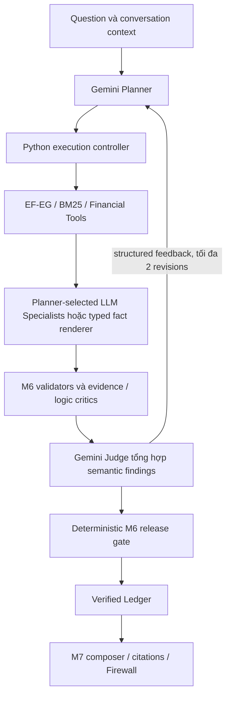

# FIX-02 — Adaptive LLM Agents và bounded Judge feedback

Checkpoint remediation mới ngày10/11/2026 ở cuối báo cáo; các lượt09/11 bên dưới
được giữ làm evidence lịch sử, không gán cho implementation mới.

Ngày09/11/2026; baseline `20694b2`. **REVIEW, chưa đủ điều kiện DONE.**
Implementation ban đầu [`b7eb2bf838c6c194cb7a55910a4937bfc043e731`](https://github.com/VuongQuocAn/vietnamese-financial-multi-agent/commit/b7eb2bf838c6c194cb7a55910a4937bfc043e731) đã push main, SHA đã xác minh.
[CI42600674784](https://github.com/VuongQuocAn/vietnamese-financial-multi-agent/actions/runs/42600674784)
completed/SUCCESS đúng implementation SHA:27Python/9Web PASS, lint/format/planning/
typecheck/build đạt; full regression SKIPPED. Checkpoint sau chỉ docs, không gán CI
implementation cho SHA checkpoint.
Không nghiệm thu financial accuracy từ engineering tests hoặc từ status completed.

## Thay đổi kiến trúc

E2E-02 ép deterministic/allow_gateway=False; document lane tắt Gateway, Router
tự chọn minimum specialist cover, specialist grammar chỉ cho phép restatement/
sign templates. Hai M6 critics có semantic support nhưng Judge cuối là policy
Python, revision chỉ sửa claim, không trở lại Planner. Vì vậy0Gemini không phải
bằng chứng cho adaptive Multi-Agent.

Runtime mới giữ Modular Monolith và reuse các contracts/M4/M6/M7 hiện có:

`auto` là default; có Gateway thì Planner hiểu/lập kế hoạch bằng Gemini.
Không có Gateway thì baseline có event PROVIDER_DEGRADED; deterministic vẫn là
baseline tường minh, gemini là diagnostic. Không tự đổi model/key hoặc retry
để chọn output đẹp. Mọi provider call qua shared Gateway.

`PlannerProposal` có reasoning_required, selection_reason, assignments theo role,
task/indicators/formulas/dependencies, completion_conditions và stop_reason.
Planner chọn tool-only cho fact/calculation, hoặc phân công đúng Specialist.
Router chỉ dispatch trong capabilities/evidence closure đã đăng ký; dependency
có thể là role hoặc tool operation đã hoàn thành, không chạy arbitrary tool.
Các tasks độc lập chạy tuần tự trong prototype; chưa parallel execution.

Profitability, Liquidity/Leverage, Cash Flow dùng model được request chọn.
Nhánh tool-only dùng typed numeric renderer, không ghi Python renderer thành
LLM Specialist. Reasoning có analyses do Gemini viết trên evidence_ids, không
bị khóa vào numeric prose templates. Backend tạo numeric premises và M6 replay
từng fact bằng Decimal/source/context/citation/quality checks. Analysis prose
không chứa số mới hoặc ratio; formula claims vẫn đi qua approved calculator.
Evidence/Logic Critics phải chấp nhận phần suy luận; kiểm tra numeric premises
không tự làm conclusion trở thành ACCEPT.

## Judge, feedback và release

Typed `JudgeFeedback`: assessment thuộc PASS/REVISION_NEEDED/REJECT/
INSUFFICIENT_EVIDENCE/JUDGE_ERROR, issues, revision_required, explanation.
Issue có claim_id hoặc null cho coverage, issue_type, explanation,
required_evidence và suggested_action. Contract không thay thế native decisions.

Gemini Judge đọc summaries từ hai critics, candidates và numeric evidence để
phản biện coverage/mâu thuẫn/thiếu tiền đề; không lặp toàn bộ source validation.
Fact/calculation tool-only đã kiểm đầy đủ có thể bỏ semantic Judge call.
Document Planner dùng BM25; literal claim vẫn giữ exact user-bound requirement,
M6 replay quotation/provenance độc lập. Document Judge không sửa OCR bằng suy đoán.
Mixed Planner tạo typed FusionPlan; M7/Firewall dùng cùng obligations đã bind,
không dùng fixed decomposition làm nguồn quyết định duy nhất. Provider/schema
failure chỉ cho phép source-bound baseline fallback, có degraded trace rõ ràng.

Planner nhận feedback, previous proposal, tool/specialist summaries và M6 decisions.
Supervisor cache theo exact typed tool request; Specialist cache theo question,
task, evidence và dependency results, chỉ trong request. Replan giữ phần hợp lệ;
không execute lại tool/agent không đổi. Không tiến triển substantive, thiếu nguồn,
provider failure, stop_reason hoặc hết budget thì dừng và giữ phần verified.

Mỗi controller tối đa2revisions/3rounds; shared request Gateway còn giới hạn
tổng2revisions/3semantic Judge calls cho cả child lanes. M6 internal revision
được tắt khi adaptive controller sở hữu loop. Default16provider calls/180s;
live runner dùng20calls/180s, tổng runner không quá100calls. Timeout là deadline
cho calls/checkpoints; không hard-kill một deterministic CPU operation đang chạy.

Judge PASS chỉ là semantic recommendation. Chỉ native M6 ACCEPT với proof replay
mới được admit Ledger; semantic veto có thể bỏ claim nhưng không tạo ACCEPT.
Sai Decimal/formula/company/period/snapshot/provenance vẫn bị chặn. Native
INVESTIGATE/ABSTAIN/REVISE không bị đổi tên thành PASS. Không sửa proof để hợp thức
hóa verdict. Các field mới rỗng không đổi serialization của historical M6 inputs.

## Files chính

- `agents/planner_contracts.py`, `query_planner.py`, `adaptive_router.py`:
  assignments, annual/as-of operation periods và dynamic materialization.
- `agents/specialist_common.py`, `orchestrator.py`, `supervisor.py`:
  Gemini analyses, source-bound projection/cache, dependencies và trace.
- `agents/adaptive_controller.py`, `document_controller.py`, `qa_planning.py`:
  bounded financial/document loops và typed document/fusion planning.
- `verification/adaptive_judge.py`, `runtime.py`, `validators.py`,
  `evidence_critic.py`, `financial_logic_critic.py`: semantic synthesis,
  one-pass M6 gate, multi-premise validation và bounded reasoning context.
- `core/request_gateway.py`, `data_config.py`: request budget/actual usage và
  explicit project root cho frozen runtime/storage.
- Hook conditional recovery hiện có nhận cùng request Gateway; deterministic/
  allow_gateway=False không khởi tạo OCR call. Không đổi thuật toán OCR hoặc chạy
  lại REC-01; source-quality blockers vẫn giữ nguyên nếu recovery không khả dụng.
- `api/financial_qa_pipeline.py`, `fusion_pipeline.py`, `conversations.py`,
  `qa_pipeline_contracts.py`; M7 request inventory/contracts/target matching.
- `scripts/evaluate_adaptive_agents.py`, `evaluate_real_pdf.py`, focused tests,
  planning checker/registry và issue log. Không Web UI/OCR/raw dataset changes.

## Engineering validation

Mock tests kiểm tra dynamic Planner/tool-only/assignments, feedback về Planner,
hai revisions, tắt nested M6 loop, Judge không nâng native rejection, Decimal/
source premises, year echo/same-filing periods và shared call/revision/Judge caps.
Compatibility suites kiểm tra baseline, reuse, conversation, document, fusion,
orchestrator và financial validators. Local:78compatibility PASS;47focused PASS
sau các sửa integration;28local smoke (CI nhẹ +1recovery guard) PASS;9adaptive tests PASS trên code
cuối sau sửa ordering/trace/gates. Các nhóm có overlap, không cộng thành tổngtests.
Ruff/planning/diff checks ghi trong registry; CI remote chỉ kết luận khi đúng SHA.
Không chạy full1000+tests hoặc coi mock là live acceptance.

## Gemini live và so sánh baseline

Inputs/reference lấy nguyên E2E-02; chọn Q01,Q11,Q21,Q08,Q22,Q33,Q34 và F08
follow-up phân tích “Như thế có đáng lo không?”. Freeze trước chạy, ledger riêng,
force_refresh cho reasoning; source-location fast path trace CACHE_HIT rõ ràng.
Giữ tất cả lỗi của hai lượt8ca; không gộp các phiên bản thành một accuracy score.
Artifacts riêng, không commit private source/prompts/responses/PDF/ledgers.

| Case | E2E-02 deterministic | Live quan sát trong FIX-02 |
| --- | --- | --- |
| Q01 direct fact | Có answer,25,425s/0calls | Lượt đầu63,040s/1Planner/5158tokens,không Specialist; lượt sau lỗi period echo đã sửa offline |
| Q11 calculation | Có answer,36,271s/0calls | Lượt đầu76,022s/1Planner/5052tokens,tool-only calculator; lượt sau lỗi period echo đã sửa offline |
| Q21 complex analysis | Partial,37,804s/0calls | Hai Specialists Gemini thực sự; lượt bổ sung có Judge feedback/replan,partial114,672s/13calls/133034known tokens |
| Q08 document / I001 | Answer đảo nghĩa,14,673s/0calls | Corrected composition,2native ACCEPT,PDF16,giữ từ “khó”;8,469s/2calls/1809tokens |
| Q22 mixed | Partial,74,486s/0calls | Fusion Planner +financial/document calls;partial42,013s/4calls/8960tokens; chưa kết luận completeness |
| Q33 source lookup | Answer,1,454s/0calls | Completed_with_caveats,1,421s/1Planner/631tokens |
| Q34 follow-up source | Blocked,19,332s/0calls | Completed_with_caveats,165ms/0calls,current verified-source replay,PDF21 |
| F08 analytical follow-up | Không có baseline cùng câu | Context tới Gemini Planner; phát hiện dependency op_id/role dispatch bug,đã sửa; chưa live xác nhận câu cuối |

Lượt `live`:16actual calls/125537known tokens; Q21 rate_limit, Q08 singleton
JSON envelope và F08 alias lỗi. Lượt `final-live`:13actual calls/74242known tokens;
Q01/Q11 period echo lỗi, Q21 provider_unavailable, F08 dependency dispatch lỗi.
Tên thư mục `final-live` là tên phase, **không có nghĩa implementation cuối đã đạt**.
Một diagnostic schema call riêng lưu raw response; singleton envelope được unwrap
chỉ khi đúng một object, sau đó vẫn strict typed validation.

Hai lượt8ca dùng cùng frozen questions/reference; bổ sung chỉ Q21 sau sửa code.
Không retry 503/rate limit để chọn response khác. Mỗi phase có414protected inputs
hash unchanged và reference unchanged. Q08 dùng approved correction có đối chiếu
PDF trước đó, không để Judge chứng nhận lại OCR cũ. Source/correction policy không
được sửa trong FIX-02. Không nâng kết quả sampled thành accuracy toàn PDF.

## Trace live có feedback

`post-fix-reasoning/results.json`,Q21,request total114,672s:

1. Planner Gemini gọi Profitability và Cash Flow;4financial/source tools chạy.
2. M6 có2facts ACCEPT, các analyses thiếu tiền đề bị INVESTIGATE.
   Gemini Judge trả REVISION_NEEDED, yêu cầu CFO/PAT cho analysis bị ảnh hưởng.
3. Planner Gemini nhận đúng feedback và sửa assignment.4tools CACHE_HIT;
   Profitability CACHE_HIT/0calls; chỉ Cash Flow gọi Gemini lại.
4. Judge Gemini lần2 yêu cầu tiếp CFO cho claim còn thiếu evidence.
5. Planner revision lần2;4tools tiếp tục CACHE_HIT. Provider failure ở Specialist
   khiến dừng trước Judge lần3. Không revision lần3, không nested M6 repair.
6. M6 histories chưa đạt không được nâng ACCEPT; Ledger/M7 phát hành2facts đã
   xác minh và giữ unanswered/limitations. Kết quả partial_verified_coverage.

Trace chứng minh actual Gemini feedback → Planner → affected execution và dừng
có giới hạn. **Chưa chứng minh Judge PASS sau một revision thành công.** Source
binding giữ nguyên; không có evidence mới từ ngoài snapshot được tạo ra.

| Stage Q21 bổ sung | Timing quan sát |
| --- | ---: |
| Planner,3calls | 17,433s wall stages;9,912s provider |
| Financial/source tools,bao gồm cache lookup | 7,016s |
| Specialist executions | 8,301s |
| Gemini Judge,2calls | 3,438s |
| M6 validators | 2,188s |
| M6 evidence critic | 7,258s |
| M6 logic / deterministic decision | 0,160s /0,193s |
| End-to-end | 114,672s |

Stage timings có phần lồng nhau, không cộng thành end-to-end. Replanning provider
token overhead lớn: Planner tổng99398tokens, trong đó hai replans53781/39801.
Đã rút gọn reusable/conversation context sau phép đo; chưa live đo lại nên không
khẳng định tối ưu thành công. Round wall latency instrumentation bổ sung sau run;
chưa có số wall overhead riêng hoàn chỉnh cho live trace này. Cost của Gateway
unknown; không suy giá tiền từ tokens. Một call thất bại có unknown token usage.

## Chín issues và giới hạn bàn giao

[Issue log](e2e-02-issue-log.md#phân-tích-fix-02--09112026) ghi root cause từng issue;
tất cả giữ OPEN chờ Tech Lead. I001 và I009 có bằng chứng cải thiện trên đường
đã chạy; I004 có targeted same-filing validation; I006 có reasoning/feedback thật
nhưng chưa đủ final analysis. I002/I003/I005 coverage, I007 latency và I008 prose
vẫn còn. Không hardcode names/financial values theo một PDF để đóng issues.

Các source hashes và `freeze.json.runtime_files` xác định runtime của từng live
phase. Sau live còn sửa period/dependency handling, request-wide caps, compact
context/cache bookkeeping, dynamic fusion inventory và actual-call trace; các
delta này được focused offline validation, **chưa full live lại trên final SHA**.
Không chạy lại tám ca lần thứ ba chỉ để có bảng đẹp.

Mixed output vẫn là independent verified components; chưa có semantic proof cho
quan hệ nhân quả xuyên document/financial lanes. Không có source đáng tin thì
abstain/partial. Specialist reasoning chưa hỗ trợ số mới trong prose hoặc công
thức chưa duyệt. Các hạn chế source/quality cũ và PDF quarantine còn nguyên.

Next action: Tech Lead review FIX-02 và quyết định nghiệm thu phần đã có bằng
chứng hoặc giao phạm vi kiểm chứng bổ sung; không tự chuyển DONE/Web/M8.

## Hoàn thiện REVIEW — 09/11/2026

Owner yêu cầu giải quyết ba P1 trong cùng task và một lượt live Q21→F08,
Q01/Q11/Q08 sau khi code ổn định. Status vẫn REVIEW.

Đối chiếu trace cũ xác định CFO/PAT **đã được tools truy xuất**. Vòng đầu chỉ giao
PAT cho Profitability và CFO cho Cash Flow. Vòng sửa đã giao thêm PAT cho Cash
Flow, nhưng một analysis có14limitations vượt contract tối đa8 làm toàn bộ
SpecialistResult failed, kể cả các numeric claims đúng. Judge chỉ thấy candidates
còn lại nên lại gọi đó là thiếu CFO. Đây là lỗi sử dụng/truyền evidence, không
phải bằng chứng PDF thiếu số liệu CFO.

Sửa đổi tiếp theo: inventory từ Supervisor độc lập với Specialist/claims; Judge
nhận cả facts đã truy xuất, assigned_roles và native M6 status. Feedback được đối
chiếu inventory để phân biệt NOT_RETRIEVED/RETRIEVED_NOT_USED/VALIDATION_BLOCKED/
MIXED; không tự nâng claim ACCEPT. Evidence đã có thì REVISE_ANALYSIS thay vì
REQUEST_ADDITIONAL_EVIDENCE cho cùng nguồn. Lặp cùng yêu cầu sau revision thì dừng
với retrieved_evidence_not_used_after_revision, không thêm vòng truy xuất vô ích.
Numeric claims hợp lệ được giữ khi một analysis lỗi schema; raw output/error trace
vẫn lưu nguyên. Replay offline output cũ đã giữ2facts, loại analysis sai,0provider calls.

Replan prompt riêng chỉ nhận schema/IDs/boundaries và compact state: inventory,
analyses, generation issues, previous proposal, feedback. Không lặp formula policy
provenance, citations hoặc full SpecialistResult; prior-agent context cũng chỉ giữ
candidate summaries. Runtime của lượt xác nhận được xuất từ commit, có SHA và
hash manifest, không import pending GEN-01a từ working tree.

### Hai lượt xác nhận được cho phép, không retry

Lượt đã thống nhất đầu tiên chạy source commit `c6add554e7a6445fb06f1691f0c9fda140614549`,
archive riêng, thứ tự Q21→F08→Q01→Q11→Q08,17calls/61071known tokens:

| Case | Kết quả | Giây | Actual calls | Known tokens |
| --- | --- | ---: | ---: | ---: |
| Q21 | PARTIAL; Judge PASS vòng0,không provider error | 87,343 | 7 | 29221 |
| F08 | PARTIAL; không dependency/context error | 88,404 | 6 | 24732 |
| Q01 | Completed_with_caveats,tool-only | 80,215 | 1 | 5235 |
| Q11 | Provider_unavailable,http_503 trước planning | 19,067 | 1 | unknown |
| Q08 | Completed_with_caveats,giữ “khó”,PDF16 | 9,135 | 2 | 1883 |

Lượt này lộ chặn proof M6: analyses không chứa chữ số có numeric premises PASS,
nhưng semantic support finding chưa được nối với check_references. Logic Critic
trả supported_numeric_premise_missing. Tôi đã chốt lượt live quá sớm trước khi
kiểm tra đủ đường proof này; không dùng kết quả đó chứng nhận bản sửa sau nó.

Bản sửa [`321f09e91cd4e32bcfcb0584d84f70d5c31e13e4`](https://github.com/VuongQuocAn/vietnamese-financial-multi-agent/commit/321f09e91cd4e32bcfcb0584d84f70d5c31e13e4)
chỉ nối semantic finding **supported** với check IDs do backend lấy từ numeric
validations PASS, đúng references đã được model chỉ ra và backend hydrate.
Không lấy check IDs hoặc approval từ LLM. Không đổi semantic verdict thành supported;
Logic Critic, native Judge và Ledger vẫn phải chấp nhận. Test synthetic có semantic
support→Logic consistent→native ACCEPT→Ledger stored; semantic unsupported vẫn bị
Ledger rejected.61focused tests PASS, không coi đó là live financial accuracy.
Planner còn được nhắc: depends_on không tự giao evidence; task đối chiếu PAT/CFO
phải giao cả hai indicators cho Specialist phù hợp.

Owner xác nhận cho phép **thêm đúng một lượt5ca** sau bản sửa, không retry.
Lượt bổ sung chạy đúng `321f09e`,không sửa runtime sau run:

| Case | Kết quả trên source cuối | Giây | Calls | Known tokens |
| --- | --- | ---: | ---: | ---: |
| Q21 | PARTIAL; PAT/CFO đều M6_ACCEPT trong inventory,Judge PASS vòng0 | 85,602 | 6 | 25626 |
| F08 | PARTIAL; routing/dependencies chạy được; Judge structured_output_invalid→JUDGE_ERROR | 86,263 | 6 | 28747 |
| Q01 | Provider_unavailable,http_503 tại Planner; không retry | 24,860 | 1 | unknown |
| Q11 | Calculator computed,1approved_metric M6 ACCEPT,0Specialist calls; output PARTIAL | 100,825 | 1 | 5794 |
| Q08 | Completed_with_caveats; quotation có “người nợ khó có khả năng thanh toán”,PDF16 | 13,361 | 2 | 1874 |

Q11 PARTIAL vì Planner có explicit operand retrieval operations và answer obligations
đòi gross_profit/net_revenue như hai answers độc lập, trong khi M5 chỉ sinh metric
candidate. Đây là coverage/obligation mismatch, không phải lỗi Decimal, formula,
period hoặc calculator; không gọi toàn bộ case PASS. Q21/F08 còn thiếu accepted
interpretation cho PAT; M6 chặn các analyses có semantic support chưa đủ hoặc
financial checks không đạt. Judge PASS không làm M7 vượt các blockers này.

Lượt bổ sung16actual calls/62041known tokens,1unknown-token call. Không chọn kết
quả tốt nhất của hai phiên bản để ghép thành “5/5 PASS”. Raw responses/errors,
traces/ledgers nằm riêng tại artifacts/evidence/FIX-02/review-completion/live/
và proof-binding-live/. Cả hai:414protected inputs/reference unchanged,
runtime_unchanged=true, imported_runtime_verified=true; toàn bộ package modules
được import từ archive đúng SHA, không dùng code GEN-01a pending.

### Đối chiếu ba P1 còn lại

1. **Evidence đã có:** root cause được phân biệt và sửa ở inventory/assignment/
   schema/proof bridge. Hai lượt mới không yêu cầu lại CFO/PAT đã có. Tuy nhiên
   Q21 đều Judge PASS ở vòng0, không kích hoạt replanning; **chưa có bằng chứng
   live mới về một revision thành công**. Repeated-known-evidence stop được kiểm
   bằng mock, không ghi thành live PASS. Judge coverage còn lệch với M7 PARTIAL.
2. **Context/cost:** Q21 cuối25626known tokens so với133034 trước,giảm80,7%;
   calls13→6,latency114,672→85,602s. Hai workflows có số revisions khác nhau,
   nên không quy toàn bộ mức giảm cho compaction. Planner cuối1call/5797tokens;
   không có replan call để đo lại prompt compaction live. Latency local vẫn lớn:
   Q21 provider wall9,831s nhưng end-to-end85,602s; Q01/Q11 scalar/metric còn chậm.
   Không tuyên bố P1 latency đã giải quyết.
3. **Code cuối:** có live5attempts trên exact source321f09e, cả financial,
   follow-up, calculator và corrected quotation. Q01 của lượt cuối bị503,
   F08 Judge output invalid và các PARTIAL trên vẫn còn; **chưa có một lượt
   final-runtime5/5 đạt yêu cầu**. Không sửa runtime tiếp rồi gán số đo cũ cho nó.

[CI42606529703](https://github.com/VuongQuocAn/vietnamese-financial-multi-agent/actions/runs/42606529703)
completed/SUCCESS đúng321f09e:31Python/9Web PASS, full regression SKIPPED.
CI của c6add55 cũng SUCCESS29Python/9Web. Đây là engineering evidence;
không thay thế các gaps live phía trên. Giữ FIX-02 REVIEW và tất cả issues OPEN.

## Correctness & Performance Remediation — 10/11/2026

Owner/Tech Lead giao implementation sau [diagnostic](fix-02-root-cause-diagnostic.md),
baseline runtime321f09e, HEAD bắt đầu2a3d82b. Giữ FIX-02 REVIEW, không Web/M8/OCR
hoặc thay financial formulas. Diagnostic09/11 được giữ và đưa vào checkpoint này.
Implementation cuối9a356bf; số đo/live/CI đúng từng source được ghi bên dưới.

### Correctness và module boundaries

- **A1:** `PlannerProposal.user_requested_targets` typed tách khỏi operations,
  required_indicators và evidence/lineage dependencies. Planner khai báo goals;
  backend đối chiếu catalog và giữ các explicit lexical targets bị model bỏ sót.
  Legacy proposals dùng question parser, không suy obligations từ tools. M7 nhận
  requirements từ goals; formula/operand explanation lấy từ calculation được
  ACCEPT, không yêu cầu fact claims độc lập cho toán hạng nội bộ. Caller M7 trực
  tiếp/historical vẫn giữ protected-slot default; không tự thêm prose.
- **A2:** `logic_rules.assertion_category` phân biệt numeric assertion, qualitative
  interpretation, evidence limitation, unsupported causal claim và unknown.
  Evidence-deficiency predicate phải chi phối complement; mệnh đề đối lập/độc lập
  và mọi digits/percentages vẫn bị numeric gates kiểm tra. Không whitelist đơn
  thuần từ “không/chưa”. Semantic Evidence/Logic Critics vẫn phải hỗ trợ assertion;
  numeric premises PASS không tự chứng minh conclusion. Earnings-quality targets
  cần cả PAT/CFO, không dùng CFO sign thay quan hệ chất lượng lợi nhuận.
- **A3:** Backend `AnswerCoverage` được tính bằng **chính request_inventory của M7**
  trên read-only projections của native ACCEPT records, có scope/ambiguity/
  explanation checks. Projections không được lưu hoặc dùng phát hành. Coverage
  không nằm trong output schema của LLM (`JudgeRecommendation` riêng); backend
  bổ sung nó vào feedback. PASS thiếu coverage thành REVISION_NEEDED khi có hướng
  sửa/evidence đã có, hoặc INSUFFICIENT_EVIDENCE. Không nâng native decisions.
  Giữ accepted interpretations không bị semantic veto khi sửa goal khác; vẫn
  admission/proof replay trước Ledger/M7 và tối đa2revisions/3rounds.
- **A4:** JSON malformed không còn latch failure cho mọi agents sau nó. Error vẫn
  ở call/claim tương ứng; outage/timeout/rate-limit tiếp tục fail-stop và shared
  caps giữ nguyên. Không thêm retry. Chuẩn hóa duy nhất singleton-array chứa một
  object; raw response giữ nguyên và vẫn strict schema/semantic validation.
  Không regex sửa `_missing` hoặc nội dung tài chính. Evidence trace phân biệt
  invalid_json/invalid_schema/invalid_semantic_contract/truncated/provider_failure;
  không gọi lỗi JSON là provider outage. Prompt nhắc exact `missing` field.
- Trace validation summary giữ status nghiêm trọng nhất khi nhiều findings cùng
  check_id; formula FAIL không bị dòng not_applicable ghi đè. Raw proof checks
  và Ledger authority được giữ.

Files runtime: agents/{planner_contracts,query_planner,adaptive_controller,contracts,
supervisor}; api/financial_qa_pipeline; core/{llm_gateway,request_gateway,schema_cache};
evidence/{snapshots,retrieval}; tools/{financial_retrieval,financial_calculator,
evidence_retrieval}; outputs/{qa_contracts,qa_composer}; verification/{validators,
logic_rules,adaptive_judge,evidence_contracts,evidence_critic,financial_logic_critic}.
Thêm focused tests và đưa chúng vào CI smoke. Không cần sửa specialist_common:
diagnostic xác nhận numeric premises đã được truyền đầy đủ ở tầng đó.

### Performance và tính bất biến

Một `SnapshotCatalog.request_snapshot()` tách khỏi caller cho mỗi fresh financial
request; Planner/Supervisor/tools/M6 chỉ đọc cùng snapshot riêng. Public constructors
vẫn detach input bình thường. API source view được dựng lại từ exact detached state;
result models trả ra vẫn là bản sao. Selection/lineage caches chỉ tồn tại trên
snapshot đó, không cache xuyên request hoặc bỏ current source-policy checks.
Không áp dụng cache này cho historical Ledger/release eligibility.

Schema path traversal giữ private cache theo contract class; schemas dùng trong
prompts giữ cached JSON text bất biến, trả dict riêng cho caller. Loại bỏ lần
OrchestrationResult→VerificationInput thứ hai trong pipeline bằng batch controller
đã tạo. Không bỏ revalidation của inputs mutable tại M6 boundaries, không bỏ
native proof replay/admission. Thêm timers request_snapshot/m5_setup và M6
handoff/setup để giảm khoảng thời gian chưa có attribution.

Proof digests mới có thể khác do source plan có typed goals, timing/random IDs và
failure metadata. Decimal values, source references, formula identity/digest,
period/scope không được thay. Không rewrite historical ledger; bốn financial
entries thực tế từ lượt321f09e đã replay qua current proof validation và giữ hash.

### Validation trước live

Regression fail trước sửa đã tái hiện metric-only dư obligations, câu phủ định bị
formula gate chặn, global failure latch và repeated schema generation. Một test
Judge PASS/missing explicit target chạy riêng trên archived321f09e cũng FAIL đúng
triệu chứng. Các negative controls về phần trăm/positive ratio/hidden assertion,
source/context mutation và strict JSON vẫn chặn phát hành.

Local targeted verification có305PASS/1FAIL do protected-slot default bị thêm
explanation; đã sửa để calculation explanation chỉ materialize qua adaptive
requirements, giữ default M7. Nhóm liên quan sau sửa75PASS; không xóa test cũ.
Focused loop control chứng minh revision có thay đổi assignment, feedback tới
Planner, native ACCEPT sau sửa và dừng PASS; proof không bị mutation, nested M6
revision vẫn tắt. Đây là **mock/engineering evidence**, không phải successful live
revision. Không chạy full unit suite hoặc E2E40câu.

Artifacts riêng: `artifacts/evidence/FIX-02/remediation/`. `local-before.json`
ghim thay đổi local ngoài task; `historical-replay.json` ghim replay bất biến.
`offline-replay-3/` dùng frozen M5 outputs, current native M6/Ledger/M7 và chỉ replay
provider responses đã lưu. Call mới không có response ghi RECORDED_RESPONSE_UNAVAILABLE
và fail closed, không dựng semantic verdict mới:

| Case | Quan sát offline | Giới hạn |
| --- | --- | --- |
| Q11 | M6 ACCEPT metric, completed_with_caveats; formula/operands từ calculation metadata | Saved Planner/full-pipeline benchmark bổ sung bên dưới; không là live |
| Q21 | Không còn formula false positive cho negated ratio; native4ACCEPT/1INVESTIGATE/1ABSTAIN; coverage guard đổi saved Judge PASS thành revision; plan lặp dừng no_substantive_plan_progress | Không có archived response cho semantic call mới của analysis; vẫn PARTIAL |
| F08 | Ba fact candidates ACCEPT, analysis thiếu mới ABSTAIN/REVISE; malformed critic không chặn các Logic/Judge calls sau; không release unverified analysis | Archive không có Logic/Judge responses trước đây bị latch; legacy follow-up proposal chưa có typed goals, nên verification_blocked; cần fresh Planner/live để đánh giá conversation |

Runner replay đầu đọc strict Decimal bằng Python-mode thay vì JSON-mode nên dừng
trước pipeline; đã đổi sang model_validate_json, giữ thư mục cũ. Replay tiếp theo
làm rõ classification lỗi JSON/outage; giữ mọi artifacts, không chọn output đẹp.
Không thay frozen questions/references/answers hoặc accepted data.

### Latency before/after và live checkpoint

Python3.12.0/Windows/cùngvenv, saved Planner response Q11 nguyên bản, cùng accepted
inputs/snapshot và sáu fresh ledgers mỗi version; **0network calls**. Before là
archived321f09e; after là archive source cuối9a356bf, loại pending GEN/Web,
ghim `candidate-corrected/hashes.json` và kiểm tra164files khớp commit. Mỗi version có
ba fresh-pipeline trials, mỗi trial cold rồi warm cùng pipeline; mỗi request vẫn
force_refresh và Ledger mới. Cold là catalog/tool/request cache mới; không flush
OS cache, process-global schema cache có thể warm giữa trials. Không heavy profiler
hoặc tuyên bố đây là cold boot toàn OS. Catalog bootstrap nằm ngoài request timer.

| Điều kiện | Before median s | After median s | Giảm wall |
| --- | ---: | ---: | ---: |
| Cold,3mẫu | 39,729 | 9,865 | 75,2% |
| Warm,3mẫu | 40,273 | 10,272 | 74,5% |
| Gộp6mẫu | 40,001 | 9,947 | 75,1% |

Range before39,302–41,782s; after9,490–10,562s. So sánh mọi12calculation candidates:
native ACCEPT, Decimal display, formula/version/digest, operands, company/document/
snapshot/period, references và citations **exactly equivalent**. Source-provenance
signature/measurements tại `performance-summary-corrected.json` và
`benchmark-{before,after-corrected}/`. Không cần cùng
verified IDs vì request/source-plan/timing identities khác; không rewrite lịch sử.

| Stage,median6mẫu | Before s | After s | Giảm |
| --- | ---: | ---: | ---: |
| Setup/application residual ngoài M5, loại Ledger/M7 | 12,552 | 3,799 | 69,7% |
| Planner local gồm validation/materialization, child M5 | 1,478 | 0,635 | 57,0% |
| Financial Tools, child Supervisor/M5 | 4,040 | 0,277 | 93,1% |
| M6 checks, child M5, chưa gồm constructors/handoff | 2,695 | 0,521 | 80,7% |
| Ledger lookup/admission/reload ngoài M5 | 1,336 | 1,851 | −38,6% |
| M7 Composer/citations/Firewall ngoài M5 | 0,492 | 0,501 | −1,8% |
| M5 inclusive | 25,610 | 3,874 | 84,9% |
| Total wall | 40,001 | 9,947 | 75,1% |
| Total process CPU | 38,945 | 9,609 | 75,3% |

Các child stages lồng trong M5; **không cộng các medians thành total**. Setup là
residual gồm construction/context/export chưa tách hết, không giả một before timer
riêng. Planner dùng replay, gồm local request/validation/materialization; không là
latency server Gemini. Ledger/M7 không cải thiện; plan/goal/explanation metadata
nhiều hơn là nguyên nhân PROBABLE, chưa profiler riêng. Fresh snapshot copy và
proof serialization/admission còn overhead; chưa tối ưu tiếp ngoài evidence này.

Lượt after working-tree sơ bộ được giữ riêng (bốn mẫu, dừng); không dùng nó để
chứng nhận implementation vì có pending source. Bảng dùng đủ sáu after mẫu từ
archive riêng. Original100,825s là phép đo ngày09/11 khác tải máy; **không** dùng
100,825→9,947 làm mức speedup. Đây là benchmark engineering một câu hỏi thật,
không phải đánh giá chất lượng tài chính toàn PDF hay mọi questions.

Checkpoint trước live6748da7 có58local CI-smoke PASS trên candidate archive;
Ruff các files đã sửa, planning checker122tasks và diff check PASS. Kết quả lượt
live và correction9a356bf tiếp theo được ghi riêng bên dưới.

### Lượt live duy nhất và correction offline sau live

Đã commit/push implementation ban đầu
[`6748da77ccf48a04946174ca160815124c339b14`](https://github.com/VuongQuocAn/vietnamese-financial-multi-agent/commit/6748da77ccf48a04946174ca160815124c339b14),
toàn164runtime files khớp candidate archive dùng đo hiệu năng.
[CI42728887170](https://github.com/VuongQuocAn/vietnamese-financial-multi-agent/actions/runs/42728887170)
SUCCESS đúng6748da7, Python/Web jobs SUCCESS. Đây không phải CI của correction sau.

Owner cho phép tối đa một lượt live: đã chạy đúng Q11→Q21→F08 trên archived6748da7,
không retry,0calls ngoài lượt này. Artifacts `remediation/live/`; integrity xác nhận
imports/runtime/source SHA,414protected inputs và reference nguyên hash.

| Case | Actual status | Wall s | Actual calls | API total tokens |
| --- | --- | ---: | ---: | ---: |
| Q11 | verification_blocked; calculator/M6 ACCEPT metric nhưng goal không match | 12,711 | 1 | 6375 |
| Q21 | internal_error; Planner target ID là operation ID, không được bind | 6,682 | 1 | 6692 |
| F08 | internal_error; relational explanation target=null bị xem là formula explanation | 6,156 | 1 | 6572 |

| Call / agent,round0 | API input | API output | Thinking/cached | Adapter/transport s |
| --- | ---: | ---: | --- | ---: |
| Q11 / Planner | 5403 | 972 | unknown/null | 3,001 |
| Q21 / Planner | 5424 | 1268 | unknown/null | 3,515 |
| F08 / Planner | 5524 | 1048 | unknown/null | 2,917 |

Tổng3actual Planner calls/19639API tokens; cả ba provider responses success/STOP,
không503/timeout/JSON malformed. **Lượt live FAIL vì integration mới**, không phải
provider failure và không phải bằng chứng latency/answer quality thành công.
Không có Specialist/Critic/Judge live execution hoặc revision trong lượt này.

Ba lỗi mới chưa được legacy saved proposals/tests bao phủ:

1. `required_indicators` trên metric goal chỉ được so với standalone fact evidence,
   trong khi metric evidence giữ verified operands bên trong calculation. Sửa
   target matching để đọc canonical indicators từ admitted calculation operands;
   vẫn cần native ACCEPT của metric/calculation, không phát hành operand facts.
2. Goal đã chỉ rõ operation ID: bind đúng operation được tham chiếu thành canonical
   item/formula ID theo operation kind. Không tự lấy toàn DAG làm goals; unknown
   hoặc sai loại vẫn bị chặn. Raw proposal giữ nguyên, effective proposal và trace
   ghi explicit_operation_target_bound.
3. `explanation` + interpretation=true + target=null + explicit premise list là
   relational interpretation. Reuse M7 fact-interpretation requirement, anchor vào
   premise đầu tiên **đã khai báo** và giữ yêu cầu tất cả premises; không chọn metric
   đại diện, không tính ratio mới. Trace relational_goal_bound. Invalid goal contracts
   trả verification_blocked có reason, không gán internal_error/provider outage.

Regression chạy trên archived6748da7:3FAIL/1PASS đúng ba lỗi; sau correction31tests
PASS, thêm typed-block control và nhóm pipeline/adaptive tổng69PASS. Các tests này
không phải Gemini live. Raw responses của lượt live không bị sửa.

`live-planner-offline/` replay chính ba actual Planner responses trên source correction:
Q11 planned→calculator/M6 ACCEPT→completed_with_caveats, có formula/operands/citations;
Q21/F08 planned và dispatch đúng Specialists, không internal_error. Archive chỉ có
Planner responses nên các Specialist calls mới ghi unavailable và fail closed,
verification_blocked; **không giả lập verdict thành công để báo đã trả lời đủ**.
Không chạy live lần hai. Correction sau live chỉ có offline/CI validation; vẫn
thiếu live acceptance trên implementation cuối và một successful live revision.

Correction đã commit/push tại
[`9a356bfaf53f0003b5f19edb031de9a3da4f6f39`](https://github.com/VuongQuocAn/vietnamese-financial-multi-agent/commit/9a356bfaf53f0003b5f19edb031de9a3da4f6f39).
Benchmark bên trên đã đo lại đủ sáu mẫu từ source correction164files khớp commit,
không dùng benchmark6748da7 để chứng nhận source mới.

### Checkpoint bàn giao cuối

[CI42729994715](https://github.com/VuongQuocAn/vietnamese-financial-multi-agent/actions/runs/42729994715)
SUCCESS đúng implementation `9a356bfaf53f0003b5f19edb031de9a3da4f6f39`:
**63Python +9Web PASS**, Ruff lint/format/planning/typecheck/build PASS,
full regression SKIPPED. Local CI-smoke63PASS trên candidate-corrected archive;
focused69PASS; các nhóm có overlap, không cộng thành tổng độc lập. Benchmark cuối
12before/after requests có giá trị/formula/operands/context/references/citations
tương đương;414protected inputs/reference và pending local ngoài task nguyên.

Issues E2E-02 giữ cả9OPEN, không tự đóng: I006 có correctness/coverage và offline
loop controls mới nhưng chưa final live answer/revision; I007 có Q11 paired timing
cải thiện75,1%, không chứng minh mọi câu hỏi đều nhanh. I001/I009 evidence trước
được giữ, không chạy thêm Q08 hoặc40câu. Legacy coverage/parser và source-quality
limitations chưa tự biến thành financial accuracy PASS.

**Chặn nghiệm thu còn lại (High):** lượt live duy nhất trên6748da7 không đạt;
correction9a356bf chưa có live Specialists/Critics/Judge và chưa successful live
revision. Không yêu cầu thêm quota hoặc chạy lại vượt giới hạn trong phiên này.
JSON/provider/model variability vẫn là giới hạn; schema/gates không được nới để
đạt completed. Ledger/proof processing còn~1,851s median trong Q11 benchmark.

Giữ **FIX-02 REVIEW — WAITING FOR TECH LEAD REVIEW**, không đề xuất DONE.
Next action duy nhất: Tech Lead review9a356bf và quyết định nghiệm thu/phạm vi
kiểm chứng tiếp theo dựa trên giới hạn live đã ghi.

## Kiểm chứng live có kiểm soát trên9a356bf — 10/11/2026

Owner/Tech Lead chấp nhận remediation ở mức engineering và cho phép thêm **một
lượt live cuối**, thứ tự Q11→Q21→F08; dừng nếu Q11 còn integration failure. Phiên này
chỉ kiểm chứng, không sửa runtime hoặc tối ưu benchmark. HEAD lúc bắt đầu ebf0e10
chỉ là docs checkpoint; toàn bộ runtime được export từ đúng
`9a356bfaf53f0003b5f19edb031de9a3da4f6f39`,164files và imports khớp trước/sau.
Không ghép kết quả6748da7/321f09e vào lượt này. Gemini vẫn3.5FlashLite,
shared caps20calls/180s mỗi request, tối đa2revisions/3rounds, không retry.

Artifacts local, Git ignored tại `artifacts/evidence/FIX-02/controlled-live-9a356bf/`:
`runner.py`, `console.log`, `run/{freeze,results,provider-attempts,integrity}.json`,
`run/provider/`, `run/ledger/`, `run/runtime/`, `audit.py`, `audit.json`.
Runner riêng thêm Q11 stop gate, không sửa runtime/production pipeline. Questions
và reference E2E-02 nguyên bản; Q21/F08 dùng chung ConversationService session,
Ledger mới trong lượt này. Không injection lỗi, mock verdict hay sửa source data.

### Kết quả end-to-end trên cùng source

| Case | Actual output | Wall s | Calls | API tokens | M6 cuối | M7 coverage | Nguồn |
| --- | --- | ---: | ---: | ---: | --- | --- | --- |
| Q11 | completed_with_caveats | 22,394 | 1 | 5981 | 1ACCEPT metric | answered,3/3goals | 13citations,PDF7 |
| Q21 | partial_verified_coverage | 29,874 | 4 | 19883 | 3ACCEPT,1INVESTIGATE | partial,3/5goals | 21citations,PDF7/8 |
| F08 | completed_with_caveats,sau1revision | 50,412 | 12 | 75970 | 5ACCEPT histories hợp nhất | answered,1/1goal | 21citations,PDF7/8 |

17actual provider calls,101834API tokens =94773input+7061output; mọi provider call
success/STOP,0provider errors/unknown total usage. Thinking/cached tokens đều null,
không suy thành0. Không gọi thêm ca thứ tư: F08 đã xuất hiện thiếu sót thực sự và
revision tự nhiên có thể kiểm chứng. Không gọi mọi Specialist mặc định: Planner
chọn đúng Cash Flow cho PAT/CFO; Q11 tool-only,0Specialist LLM calls.

### Q11 gate và financial audit

Calculator computed gross_margin=**7,21%**, operands32.482.519.668/450.474.531.227VND,
năm2025. Đối chiếu frozen Decimal reference7,2107338853…%, sai số nhỏ hơn0,005
percentage points; formula digest/operand roles/company/document/snapshot/period
đúng. M6 ACCEPT, Ledger stored, M7 answered cả metric/formula/operands; không có
unanswered target.13citations cùng PDF7, Firewall ALLOW_WITH_CAVEAT. Q11 gate đủ
điều kiện nên runner tiếp tục Q21/F08. Wall22,394s là một sample live có network,
không gộp với benchmark offline9,947s hoặc tuyên bố một speedup mới.

### Q21: vẫn còn blocker High, không phải provider failure

Cash Flow Specialist thực sự chạy, nhận cả PAT/CFO, tạo facts và interpretation
`candidate:c500b69f901255b873a005ea`. Câu analysis nói dữ liệu chưa đủ để tính tỷ lệ
chuyển đổi hoặc kết luận chi tiết chất lượng lợi nhuận. Cấu trúc
**“dữ liệu chưa đủ để tính toán tỷ lệ…”** chưa khớp evidence-deficiency predicate
của `logic_rules.assertion_category`: pattern hiện đòi “chưa đủ + cơ sở/căn cứ/…”
hoặc “chưa/không thể” rồi calculation/conclusion. Vì không nhận diện được phạm vi
phủ định, từ “tỷ lệ” trong phần còn lại bị phân loại NUMERIC_ASSERTION.
`DeterministicFinancialValidator._analysis` trả formula FAIL /
analysis_requires_approved_calculation, trước khi kiểm tra hai numeric premises.

Audit offline bằng **nguyên statement của live**, đúng archived9a356bf, không
Gemini: không có digits/% mới nhưng assertion_category=NUMERIC_ASSERTION.
Root cause **CONFIRMED**, tái diễn D01 ở cách diễn đạt khác; chưa giải quyết đầy
đủ A2, không coi đó là legitimate missing-source abstention hoặc đã ACCEPT analysis.
Không sửa regex/runtime trong phiên kiểm chứng này.

PAT7.249.557.946VND/PDF7 và CFO14.319.681.754VND/PDF8 cùng CFO-sign candidate đều
native ACCEPT. Analysis bị INVESTIGATE và không vào Ledger. M7 chọn hai fact IDs;
CFO-sign không đáp ứng hai relational interpretation goals. Output số đúng nhưng
**chưa giải thích quan hệ CFO/PAT hoặc đáp ứng đánh giá chất lượng lợi nhuận**.
Đối chiếu frozen Q21 reference: PARTIAL, không là câu trả lời đầy đủ.

Raw LLM Judge trả PASS về số liệu; backend coverage guard đổi thành
INSUFFICIENT_EVIDENCE,complete=false,hai no_supported_interpretation,STOP do
native hard financial blocker khiến recoverable=false. Đây là hành vi dừng an
toàn theo code hiện tại, nhưng **LLM Judge vẫn đánh giá thiếu coverage**. Không
gán corrected verdict cho bản thân model, không dùng Judge PASS vượt M6.

### F08: context và một live revision thành công

F08 dùng nguyên câu “Như thế có đáng lo không?”, được resolve theo Q21 thành câu
follow-up năm2025; company/document/snapshot/period và conversation_context được
inherited. Không dùng nhầm Q11 metric làm referent. Raw Planner/operation bindings
không gặp lại ba integration errors của6748da7.

1. **Round0:** Cash Flow nhận cả PAT/CFO và tạo analysis `candidate:b45b536f…`
   chỉ mô tả hai chỉ tiêu dương. Native M6 ACCEPT4claims trong round, nhưng analysis
   chưa nêu giới hạn đánh giá rủi ro/chất lượng lợi nhuận và không đáp ứng declared
   earnings_quality goal theo M7 matching; không gọi số dương là không đáng lo.
2. Raw LLM Judge lại PASS. **Backend native/M7 coverage guard** phát hiện thiếu
   coverage thật, recoverable=true, evidence đã có; phát structured
   REVISION_NEEDED/INCOMPLETE_COVERAGE/REVISE_ANALYSIS/RETRIEVED_NOT_USED. Đây là
   nguồn feedback, không phải claim rằng LLM tự phát hiện sai sót. Không ép model
   trả REVISION_NEEDED và không tạo lỗi production để kích hoạt loop.
3. Replan request chứa **exact feedback**, previous proposal và reusable evidence.
   Planner thay task: mô tả quan hệ có giới hạn và nêu giới hạn phân tích, không
   đòi PAT/CFO đã có.4tool calls round1 CACHE_HIT; không retrieval mới. Chỉ Cash
   Flow Specialist được gọi lại; Evidence/Logic Critics và Judge đánh giá lại.
4. Analysis mới `candidate:3c66c375ade92bfa6ef4d5f9` nêu lợi nhuận và CFO dương,
   đồng thời chưa đủ đánh giá đầy đủ rủi ro/chất lượng lợi nhuận với context đang
   có. Evidence supported, Logic consistent, numeric premises/source bindings PASS,
   native M6 ACCEPT, Ledger stored. Round1 raw Judge PASS và backend coverage=true;
   dừng PASS,không revision2/nested M6 loop. M7 dùng analysis mới,answered1/1,
   Firewall ALLOW_WITH_CAVEAT; không phát hành claim chưa ACCEPT.

Round wall14,308s→14,662s nằm trong M5, không cộng với end-to-end50,412s thành
total. Native final5ACCEPT là union hai rounds có3IDs chung và2analyses khác nhau,
không phải5claims mới ở round1. M7 chọn đúng một final interpretation; old
sign-only analysis không đáp ứng earnings_quality target nên không thay câu mới.

Đây là **live coverage-feedback → Planner sửa affected assignment → cache reuse
→ Specialist/Critics → native ACCEPT → Judge/M7 answered trên cùng9a356bf**.
Không cần ca bổ sung để tạo lỗi giả. Structured outputs của các Critics/Judges đều
hợp lệ trong lượt này, không có F08 structured_output_invalid. Không suy một lượt
thành bảo đảm mọi JSON tương lai hợp lệ.

Nội dung F08 là **kết luận có giới hạn/không kết luận đầy đủ mức đáng lo**, không
phải nhận định doanh nghiệp chắc chắn an toàn hoặc chất lượng lợi nhuận tốt. Câu
“thiếu dữ liệu” được đọc trong phạm vi context đã cung cấp, không chứng nhận toàn
PDF thiếu dữ liệu điều chỉnh/vốn lưu động. Không dùng F08 để đổi Q21 thành PASS;
hai requests khác nhau, dù cùng source/session. Prose/caveats dài và lộ internal
reason codes/PLANNER_TASK vẫn là limitation I008, chưa được sửa.

### Chi tiết agent calls/tokens/latency

Mọi số tokens dưới đây do provider báo, `?`=unknown cho thinking/cached. Latency là
Gateway wall theo execution_events, đã nằm trong stage cha; không tách network
và token generation khi không có stream/TTFT. Không cộng các stages lồng nhau.

| Case/call | Agent | Round | Input | Output | Thinking/cached | Total | Gateway s |
| --- | --- | ---: | ---: | ---: | --- | ---: | ---: |
| Q11/1 | planner | 0 | 5403 | 578 | ? / ? | 5981 | 2.132 |
| Q21/1 | planner | 0 | 5424 | 1305 | ? / ? | 6729 | 3.984 |
| Q21/2 | cash-flow-earnings-quality | 0 | 2783 | 495 | ? / ? | 3278 | 1.845 |
| Q21/3 | evidence-critic | 0 | 4542 | 102 | ? / ? | 4644 | 1.023 |
| Q21/4 | adaptive-judge | 0 | 5073 | 159 | ? / ? | 5232 | 1.338 |
| F08/1 | planner | 0 | 6130 | 1148 | ? / ? | 7278 | 3.598 |
| F08/2 | cash-flow-earnings-quality | 0 | 2776 | 467 | ? / ? | 3243 | 1.939 |
| F08/3 | evidence-critic | 0 | 7731 | 110 | ? / ? | 7841 | 1.472 |
| F08/4 | evidence-critic | 0 | 4543 | 102 | ? / ? | 4645 | 1.278 |
| F08/5 | financial-logic | 0 | 10722 | 267 | ? / ? | 10989 | 1.518 |
| F08/6 | adaptive-judge | 0 | 4457 | 105 | ? / ? | 4562 | 1.226 |
| F08/7 | planner | 1 | 4423 | 1108 | ? / ? | 5531 | 2.997 |
| F08/8 | cash-flow-earnings-quality | 1 | 2772 | 503 | ? / ? | 3275 | 2.075 |
| F08/9 | evidence-critic | 1 | 7696 | 107 | ? / ? | 7803 | 1.152 |
| F08/10 | evidence-critic | 1 | 4539 | 102 | ? / ? | 4641 | 1.741 |
| F08/11 | financial-logic | 1 | 10451 | 258 | ? / ? | 10709 | 2.533 |
| F08/12 | adaptive-judge | 1 | 5308 | 145 | ? / ? | 5453 | 1.348 |

### Audit, trạng thái và quyết định còn lại

Read-only `audit.py` trên archived9a356bf: Calculator/reference Decimal đúng;
PAT/CFO/source document/snapshot/year/page bindings khớp; cả6financial Ledger
entries mới replay proof PASS, Ledger bytes không đổi. Exact replan feedback và
previous proposal, task delta,4CACHE_HIT và M7 coverage được assert từ raw trace.
Audit xác nhận164runtime/414protected inputs/reference và mọi local changes ngoài
task nguyên. Không ingestion/OCR/PDF/source-correction/formula/policy changes.

Không chạy lại benchmark/unit/full regression/CI: runtime không đổi, CI42729994715
SUCCESS63Python/9Web vẫn là engineering evidence của9a356bf, không gán cho SHA
docs checkpoint mới. Chỉ planning/diff checks cho tài liệu cập nhật.

**Kết luận:** Q11 live đạt; F08 đạt trong phạm vi trả lời có giới hạn và đã có live
revision thành công; Q21 còn false positive formula gate **High/P1** và answer
PARTIAL. Chưa đạt đầy đủ live acceptance của FIX-02; không đóng9issues hoặc tự DONE.
Next action duy nhất: Tech Lead quyết định xử lý blocker Q21 D01 tái diễn và nghiệm
thu phạm vi đã có evidence; không tự sửa thêm/live thêm/Web/M8.

## P1 Q21 — phạm vi phủ định và Judge input,10/11/2026

Tech Lead chấp nhận Q11/F08 và bounded feedback, chỉ giao xử lý Q21D01; không
tối ưu hiệu năng hoặc test diện rộng. Baseline9a356bf/HEADdocs e463316; pending
GEN/Web/CHAT và source/approved data giữ nguyên.

### Thay đổi và offline evidence trước live

`logic_rules._limitation_remainder` tách evidence-deficiency predicate và
calculation/conclusion complement nằm trong phạm vi nó. Hỗ trợ deficiency-first
(“chưa có đủ căn cứ để…”) và evidence-first (“dữ liệu hiện có vẫn chưa đủ để…”),
không ngoại lệ riêng một câu Q21. Scope dừng tại punctuation, contrast và
conjunction mở subject+asserted predicate mới. Phủ định kép đối với deficiency
không được coi là limitation. Digits/% vẫn qua deterministic gate trước scope
routing; independent ratio/causal clauses vẫn phải kiểm chứng. Không tự ACCEPT
vì có “chưa đủ”; các cách nói chưa rõ vẫn defer semantic/abstain.

Không thay Financial Validator, Evidence Critic, Logic Critic, native M6 hoặc
Ledger policy. Model phải hỗ trợ conclusion; numeric premises kiểm tra độc lập
với canonical facts/sources. Synthetic negative controls: unsupported Evidence
hoặc insufficient Logic không thể tạo native ACCEPT/Ledger stored; fully supported
control vẫn qua đủ tầng, không phải research accuracy evidence.

**answer_coverage đã có trong input LLM Judge trước call ở9a356bf**, được xác minh
từ source và raw provider requests; không chỉ bổ sung sau kết quả. Không thêm
contract hay coverage calculation khác. Sửa prompt yêu cầu xét từng native
verified_candidate_ids/blocked_candidate_ids/missing_reason/recoverable;
answer_coverage.complete=false không PASS vì facts/inventory đủ; thiếu có thể sửa
thì REVISION_NEEDED,không thể sửa thì INSUFFICIENT_EVIDENCE. Backend guard vẫn
giữ quyền chặn cuối. Capture-request tests với native ACCEPT có/không xác nhận
coverage trong actual request và model PASS không vượt guard. Chưa suy thành
model đã tự phát hiện coverage đúng trong live.

`tests/unit/test_q21_negation.py`: nhiều diễn đạt Việt,percentages,contrast,
independent assertion sau conjunction,double negation,evidence/logic/admission
gates và Judge input. Nhóm targeted mới+existing adaptive/financial-validator/
evidence/logic: **113PASS**; regression trước sửa tái hiện evidence-first/chưa có
đủ,independent numeric clause và deficiency negation. Một test coverage fixture
đầu dùng nhầm revenue target với gross-profit claim đã sửa đúng explicit target;
không tính fixture mismatch là runtime bug. Thêm focused file vào CI smoke;
không full suite/benchmark/Q11/F08live lại.

Replay exact saved candidate `candidate:c500b69f901255b873a005ea` từ controlled-live
Ledger batch, không đổi content/premises/references: EVIDENCE_LIMITATION,
2numeric premisesPASS,0financial checkFAIL,không còn formula false positive.
Không có saved semantic response cho analysis trước đây bị chặn nên no-Gateway
replay:Evidence insufficient_evidence/semantic_gateway_unavailable,Logic
insufficient_context,M6ABSTAIN/required_semantic_assessment_unavailable,Ledger
rejected. Không dựng verdict LLM giả. Replay đầu route đã semantic nhưng label
QUALITATIVE do whitespace giữa clauses; chuẩn hóa whitespace ở remainder, thêm
exact-statement regression và giữ cả artifacts cũ/cuối. Sáu historical entries
replay proofPASS/bytes unchanged.

Artifacts ignored: `artifacts/evidence/FIX-02/q21-negation/` gồm regression-before,
offline-tests-final logs,candidate/hashes.json,saved-analysis-replay-2/{summary,
history}.json,historical-proof-replay.json. Candidate chỉ2runtime deltas,
logic_rules/adaptive_judge,không import pending local modules.

### Live Q21 và checkpoint

Sau offlinePASS, chạy đúng1Q21request trên implementation commit mới/source archive
cố định,không retry hoặc sửa runtime giữa run. Actual usage/latency/native/M7 và
CI đúng SHA bổ sung dưới đây. FIX-02giữREVIEW.

### Kết quả lượt Q21 duy nhất trên implementation mới

Implementation đã commit/push
[`8eadc84d98928ec4b53e6589e723bbeb8e617009`](https://github.com/VuongQuocAn/vietnamese-financial-multi-agent/commit/8eadc84d98928ec4b53e6589e723bbeb8e617009).
164runtime files của candidate offline khớp commit; live import archive đúng SHA,
không pending local source. Chỉ1request Q21,không Q11/F08lại,không retry hoặc sửa
runtime sau khi chạy. Raw artifacts `q21-negation/live/`, audit `live-audit.json`,
`live-schema-diagnostic.json`; inputs/reference/question giữ nguyên.

| Case | Actual status | Wall s | Calls | Input tokens | Output tokens | Total | Gateway s |
| --- | --- | ---: | ---: | ---: | ---: | ---: | ---: |
| Q21 | verification_blocked | 9,415 | 1Planner | 5424 | 1434 | 6858 | 3,906 |

Provider trả success/STOP,JSON hợp lệ; cached/thinking tokens null (unknown),cost
unknown. **Không phải provider failure hoặc thiếu source evidence.** Proposal
strict validation FAIL ở `assignments[1].depends_on`:3items trong khi schema max2.
Profitability dependency=[op_pat];Cash Flow dependency=[op_pat,op_cfo,op_bundle].
Prompt schema thực tế **đã ghi maxItems=2**,đúng backend contract; model không tuân
thủ. Đây là giới hạn SpecialistAssignment tồn tại từ9a356bf, không phải error từ
negation scope mới, nhưng vẫn là lỗi integration/generation làm live request dừng.
Không tự bỏ dependency hoặc nới maxItems để nhận output trong phiên này.

Application ghi `invalid_proposal_schema_schema`,pipeline trả verification_blocked
và không phát hành claim. Specialists/Evidence Critic/Logic Critic/Semantic Judge:
**0calls**; native M6 decisions rỗng, M7 không chạy,0new Ledger claims/citations.
Vì không đi tới semantic verification, **live chưa xác nhận Q21negation fix đầu-cuối**.
Không gán offline ABSTAIN thành actual live M6 result; không gọi run này PARTIAL
do thiếu bằng chứng hoặc completed. Runtime/sources chưa đổi và không live lần2.

Read-only diagnostic parse đúng raw response tái hiện Pydantic `too_long`,location
assignments/1/depends_on,max2/actual3; không biến response thành plan có thể chạy.
Audit xác nhận164runtime/414protected inputs/reference và pending local unchanged.
Q11/F08đã được Tech Lead chấp nhận trên9a356bf giữ evidence cũ,không ghép thành một
lượt successful trên8eadc84. Bounded live feedback ở F08vẫn là bằng chứng trước đó;
coverage đã nằm trong input của cả hai versions, không tuyên bố model mới phát
hiện coverage đúng khi Judge còn chưa được gọi trong run mới.

**Trạng thái:** phạm vi phủ định đã sửa và exact Q21analysis replay không còn
formula false positive;113targeted testsPASS,independent native/source gates giữ
nguyên. End-to-end Q21acceptance vẫn chưa đạt do Planner output schema violation,
không phải financial evidence insufficiency. CI đúng8eadc84 được chốt ở checkpoint
tài liệu. FIX-02REVIEW,không tự DONE,không tiếp tục sửa/đánh giá lớn.

[CI42735324025](https://github.com/VuongQuocAn/vietnamese-financial-multi-agent/actions/runs/42735324025)
SUCCESS đúng implementation `8eadc84d98928ec4b53e6589e723bbeb8e617009`:
**85Python +9Web PASS**,Ruff lint/format/planning/typecheck/build PASS,
full regression SKIPPED. Local113targetedPASS có overlap với CI,không cộng số tests.
CI chỉ là engineering validation,không thay kết quả live bị chặn. Planning/diff
checks của docs checkpoint PASS;runtime không đổi sau live,không gán CI cho SHA
tài liệu mới. Q11/F08previous acceptance và giới hạn raw LLM Judge vẫn giữ nguyên.
Next action duy nhất: Tech Lead review8eadc84 và quyết định chặn Planner schema/
phạm vi live acceptance Q21;giữ FIX-02REVIEW,không tựDONE/Web/M8.

## Planner dependency contract — 10/11/2026

Tech Lead cho phép sửa integration trong FIX-02, giữ REVIEW. Contract cho phép
35 references (32 operations + 3 roles), thay giới hạn 2. Proposal kiểm tra toàn
DAG trước materialization: reference tồn tại, không trùng/vòng, operation chỉ
tham chiếu operation, namespace operation/role không nhập nhằng. Router kiểm tra
lại DAG, giữ capability gate và chặn role dependency không đủ điều kiện chạy.
Không thay Financial Validator, Evidence/Logic Critics, M6, Judge hoặc M7.

77 targeted tests PASS: 63 Planner/router/adaptive/negation và 14 orchestrator;
10 dependency controls được chạy lại sau bổ sung assertions, không cộng trùng.
Controls gồm giới hạn schema, DAG đủ 32 operations/3 roles, ba tool refs,
role topo order, missing/duplicate/self/cycle/tool→role/collision/wrong role,
capability gate và role dependency không eligible. Replay dùng nguyên payload
Planner từ live 8eadc84 (provider response SHA256
`a6eedf55de925311c4e9fcfd93e733b459f00c058b9eaa152c80f767a191532e`):
Planner planned, Supervisor completed, Router chọn profitability rồi cash-flow;
dispatch cả hai generated (1 và 2 candidates). Specialist chạy deterministic
chỉ kiểm tra dispatch, không thay bằng chứng live reasoning/M6 ACCEPT.
0 live calls; 414 protected inputs giữ nguyên. Harness ban đầu dùng nhầm tên
correlation field; sửa harness rồi replay PASS, không thay payload/source evidence.
Artifacts ignored: `artifacts/evidence/FIX-02/planner-dependencies/` chứa replay,
raw hash, full trace và candidate runtime hashes. SHA và đúng một Q21 live sẽ
được chốt sau implementation commit; không chạy lại Q11/F08/benchmark/full E2E.

Implementation live: **`0b6c8d74b3674198a4a6b259ea2ade033fbc57de`**, đã push main.
Candidate offline khớp toàn bộ 164 Python files trong git archive SHA này.
Đúng một Q21 request chạy `--committed-runtime`, fresh ledger, original question;
bounded revision bên trong request không phải lượt live thứ hai. Không runtime
changes sau lượt chạy; không ghép kết quả live của SHA khác.

**Kết quả: `partial_verified_coverage`, 23,226s, 7 calls, 44.344 tokens
(40.800 input / 3.544 output), 0 provider errors, không tự COMPLETED.**
Tất cả calls Gemini qua Shared Gateway, model `gemini-3.5-flash-lite`.

| Agent/call | Input tokens | Output tokens | Total | Provider wall ms |
| --- | ---: | ---: | ---: | ---: |
| Planner round 0 | 5437 | 1200 | 6637 | 3533,602 |
| Cash-flow Specialist | 2782 | 418 | 3200 | 1733,080 |
| Evidence Critic — generic analysis | 7602 | 107 | 7709 | 1416,160 |
| Evidence Critic — CFO sign | 4541 | 102 | 4643 | 1366,497 |
| Logic Critic | 10405 | 251 | 10656 | 1550,295 |
| LLM Judge | 5004 | 145 | 5149 | 1352,589 |
| Planner round 1 | 5029 | 1321 | 6350 | 3381,088 |

Đây là wall time của adapter từng call, không phải toàn stage. Full stage/provider
Gateway latencies và raw requests/responses nằm trong `live/results.json`,
`live/provider-attempts.json`, `live/provider/` và `live-audit.json` (ignored).

Round 0 Planner schema/materialization PASS với chính ba refs
`op_pat/op_cfo/op_bundle`. Planner chọn một cash-flow role nhận đủ PAT/CFO;
Supervisor hoàn tất, Specialist thực sự chạy LLM. Evidence Critic hai calls trả
supported; Logic Critic một call trả consistent cho generic bounded analysis,
CFO-sign có deterministic logic consistent. Native M6 **4 ACCEPT**, admission
stored 4: hai numeric facts, generic supported interpretation và CFO-sign
interpretation. Không claim nào được tự nâng ACCEPT bằng dependency contract.

Tuy nhiên, Specialist chỉ nói báo cáo có hai chỉ tiêu để phục vụ xem xét và mô tả
CFO dương; chưa phân tích quan hệ PAT/CFO theo goal earnings_quality. Coverage
guard không dùng các ACCEPT này để tự coi relational goal đã được trả lời.
Judge input có `answer_coverage.complete=false`, ba goals thiếu matching native
ACCEPT. **Raw LLM Judge vẫn PASS**, backend mới chuyển thành REVISION_NEEDED
với `RETRIEVED_NOT_USED/REVISE_ANALYSIS`; không ghi LLM đã tự phát hiện thiếu sót.

Round 1 Planner provider cũng success/valid JSON và dependency schema PASS,
nhưng trả hai targets `kind=explanation`, `target_id=b02.profit_after_tax` hoặc
`b03.operating_cash_flow`, `interpretation_topic=earnings_quality`, `aspect=formula`,
trong khi `formula_ids=[]`. Nhánh bind relational goal hiện chỉ xử lý target_id
null; hai non-null fact IDs đi vào formula target gate và bị
**`answer_target_outside_plan_formulas`**. Không có Specialist/Critics/Judge ở
round 1; controller STOP `execution_unavailable`, giữ kết quả đã xác minh round 0.
Đây là integration blocker ở binding/validation của revision target, chưa phải
bằng chứng thiếu financial evidence thật hoặc lỗi provider. Không sửa/retry tiếp.

M7 `partial`, Firewall `ALLOW_WITH_CAVEAT`, coverage **3/6**: hai facts và
limitations covered; ba requirements earnings_quality chưa có supported
interpretation phù hợp. Một phần overlap do một explicit relational goal và hai
requirements trích từ câu hỏi; không báo 3/6 là tỷ lệ đúng tài chính. Câu trả lời
thực tế dẫn PAT **7.249.557.946 VND (PDF 7)** và CFO **14.319.681.754 VND (PDF 8)**,
nêu còn thiếu nhận định và giới hạn nguồn/scope, không đưa kết luận chất lượng lợi
nhuận hoàn chỉnh. Prose còn internal reason/task markers và nhiều citation lặp;
ghi nhận giới hạn, không mở scope sửa.

Lượt này không sinh câu “dữ liệu chưa đủ để tính toán tỷ lệ…” của Q21 cũ. Không
quan sát formula false positive ở M6, nhưng cũng không tuyên bố negation fix đã
được exercise đầy đủ bằng live; bằng chứng scope fix vẫn là regression/exact
analysis replay được Tech Lead chấp nhận trước. Q11/F08 không chạy lại; giới hạn
raw Judge PASS dù coverage thiếu vẫn giữ trong báo cáo.

Integrity PASS: 164 runtime files unchanged/imports đúng archive, 414 protected
inputs và reference E2E-02 unchanged. CI `42737707767` trên đúng live SHA FAIL vì
dòng test mới bị thụt lề trong YAML folded command: 83 tests PASS rồi shell cố
execute file test, exit 126. Lint/format/planning PASS; không gọi CI này SUCCESS.
Checkpoint tiếp theo sửa riêng indentation workflow và docs/planning; source,
tests và live runtime giữ nguyên, không live lại để gán kết quả cho SHA mới.

FIX-02 giữ **REVIEW**. Next action duy nhất: Tech Lead review partial Q21 và
quyết định blocker revision-target binding; không tự DONE, retry, runtime fix,
benchmark, Q11/F08/E2E-02 rộng, WEB-02 hoặc M8.

[CI42738238199](https://github.com/VuongQuocAn/vietnamese-financial-multi-agent/actions/runs/42738238199)
**SUCCESS** trên checkpoint `b0b4a0d85363e0dc194b7b43f640ba3e0d3495bc`:
95 Python + 9 Web tests PASS, Ruff lint/format/planning/typecheck/build PASS;
full regression SKIPPED. Checkpoint chỉ sửa indentation YAML và báo cáo/planning;
`git diff 0b6c8d7 b0b4a0d -- src tests` rỗng. Đây là CI của checkpoint có cùng
runtime/tests với live SHA, không phải CI SUCCESS trên SHA live 0b6c8d7 và không
thay kết quả Q21 PARTIAL. Docs checkpoint cuối không đổi source/tests/workflow;
unrelated local changes giữ nguyên, chỉ FIX-02 planning được stage.
