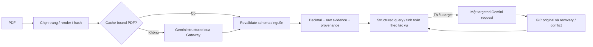

# Audit end-to-end M1/M2 — M2-08

Ngày 2026-10-28, Research MVP Lean v3. Một PDF BBS2025, 24 trang;
baseline chỉ trang PDF 5/7/8, recovery thêm đúng một hàng trang 6.
Baseline Git `2c9c63dbcfd8fd86cf5eb0b81090fc49f8bf5469`, sạch và trùng origin/main.
Đây là structured query probe với intent khai báo, chưa phải chatbot tự hiểu câu hỏi,
verified ledger hoặc đánh giá accuracy toàn báo cáo. M2-07 đã DONE trước khi bắt đầu.

## Runtime thực tế và quyết định kiến trúc

Trước audit có **hai nhánh độc lập**, không có một pipeline bắt buộc chạy mọi task M1/M2:

1. `run_document_understanding` trong `document_processing/understanding_pipeline.py`
   nhận PathMappingRequest → loader OCR cũ, hoặc PDF/PNG → `load_pages` →
   `ingest_page` → Vision OCR → component validation → unified adapter/router.
   `_route` chỉ ghi recovery decisions, không tự gọi lại Gemini.
2. `accounting/automated_extraction.run_automated_pdf` → renderer `load_pages`
   trong `gemini_ingestion.py` → `extract_financial_page` → Gateway JSON schema →
   `validate_automated_extraction` → context/statement/catalog resolution và links.
   `quality.evidence_from_automated_records` giữ cả raw links ngoài catalog;
   `assess_evidence_for_task` đánh giá usability. Không import hoặc tạo unified document.

Sau audit giữ nhánh 2 làm financial table primary path vì replay PDF thật giữ được
121 giá trị số; không ép kết quả này thành kết luận nhánh 2 tốt hơn cho mọi tài liệu.
Thêm composition nhỏ `accounting.financial_runtime.process_financial_pdf` để bàn giao
records/evidence/quality/page issues và giữ trang tốt khi response trang khác thất bại.
Thêm structured query và recovery theo đúng trang/target. Không xóa code M1.
Không có bước mandatory cũ nào bị gỡ trong phiên này: M2-04b/07 đã bỏ các gates đó.

| Module / code path | Phân loại financial runtime | Bằng chứng / hành động |
| --- | --- | --- |
| `gemini_ingestion.load_pages`, `vision_ocr.VerifiedPageImage`, `image_source` | Core | Đọc cùng bytes PDF để hash/render, bind trang/ảnh; tái sử dụng, không chạy Vision OCR |
| `automated_extraction.extract_financial_page` | Core khi cache thiếu | Gửi inline PNG qua service Gateway, `urn:financial-extraction/v1`; schema giữ raw cells/context |
| `validate_automated_extraction`, `parse_vietnamese_number` | Core | Revalidate cache, tạo links, Decimal; response gốc luôn giữ |
| `context_resolution.resolve_financial_context`, `statement_resolution.resolve_statement_type` | Core helpers | Xác định kỳ/unit/title từ text Gemini; không suy theo filename |
| `item_mapping.map_item_label` | Optional về usability | Validator hiện gọi catalog để annotate; raw adapter bỏ mapping-only rejection, không cần canonical cho Direct QA |
| `quality.evidence_from_automated_records`, `assess_evidence_for_task` | Core cho query | Snapshot/provenance/conflict/usability; không sửa accepted status |
| `financial_runtime.process_financial_pdf`, `tools.financial_query.answer_query` | Core composition/probe mới | Không thêm model call ngoài extraction; exact source/page/code/period, không hardcode BBS |
| `financial_runtime.recover_financial_target` | Optional khi thiếu target | Caller chọn trang; một request hoặc cache bound cùng target/model; original giữ nguyên |
| `arithmetic.evaluate_automated_records` | Optional annotation | Chỉ nhận accepted links; không thể chặn raw retrieval ngoài catalog |
| `relationships.evaluate_automated_relationships` | Optional, cần cho endpoint query | Dùng metadata PDF và accepted links để đối chiếu B01/B03; không gate toàn document |
| M1 `gemini_ingestion.ingest_page`, `vision_ocr.extract_structured` | Optional nhánh OCR/text | Đọc ảnh riêng nếu caller chạy; không được `run_automated_pdf` gọi |
| M1 `ocr_loader`, `path_resolver`, `table_reconstruction`, `table_assistance`, `ocr_correction`, `understanding_pipeline` | Optional nhánh OCR/unified | Hỗ trợ nguồn OCR cũ, thuyết minh/text/search tương lai; financial path không gọi |
| M2 `table_recovery.recover_table_structure`, `link_reviewed_candidate` | Legacy/manual với financial primary path | `ManualReview` chỉ nhánh M2-04a; giữ public API cũ, không bắt QA chạy |
| `item_mapping.map_financial_items` | Optional unified consumer | Dùng UnifiedPage, khác `map_item_label` được extraction gọi trực tiếp |
| M1 `classification`, `checkpoints`, crop audit/recovery/review | Optional/diagnostic | Dành OCR/classification và quản lý artifacts riêng; primary path không phụ thuộc |
| M1 `evaluation`, extraction/classification/table pilots; M2 pilot scripts | Diagnostic/evaluation | Không runtime requirement; không dùng expected values trong extraction/query |

Duplication thực tế: chạy cả `ingest_page` và `extract_financial_page` trên cùng trang
sẽ gửi ảnh hai lần vì prompt/schema khác nhau; đó là lựa chọn của caller, không có
automatic double-read trong financial path. M1 table assistance/M2 manual recovery
cũng đọc lại bảng nhưng không được composition mới gọi. Context/period được resolve
lại trong raw adapter sau validator, accepted values cũng có Decimal parse kiểm tra;
chi phí local nhỏ, giữ để không đổi contracts hoặc thêm cache abstraction trong MVP.
Không phát hiện duplication LLM bắt buộc cần refactor.

## Các checks và hành động

| Check | Module | Required cho Direct QA? | Lý do / hành động |
| --- | --- | --- | --- |
| PDF/page/image hash, renderer/DPI identity | `load_pages`, extraction validator | Có | Keep; cache re-render từ PDF, sai binding raise |
| JSON/schema, successful complete response | Gateway/extraction | Có | Keep; partial/truncated response không thành số liệu dùng được |
| Cell association/bounds/duplicate positions | extraction validator | Có để biết label/header nào gắn số | Keep; không đối chiếu lại glyph hoặc bbox pixel |
| Reading observed, Decimal/dấu | extraction/raw adapter | Có | Keep; dấu gạch không suy zero |
| Period từ header, distinguishing label/code, page provenance | quality | Có | Keep; không fabricate locator/canonical |
| Unit/scale | quality | Caveat khi raw retrieval, bắt buộc khi tính | Keep task-aware policy M2-07 |
| Canonical mapping/code catalog | extraction/quality | Không | Đã optional từ M2-07; dùng raw items, không mở catalog chỉ để tăng điểm |
| OCR witness/bbox geometry/unified accepted table | M1/manual path | Không | Không có trên primary path; không bổ sung framework |
| ManualReview | M2-04a | Không | Giữ optional legacy API |
| Arithmetic PASS | M2-05 | Không | Annotation; explicit residual probe tính từ operands có ngữ cảnh, không khai báo quy tắc kế toán mới |
| Relationship CONSISTENT | M2-06 | Không cho retrieval | Chỉ endpoint query cần check liên quan để so B01 as_of với B03 duration |
| Conflict | quality/query/recovery | Có trong operands | Giữ hai observations, block đúng query; không silently overwrite |

Không nới các checks hiện có để tạo gain giả. Chỉnh sửa thật: optional target trong
request extraction/CLI; composition giữ partial document; query có chọn nguồn, tính
Decimal và citations; recovery merge observations có request identity. Original thiếu
số không chặn recovered readable value, còn hai số khác nhau cùng identity vẫn conflict.

## Retention và nguyên nhân thiếu

Re-render/revalidate cache trang 5/7/8 từ PDF gốc 200 DPI. PDF SHA256:
`6c261d2a1328daa267976d615282f1841b8daaf64e8ab534c21e19a73a149ce1`.
Cache hashes khớp toàn bộ receipt M2-07. Không ghi raw/processed/source cache.
Trace trong ignored `artifacts/audit/M2-08/benchmark-final-review.json` giữ từng raw label/code,
value/header, period/unit/scale/statement/page, context/cell selectors, image/PDF hash,
model/request, normalization/mapping và decision/reasons; raw Gemini payload ở records.

| Metric | Baseline 5/7/8 | Sau recovery một hàng trang 6 |
| --- | ---: | ---: |
| Slots (gồm headings và dấu gạch) | 136 | 138 |
| Decimal parse được / Direct QA usable | 121 | 123 |
| Canonical numeric | 28 | 28 |
| Raw numeric ngoài catalog | 93 | 95 |
| Accepted extraction | 28 | 28 |
| Không có số cụ thể | 15 | 15 |
| Conflict thực | 0 | 0 |

Core quality không chạy annotations: 28 usable/93 caveat/15 insufficient.
M2-07 có relationship annotations: 20 usable/101 caveat/15 insufficient trên cùng
121 số; chênh lệch caveat không là mất dữ liệu. 108 unresolved extraction baseline
gồm 93 số ngoài catalog và 15 slot không có số. Không có số parse được nào bị gate mất.

15 slot thiếu gồm **7 dấu gạch** (B01 152 đầu năm, 227 hai ngày; B02 02/52 hai năm)
và **8 heading slots** B03 không phải chỉ tiêu số. Không gọi các heading là Gemini
đọc thiếu tám giá trị. Parser không nhận `_`/`-.` là zero là đúng. Không có bằng chứng
Gemini sai số trong các operands benchmark đã review; không suy thành accuracy 121/121.
Thiếu canonical không phải extraction failure. Bottleneck thực là selected pages chưa
có trang 6; không phải unresolved accounting rule hoặc provenance quá chặt.

## Benchmark 26 câu và source review

Một reviewer kỹ thuật đọc trực tiếp ảnh render PDF trang 5/6/7/8, xác nhận label/code,
cột kỳ, dấu và unit VND (scale 1), sau đó ghi reference riêng; không tự lấy cache làm
ground truth. Trang PDF khác số trang in: 5→4, 6→5, 7→6, 8→7.
B01 “đầu năm” là **01/01/2025**, không gán nhầm 31/12/2024. B02/B03 là năm 2025/2024.
Các reference phép tính lấy operands đã đọc ảnh và phép trừ Decimal độc lập.

Baseline dùng API M2-04b/07 hiện có với chính query probe mới; sau dùng cùng queries,
chỉ thêm recovery page6. Đây là ablation của recovery, không giả lập mapping-only
baseline đã được M2-07 sửa. Thay đổi page coverage được công khai; không tuyên bố
gain OCR accuracy hoặc quality-policy gain trên cùng ba trang.

Các giá trị dưới đây là VND; âm giữ dấu. Với comparison, kết quả là kỳ mới trừ kỳ cũ;
residual bằng 0 thể hiện khớp phép tính đã khai báo. `A` answered, `P` partial, `X` abstained.

| ID | Câu hỏi | Reference / nguồn PDF (mã; kỳ) | Trước → sau |
| --- | --- | --- | --- |
| Q01 | Doanh thu thuần 2025? | 450.474.531.227; p7 B02/10 2025 | A → A |
| Q02 | Giá vốn 2024? | 319.074.961.905; p7 B02/11 2024 | A → A |
| Q03 | Tổng tài sản cuối 2025? | 266.086.680.765; p5 B01/270 2025-12-31 | A → A |
| Q04 | Lưu chuyển tiền thuần 2025? | 1.208.501.810; p8 B03/50 2025 | A → A |
| Q05 | Tiền cuối năm theo B03? | 3.711.595.064; p8 B03/70 2025 | A → A |
| Q06 | Tiền đầu năm theo B01? | 2.503.093.254; p5 B01/110 2025-01-01 | A → A |
| Q07 | Hàng tồn kho cuối 2025? | 50.788.605.600; p5 B01/140 2025-12-31 | A → A |
| Q08 | Dự phòng phải thu cuối 2025? | -17.446.822.723; p5 B01/137 2025-12-31 | A → A |
| Q09 | Doanh thu tài chính 2025? | 3.512.418; p7 B02/21 2025 | A → A |
| Q10 | Lợi nhuận kinh doanh 2025? | 8.832.762.678; p7 B02/30 2025 | A → A |
| Q11 | Lợi nhuận sau thuế 2024? | 6.189.585.588; p7 B02/60 2024 | A → A |
| Q12 | Dòng tiền kinh doanh 2025? | 14.319.681.754; p8 B03/20 2025 | A → A |
| Q13 | Dòng tiền đầu tư 2025? | -7.672.311.772; p8 B03/30 2025 | A → A |
| Q14 | Dòng tiền tài chính 2024? | -25.553.501.766; p8 B03/40 2024 | A → A |
| Q15 | Tiền thu đi vay 2025? | 412.590.165.180; p8 B03/33 2025 | A → A |
| Q16 | Trả trước người bán cuối 2025? | 1.085.835.071; p5 B01/132 2025-12-31 | A → A |
| Q17 | Doanh thu thuần 2025 trừ 2024? | 94.967.158.941; p7 B02/10 2025; p7 B02/10 2024 | A → A |
| Q18 | Lợi nhuận gộp 2025 trừ 2024? | -3.949.890.713; p7 B02/20 2025; p7 B02/20 2024 | A → A |
| Q19 | Lưu chuyển tiền thuần 2025 trừ 2024? | -656.502.697; p8 B03/50 2025; p8 B03/50 2024 | A → A |
| Q20 | Tổng tài sản cuối năm trừ đầu năm? | -25.219.978.339; p5 B01/270 2025-12-31; p5 B01/270 2025-01-01 | A → A |
| Q21 | Doanh thu thuần trừ giá vốn trừ lợi nhuận gộp 2025? | 0; p7 B02/10 2025; p7 B02/11 2025; p7 B02/20 2025 | A → A |
| Q22 | Doanh thu thuần trừ giá vốn trừ lợi nhuận gộp 2024? | 0; p7 B02/10 2024; p7 B02/11 2024; p7 B02/20 2024 | A → A |
| Q23 | Tiền cuối năm B01 và B03 có bằng nhau? | Có, bằng nhau; p5 B01/110 2025-12-31; p8 B03/70 2025 | A → A |
| Q24 | Chi phí thuế TNDN hoãn lại 2025 có số cụ thể? | Không có số (dấu gạch); p7 B02/52 2025 | X → X |
| Q25 | Nợ phải trả cuối 2025? | 157.146.559.558; p6 B01/300 2025-12-31 | X → A |
| Q26 | Tổng tài sản trừ nợ phải trả cuối 2025? | 108.940.121.207; p5 B01/270 2025-12-31; p6 B01/300 2025-12-31 | P → A |

| Metric | Trước | Sau |
| --- | ---: | ---: |
| Answerability (answered / 26) | 23/26 = 88,46% | 25/26 = 96,15% |
| Correct numeric/boolean answers | 23 | 25 |
| Incorrect answers | 0 | 0 |
| Partial answers | 1 | 0 |
| Abstained | 2 | 1 |
| Unsupported answers | 0 | 0 |
| Grounding coverage các answers đầy đủ | 23/23 | 25/25 |
| Query-time recovery target thành công | Chưa dùng | 1/1 |

Grounding coverage nghĩa mọi operand dùng trong answer có document/page và selectors;
không phải chỉ số entailment tự động. Q24 không có số cụ thể trong PDF, abstention đúng
không cộng vào “correct numeric answers”. Q25 baseline thiếu trang; Q26 giữ tài sản
kèm nguồn nhưng không tự suy nợ phải trả. Không bỏ các câu khó khỏi denominator.

## Recovery thực tế và chi phí

Target: B01 mã300 “Nợ phải trả”, trang PDF6, hai cột ngày. Một request full-page,
trả đúng hai số `157.146.559.558` và `183.476.510.255`, đối chiếu ảnh PDF sau extraction.
Hai giá trị đều ngoài catalog, vẫn usable. Giúp Q25 và Q26 đầy đủ; không hardcode giá
trị trong runtime. Không cần crop, manual approval, OCR witness hoặc arithmetic gate.

Một Gemini call, model `gemini-3.5-flash-lite`, 1.385 input +652 output =2.037 tokens,
0 provider failure/retry, monetary cost không đo. Dùng đúng credential/project đã cấu
hình và policy cục bộ hiện có; không xoay keys. Không tính 5 calls/31.449 tokens lịch sử
M2-04b thành chi phí phiên M2-08. Replay benchmark dùng **0 calls**, local elapsed
khoảng 2,72 giây gồm render/revalidate/recovery-cache/query serialization, không là API
latency; live latency chưa instrument, không suy từ thời gian tool.

Không có ca live recovery failure trong một target đã thử; không bịa tỷ lệ success
cho target khác. Q24 giữ missing thực, không gọi Gemini chỉ để đổi dấu gạch thành số.
Timeout/schema failure trả record/issues, giữ originals; conflict và unavailable
response được kiểm thử synthetic riêng, không coi là mâu thuẫn thực của BBS.

`recover_financial_target` hỗ trợ extraction recovery lẫn query-time recovery: caller
chỉ định selector và target từ slot thiếu/reading uncertain hoặc câu hỏi thiếu evidence.
Mỗi invocation tối đa một Gateway request, không loop/majority vote. Caller quản lý
budget và lưu record riêng; persisted recovery yêu cầu cùng target/model, actual model,
PDF/page/image. Gateway cache có key từ request/model/schema/images; recovery record
replay thêm kiểm tra target. Không tự đoán trang trong 24 trang hoặc sửa original.

## Runtime V1 và tái chạy

Entrypoint: `accounting.financial_runtime.process_financial_pdf(path, symbol=...,
year=..., pages=..., service=..., credential_ref=..., cached_records=...)`.
Trả `records`, `evidence` (AssessableEvidence), `quality`, `page_issues`.
Required: selection/render/binding, extraction hoặc cache, raw adapter, task quality.
Optional: arithmetic/relationships từ records tốt, M1 OCR/unified cho text, targeted
recovery. Query dùng `tools.financial_query.FinancialQuery` + `EvidenceSelector`
(document hash, page, statement, source code, period) → `answer_query`.
Operation: retrieve, difference, residual, match; số operands được kiểm tra, không NL parser.

Invalid provider response của một trang giữ record và page issues, các trang tốt vẫn
trả evidence. Sai source/cache binding hoặc PDF selection/render không hợp lệ vẫn raise;
không âm thầm bỏ qua lỗi identity. Downstream hiển thị raw values/unmapped labels,
period/unit/scale/citations và caveats; mọi `financial_fact_verified=false`.
Đây là research candidate answers; production ledger/firewall chưa triển khai ở M2-08.

CLI replay:
`python scripts/run_financial_query_probe.py data/raw/Financial_Report_pdf/BBS/2025/BBS_2025.pdf --spec artifacts/audit/M2-08/queries.json --output artifacts/audit/M2-08/new-benchmark.json`.
Output phải chưa tồn tại. Spec JSON local gồm symbol/year, `cache` (page→path),
`queries` (query_id/operation/operands selectors), optional `recoveries`
(selector/target/cache path). Probe không đọc reference values, không network.

Live recovery: CLI `scripts/run_gemini_ingestion.py` với `--financial --pages 6
--target "B01 source code 300 total liabilities, both printed dates; return only this row with visible statement/date/unit context"`
và cấu hình service/policy/credential như [extraction API](automated-financial-extraction.md).
Luôn output mới dưới artifacts; `--target` chỉ nhận một trang và financial mode.
Không chạy lại live khi recovery cache hiện có hợp lệ.

Artifacts ignored tại `artifacts/audit/M2-08/`: `baseline-records.json`,
`queries.json`, `references.json`, `benchmark-final-review.json`, `metrics-final-review.json`, `retention-trace.json`, `recovery/` response/manifest/meter.
References SHA256 `c5ef4b6211c1f3d432aee9b68b3bba4b563a64404b9f826b1a8a74cae6fc0f2f`;
recovery record SHA256 `0ea0ac380e4c9b19171228660a957a2c357d6a0dc198ae53538d11e2d57979bb`.
Không commit raw responses/PDF/images/normalized datasets/credentials.

## Kiểm thử và phần còn lại

18 focused tests mới; regression trực tiếp extraction/quality/arithmetic/relationships/
ingestion, tổng **152 targeted PASS**. Checks synthetic chỉ là engineering evidence.
Ruff changed files, planning checker và diff check; CI full unit Python3.11/3.12
không gọi Gemini. Implementation SHA và CI ghi trong spec/handoff sau khi xác minh.

Trước Web Demo còn: lựa chọn trang theo câu hỏi (hiện caller chọn), hiểu ngôn ngữ tự
nhiên, đo latency thực khi gọi Gemini, storage/budget xuyên nhiều session, corpus rộng
hơn, human review bổ sung ngoài operands này. Arithmetic/relationship catalog vẫn nhỏ,
không bao phủ mọi raw item; không cần mở rộng để Direct QA đọc được.
Không triển khai các hạng mục này hoặc M3 trong M2-08. Next action sau REVIEW:
Chờ Tech Lead review M2-08.

Benchmark-final SHA256 `baa8c4651c0ca3c3526540f7feb5799c2645257ccf1ea3b3594c1f5268391b94`;
receipt `immutability-before.json` và `metrics-final-review.json` xác nhận PDF/cache/reference nguyên vẹn.

`retention-trace.json` giữ per-slot quality cho cả 138 slots sau recovery:28 usable,
95 usable_with_caveat,15 insufficient; không có số parse được bị gate mất.

Regression bổ sung: khác biệt ordinal/label giữa original và recovery không chặn
query khi cùng document/page/code/period/value; conflict về số vẫn bị chặn.

Conflict identity ưu tiên mã in nguồn khi có (document/statement/period/scope/unit
vẫn giữ nguyên), rồi mới canonical ID/label khi thiếu code. Nhờ đó mapped original
và unmapped recovery có cùng mã nhưng khác số không lọt thành hai identity riêng.
