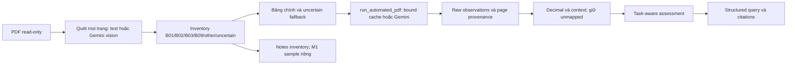

# M2-09 — Đánh giá full PDF BBS2025

Ngày 2026-10-28 (Asia/Bangkok), task **REVIEW**. **Khuyến nghị: CONDITIONAL GO cho Web Demo V1**
trong phạm vi các bảng B01/B02/B03 của pilot. Chưa nghiệm thu Tech Lead; chưa xây web.
Đây là Evaluation Level 1 trên một PDF, không phải đánh giá chatbot hoặc production readiness.

## Phạm vi và tính toàn vẹn

Baseline Git thực tế: `d0a82ea` trên `main`, sạch và trùng `origin/main` lúc bắt đầu.
Handoff M2-08 ghi baseline khác; không dùng nội dung đó thay SHA Git đã kiểm tra.
M2-08 đã DONE, implementation trước đó giữ nguyên.

Chỉ dùng `data/raw/Financial_Report_pdf/BBS/2025/BBS_2025.pdf`, 24 trang.
SHA256 `6c261d2a1328daa267976d615282f1841b8daaf64e8ab534c21e19a73a149ce1`.
Cả 24 trang không có text layer. Hash PDF, cache extraction 5/7/8, recovery M2-08
và reference M2-08 khớp ledger hash lịch sử; không sửa dữ liệu nguồn.

## Pipeline thực tế



`discover_financial_pages` thuộc `document_processing`; `process_financial_pdf`
thuộc `accounting` dùng discovery khi bỏ tham số `pages`. Không có catalog gate,
manual-review gate, OCR witness hoặc accounting PASS gate trên đường đọc số.
Record lỗi response giữ trong document; evidence của trang tốt vẫn được dùng.
Uncertain được chọn để fallback extraction và luôn xuất hiện trong inventory.
B09 được giữ inventory, không ép notes vào schema financial statement có mã chỉ tiêu.

## Inventory đối chiếu trực tiếp PDF

Agent xem bốn contact sheets của toàn bộ 24 trang từ chính PDF; xem riêng ảnh
200 dpi các bảng chính và trang 14; hai chỗ khó đọc được phóng từ PDF 300 dpi.
Số trang dưới đây là PDF page, không phải số in ở chân trang.
Không truyền danh sách trang reference vào discovery.

| PDF page | Phân loại đúng / dự đoán | Nội dung | Có bảng | Detailed financial extraction |
| --- | --- | --- | --- | --- |
| 1 | Other | Bìa báo cáo kiểm toán | Không | Không |
| 2 | Other | Mục lục, có nhắc tên cả bốn mẫu | Không | Không |
| 3 | Other | Báo cáo ban giám đốc, chữ ký | Không | Không |
| 4 | Other | Báo cáo kiểm toán độc lập | Không | Không |
| 5 | B01 | Tài sản | Có | Có, cache hợp lệ |
| 6 | B01 | Nợ và vốn chủ sở hữu, trang nối tiếp | Có | Có, một call mới |
| 7 | B02 | Kết quả hoạt động kinh doanh | Có | Có, cache hợp lệ |
| 8 | B03 | Lưu chuyển tiền tệ gián tiếp | Có | Có, cache hợp lệ |
| 9 | B09 | Thông tin chung và chính sách; ảnh ngược 180 độ | Không | Inventory notes |
| 10 | B09 | Ước tính, tiền, phải thu, tồn kho, TSCĐ | Không | Inventory notes |
| 11 | B09 | Chính sách khấu hao, thời gian hữu ích, tài sản | Có, năm sử dụng | Inventory notes |
| 12 | B09 | Vay, chi phí vay/phải trả, doanh thu | Không | Inventory notes |
| 13 | B09 | Thu nhập tài chính, thuế, bên liên quan | Không | Inventory notes |
| 14 | B09 | Tiền, phải thu khách hàng, tồn kho | Có, nhiều bảng | Inventory + M1 sample |
| 15 | B09 | Nợ xấu/dự phòng, chi phí trả trước; nhiều cột | Có | Inventory notes |
| 16 | B09 | Biến động TSCĐ hữu hình | Có | Inventory notes |
| 17 | B09 | Phải trả người bán và thuế | Có | Inventory notes |
| 18 | B09 | Vay và nợ thuê tài chính | Có | Inventory notes |
| 19 | B09 | Hợp đồng, hạn mức, mục đích vay và tài sản đảm bảo | Có | Inventory notes |
| 20 | B09 | Biến động vốn và cổ đông | Có | Inventory notes |
| 21 | B09 | Vốn/cổ phiếu, phải trả khác, doanh thu, giá vốn | Có | Inventory notes |
| 22 | B09 | Chi phí, yếu tố sản xuất và thuế TNDN | Có | Inventory notes |
| 23 | B09 | EPS và giao dịch bên liên quan | Có | Inventory notes |
| 24 | B09 | Thù lao, thông tin khác, sự kiện sau kỳ và chữ ký | Có | Inventory notes |

Discovery: 24/24 nhãn trang đúng; B01 2/2, B02 1/1, B03 1/1, B09 16/16,
Other 4/4; false positive 0, false negative 0, uncertain 0. Cần Gemini 24/24
trang vì không có text. Không xoay/sửa ảnh gốc, Gemini nhận đúng cả trang 9.

Có 16 trang chứa bảng theo nghĩa rộng, gồm bảng thời gian khấu hao trang 11;
15 trang chứa bảng tiền/cổ phiếu/hạn mức. Inventory nhận đúng 16/16.
**Statement extraction coverage 4/4 trang, 4/4 bảng chính**. Notes: 16/16 trang
được nhận diện; không tuyên bố đã financial-normalize tất cả bảng notes.
Mẫu M1 trang 14 có ba bảng; kiểm tra riêng toàn bộ bảng tiền gồm 6 numeric cells.

## Reference và quy trình đối chiếu

Reference chính bao phủ **toàn bộ 85 coded rows, hai kỳ của bốn bảng chính**:
170 ô =163 numeric +7 dash. Số ô số theo trang: 39/42/34/48 tại trang 5/6/7/8.
Lớn hơn mục tiêu 80–150 vì lấy trọn bốn bảng, không bỏ dòng khó.
Bao gồm cả hai kỳ, số âm, dấu gạch, ngoài catalog, mã `411a`/`421b`, B01 nối tiếp
và dòng B03 nhiều hàng chữ. Không có literal numeric zero trong phạm vi này;
không tự chuyển dash thành zero để tạo mẫu. Zero chỉ có regression synthetic và
kết quả phép tính trong query probe; không tính vào extraction reference.

Agent chép reference trực tiếp ảnh PDF trước khi liệt kê extraction dự đoán.
Không dùng Gemini sinh candidate reference. Sau so sánh phát hiện hai chỗ
reference chép nhầm: B01 mã 222 kỳ đầu năm và B03 mã 14 năm 2025. Đọc lại crop
300 dpi xác nhận, sửa reference và ghi candidate/final/reason trong correction log.
Không sửa prediction hoặc lấy prediction thay source. Cả before/after cuối cùng
dùng cùng reference đã sửa. Đây là đối chiếu source độc lập extraction bởi cùng
agent; **chưa có reviewer người thứ hai hoặc blind human annotation**.

Reference notes riêng: 6 ô bảng tiền B09 trang 14, chép trực tiếp ảnh nguồn.
Cache M1-15 được render lại và đối chiếu exact PDF/image/source trước khi dùng.
6/6 đúng cả số, dấu, label/row, cột ngày và VND. Chỉ chứng minh khả năng giữ
nội dung notes qua M1, không trộn sáu ô này vào denominator 163 của financial runtime.
Không đánh giá toàn bộ bảng rộng/multiple headers của B09 hoặc notes QA.

## Định nghĩa và kết quả metrics

Numeric prediction đúng cần đồng thời: Decimal, dấu, đúng PDF page/statement/
source code/period và label association. So sánh label qua cụm từ reference sau
chuẩn hóa dấu/cách; không yêu cầu catalog ID. Mọi numeric prediction trên trang
reference đều nằm trong precision denominator, kể cả mã không có trong reference.
Duplicate không được tính đúng nhiều lần. Unit và grounding báo riêng.

| Metric | Initial full-PDF run | Re-evaluation cùng PDF/reference |
| --- | --- | --- |
| Numeric precision | 163 đúng /163 numeric predictions =100% | 163/163 =100% |
| Numeric recall | 163 reference cells đúng /163 numeric reference =100% | 163/163 =100% |
| Period correctness | 163/163 numeric predictions | 163/163 |
| Unit/scale correctness | 163/163 VND, scale 1 theo tiêu đề/cột nguồn | 163/163 |
| Grounding correctness | 163/163 đúng PDF/page; source-image revalidated | 163/163 |
| Direct QA usability | 163/163 numeric có thể dùng; 28 canonical +135 ngoài catalog | 163/163 |
| Primary statement coverage | 4/4 trang, 4/4 bảng | 4/4, 4/4 |
| Notes inventory | 16/16 trang, sample 6/6 ô đúng riêng | Không đổi |
| Exact dash glyph | 0/7; đều giữ thiếu số, không thành zero | Không đổi |
| Structured M2-08 query probe | Xem giải thích harness bên dưới | 25/26 answered đúng, 25/25 grounded |

Numeric quality không tăng vì không có numeric error được xác nhận cần sửa.
Before/after là cùng caches, cùng reference, qua discovery/runtime thật; không
coi replay thành đo độ ổn định nhiều fresh Gemini runs. Trước M2-09 runtime bắt
buộc chọn pages; sau thay đổi tự quét 24 trang và chọn đủ bốn trang chính. Không
gán precision/recall cho full-PDF baseline chưa tồn tại trước M2-09.

Runtime có 178 observations: 163 numeric dùng được và 15 insufficient (7 dash,
8 ô ở bốn dòng tiêu đề B03 không có số). 135 usable_with_caveat ngoài catalog
không phải 135 extraction errors. Scope báo cáo chưa xác nhận vẫn là caveat.

## Lỗi thực tế, recovery và hardening

| Nhóm | Số lượng trong phạm vi đã đối chiếu | Xử lý |
| --- | --- | --- |
| Thiếu automatic page selection ở baseline | Một thiếu hụt runtime | Thêm discovery và `pages=None`, giữ explicit pages API cũ |
| Thiếu full-page B01 continuation cache | Một trang (6) | Một extraction call đầy đủ; cache recovery M2-08 chỉ chứa một hàng không thay thế full page |
| Missed page/table/row hoặc missing numeric cell | 0 trong bốn bảng chính | Không gọi lại extraction |
| Wrong value/sign/item/period/unit/statement | 0/163 numeric cells | Không sửa prompt/parser/mapping |
| Duplicate/conflict hoặc provenance problem | 0 trong evaluated numeric set | Giữ conflict detection hiện có |
| Schema/provider failure | 0/25 live calls đã thực hiện | Partial-response preservation được regression test |
| Raw dash transcription | 7 ô: trang 5 chép `-.` (3), trang 7 chép `_` (4) | Giữ nguyên raw, normalized missing; không suy thành zero |
| Reference transcription corrections | 2, thuộc annotation, không phải extraction | Đối chiếu crop PDF; correction log riêng |

Recovery mới: **0 calls, 0 targets**. Không có lỗi số/kỳ/association hoặc thiếu
numeric có tác động lớn cần recovery. Lỗi glyph dash không cản quyết định giữ
missing; không gọi thêm Gemini chỉ để làm đẹp metric. Q24 thuế TNDN hoãn lại
được abstain vì nguồn in dash; không ép trả zero. Recovery M2-08 vẫn được bảo toàn,
không ghi đè/merge silently hoặc dùng reference answers làm prompt.

Hardening chỉ khắc phục manual selection và giữ multi-page/uncertain/notes.
Không thay extraction schema/prompt, Decimal parser, quality gates, catalog,
accounting relationships hoặc query runtime. Regression focused giữ partial page
failure, exact cache/source identity, raw unmapped, recovery và context consistency.

Harness đầu tiên cho Q23 `partial` vì evaluator chưa truyền optional relationship
annotations như probe M2-08. Đã sửa **harness** dùng cùng annotation API hiện có;
không thay runtime hoặc nới period check. Re-evaluation đủ 25/26, đúng từng
status/value so với M2-08, Q24 abstained, 0 unsupported. Artifact trước giữ nguyên
để không che việc so sánh harness khác điều kiện.

## Calls, tokens và latency

| Hoạt động mới | Calls | Input tokens | Output tokens | Total tokens | Latency |
| --- | --- | --- | --- | --- | --- |
| Discovery 24 ảnh 100 dpi | 24 | 28.968 | 1.910 | 30.878 | 116,11 giây wall, gồm render/pacing |
| Full financial extraction trang 6, 200 dpi | 1 | 1.299 | 5.205 | 6.504 | Không đo wall riêng |
| Targeted recovery | 0 | 0 | 0 | 0 | Không áp dụng |
| Tổng calls mới | 25 | 30.267 | 7.115 | 37.382 | Không cộng latency thiếu phép đo |

Model `gemini-3.5-flash-lite`, Gateway chung, single selected credential/project,
quota guard và SDK attempt cap, không voting/key rotation. Unknown usage 0;
provider failures 0. Hai lỗi setup local trước calls được sửa, có marker riêng;
không tính thành provider calls. Các call dùng policy local free tier cap USD 0;
không đọc được billing thực từ provider, không suy ra monetary charge đã kiểm toán.
Extraction 5/7/8 và M1 notes dùng cache hợp lệ; không tính tokens lịch sử vào tổng mới.
Re-evaluation full discovery+render+cache+quality+query khoảng 6,11 giây, 0 calls mới.

## API và tái lập local

```python
from vietnamese_financial_multi_agent.accounting.financial_runtime import process_financial_pdf

result = process_financial_pdf(
    pdf_path,
    symbol=symbol,
    year=year,
    service=extraction_service,
    discovery_service=page_understanding_service,
    credential_ref=credential_ref,
    cached_records=extraction_cache,
    discovery_cache=page_prediction_cache,
)
```

`pages` được bỏ hoàn toàn. `service`/`discovery_service` là CachedLLMService qua
Gateway đã có schema registry đúng: `EXTRACTION_REF`/`ExtractedPage` và
`DISCOVERY_REF`/`PagePrediction`. Nếu dùng chung service, đăng ký cả hai schemas
trong LocalSchemaRegistry; không dùng financial-only registry cho discovery.
`on_discovery_page(record)` có thể persist từng record để resume. Discovery cache
kiểm tra PDF SHA/image SHA/model; extraction cache qua `run_automated_pdf` revalidation.
Cache DPI discovery 100, extraction 200. Cache lỗi identity raise, không bỏ kiểm tra.

Replay evaluator không gọi API, không truyền `pages`, đọc config private chứa
`symbol`, `year`, `cache` (page→path), `discovery_cache` (page→path), `queries`.
Reference private chứa document_id và cells với page/statement/code/period/value/
label_contains/kind/unit/scale/independently_checked. Chỉ ghi artifact mới, không overwrite.

```powershell
python scripts/evaluate_full_pdf.py data/raw/Financial_Report_pdf/BBS/2025/BBS_2025.pdf --spec artifacts/evaluation/M2-09/replay-spec.json --reference artifacts/evaluation/M2-09/reference.json --output artifacts/evaluation/M2-09/new-review.json
```

Artifact private: discovery page records/inventory/usage, full page-6 extraction,
reference/correction log, source-integrity, notes-check, evaluation-before/after,
contact sheets và PDF crops. Các file này ignored; báo cáo aggregate này được commit.
Ảnh/dataset/raw payload/normalized/credentials và đường dẫn cá nhân không đưa vào Git.

Reference SHA256 `8e5257a7710d38d43e3f2d17a38e4fa7631ef1655b464a78cd9a74100fbe2ebe`;
re-evaluation artifact `4674d86c4b338a66362637f14ca8b5342830582a7b929a075beee9ab705583b9`.
`metrics-final.json` ghi hash các artifact và tính lại metrics cùng reference;
dash giữ missing 7/7, exact glyph 0/7.

## Kiểm thử, giới hạn và quyết định

Local: 14 tests mới (8 discovery/runtime +6 evaluator), cùng 18 query regressions
=32 PASS; thêm 108 extraction/quality/relationship/context regressions PASS.
Tổng 140 targeted PASS. Ruff/planning/diff và CI exact SHA được ghi tại checkpoint
cuối, không dùng CI của M2-08 thay CI M2-09. Không gọi Gemini/PDF thật trong CI.
Local Ruff lint PASS; format toàn code/tests/scripts và report mới PASS. Bốn docs
lịch sử có CRLF local khiến full-root format báo khác line endings; kiểm tra Git
blob LF của đúng bốn file đều PASS, giữ nguyên working copies lịch sử. CI checkout
LF sẽ xác nhận full-root format; không bỏ/tắt check.

**CONDITIONAL GO** đề nghị demo tập trung B01/B02/B03 với raw labels/codes,
page citations, unmapped retrieval, explicit missing/conflict, không cần chọn trang.
Điều kiện: công khai phạm vi notes chỉ inventory/M1 sample, không gọi notes QA là
đã hỗ trợ; giữ dash là missing; không suy kết quả một PDF thành chất lượng đa doanh
nghiệp. Tech Lead review reference/correction log và giới hạn trước quyết định demo.

Không có runtime blocker nghiêm trọng được xác nhận trên bốn bảng chính.
Chưa đánh giá fresh-run variance, notes numeric coverage đầy đủ, natural-language
query parsing, QA chatbot, multi-company/cross-year, tải lớn hay production reliability.
Các phép kiểm tra schema/arithmetic/relationship không thay đối chiếu source.
Số 100% chỉ áp dụng 163 numeric cells đã nêu, không phải accuracy toàn 24 trang.

Implementation `bd5a3c525f4cfe1d3f5204983e86746e748b1c93` đã push;
[CI40661431781](https://github.com/VuongQuocAn/vietnamese-financial-multi-agent/actions/runs/40661431781)
SUCCESS đúng SHA. Đã kiểm tra từng bước Python 3.11/3.12, gồm full unit,
lint/format/planning. Checkpoint REVIEW sau đó chỉ docs/planning [skip ci], không
gán kết quả CI implementation cho SHA tài liệu. Không tự DONE.

Next action: Chờ Tech Lead review M2-09.
