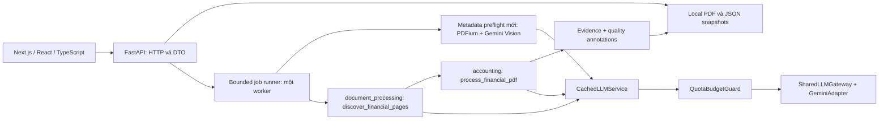
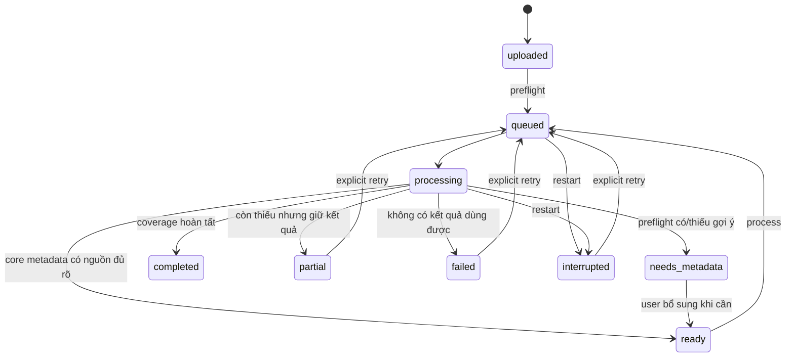

# Financial AI Workspace — Kiến trúc Web Demo V1

W-01, 2026-10-28, thiết kế chờ Tech Lead review. Chưa cài framework/chạy web.
Baseline đã fetch: `5c8a80e4ceedb735dcbad12e267620b0b8046adb`, M2-09 DONE.
[API](api-contracts.md), [UI](ui-handoff.md), [spec](../../planning/tasks/W/W-01.md).
Các quyết định dưới đây là đề xuất triển khai W-02–W-07, không phải khả năng đã có.

Checkpoint W-03: W-01/W-02 đã DONE; upload/local storage, metadata-only worker,
Gateway/Gemini Vision preflight và review/confirmation đã triển khai, chờ REVIEW.
[Usage/giới hạn](w-03-usage.md), [API hiện hành](api-contracts.md). Các đoạn W-01
dưới đây giữ làm thiết kế nền; extraction/viewer vẫn thuộc W-04/W-05. W-03 dùng
một document.json atomic chứa attempts/job/history và OS writer lock. Refinement
W-03 dùng key-file-only rotation với cap chung, counters persist qua restart;
không project ID/policy/fingerprint/scope thủ công, không giả mapping Google project. Renderer metadata riêng không đòi
symbol/year; mỗi ảnh một user message theo Gateway v1, cùng request có nhiều ảnh.
Không thay contracts hoặc pipeline tài chính M1–M2.
Giữ Offline → Online → Output; V1 chỉ mở bề mặt đọc evidence M1–M2,
không đi qua agents/ledger và không gọi extracted facts là verified claims.

## Kiến trúc và ranh giới



Frontend dự kiến `web/`: Next.js, Tailwind, shadcn/ui, Lucide; chọn React-PDF
trên PDF.js cho viewer client component. Không copy Stitch HTML/CDN scripts.
FastAPI đặt ở `src/api`, chỉ HTTP/serialization và composition/session adapters;
metadata extraction thuộc `document_processing` trong W-03; logic số/context
vẫn thuộc `accounting`, Gateway/quota thuộc `core`. Không import ngược từ core
hoặc accounting vào API. Frontend không gọi Gemini, không giữ secret hoặc parse số
tài chính bằng JavaScript Number. Chưa thêm dependency/package trong W-01.

Local-first một người dùng, một API process và một background worker dùng chung
Gateway/quota guard. Hai process Next.js/FastAPI khi development; frontend gọi
`/api` qua proxy cùng origin cấu hình ở W-02. Bind loopback, không public hosting.
Không Postgres/Redis/Celery/WebSocket hoặc authentication service ở V1.

## Integration matrix đã đối chiếu code/tests

Đường dẫn trong bảng tương đối repository; import namespace thực là
`vietnamese_financial_multi_agent`, ví dụ `.accounting.financial_runtime`.

| Chức năng | Backend hiện có | Entrypoint | Adapter cần thiết | Giới hạn |
| --- | --- | --- | --- | --- |
| PDF render/identity | `document_processing/gemini_ingestion.py` | `load_pages(path: Path, symbol: str, year: str, pages: list[int], dpi=200)` | Validate upload + chọn trang tự động ở server | Đòi symbol/year không rỗng; PDF hoặc PNG nội bộ, web chỉ PDF; không metadata extractor |
| Discovery mọi trang | `document_processing/financial_discovery.py` | `discover_financial_pages(..., cached_predictions, on_page)` | Persist callback, lọc DTO inventory | Text layer nếu rõ; Vision fallback kể cả scan; B09 không financial-normalize; uncertain vẫn selected |
| PDF → evidence | `accounting/financial_runtime.py` | `process_financial_pdf(path, *, symbol, year, pages=None, service=None, credential_ref="", cached_records=None, model=MODEL, dpi=200, discovery_cache=None, discovery_service=None, on_discovery_page=None)` | Session orchestration + serialization | Không HTTP/job; default tự discovery; input/render/cache binding errors raise |
| Financial extraction | `accounting/automated_extraction.py` | `run_automated_pdf`, `extract_financial_page` | Lưu record riêng mỗi trang | Không extraction progress callback; lỗi response thành record, lỗi I/O có thể raise |
| Raw/unmapped | `accounting/quality.py` | `evidence_from_automated_records` | Giữ record và evidence, không lọc theo catalog | Invalid response không thành financial cells; vẫn có lỗi trang; raw fallback không bảo đảm usable |
| Decimal/context | `contracts.py`, `context_resolution.py` | `FinancialNormalizationResult.export_result`, `resolve_financial_context` | DTO JSON string, context giữ nguyên | Không float; scale riêng, không tự nhân; metadata document không ghi đè context từng cell |
| Quality | `quality.py` | `assess_evidence_for_task(..., task_type="direct_qa")` | Group quality với evidence ID | usable/usable_with_caveat/insufficient/conflicted; khác resolved/uncertain/unresolved; không confidence % |
| Accounting | `arithmetic.py`, `relationships.py` | `evaluate_automated_records`, `evaluate_automated_relationships` | Optional annotation adapter với inputs/tolerance có basis | Runtime mặc định không chạy; không tạo PASS hoặc coi unavailable rule là pass |
| Gemini | `core/gemini_adapter.py`, `llm_gateway.py` | `GeminiAdapter.from_environment`, `SharedLLMGateway` | Composition root, local schema registry | `GEMINI_API_KEY` chỉ server; SDK attempts=1; không tự retry/rotate key |
| Quota/cache | `core/llm_quota_budget.py`, `llm_cache.py` | `ProjectRegistry`, `GatewayBinding`, `QuotaBudgetGuard`, `CachedLLMService` | Một scope/project xác nhận, policy server, reservations đúng bounds | In-memory, không durable qua restart; cache TTL mặc định 60s/128 entries; historical usage không phải calls mới |
| Checkpoint | `document_processing/checkpoints.py` | `CheckpointStore.lookup/save_verified` | Chỉ tái sử dụng khi có request fingerprint và semantic validation phù hợp | Chưa nối vào financial runtime; không tự gọi verified=True cho extraction chưa kiểm tra |

Evidence code đã đọc cùng tests `test_financial_discovery.py` (auto selection,
uncertain fallback, partial invalid response, cache binding),
`test_automated_extraction.py`, `test_quality.py` và cache/checkpoint contracts.
Không chạy lại evaluation; [M2-09](../m2-09-full-pdf-evaluation.md) là báo cáo
checkpoint lịch sử REVIEW, trạng thái nghiệm thu hiện tại lấy từ registry DONE.

## Khởi tạo service và cách gọi thực tế

Thiết kế W-01 cho composition extraction tương lai đăng ký `EXTRACTION_REF` → `ExtractedPage`,
`DISCOVERY_REF` → `PagePrediction` và schema metadata mới trong cùng
`LocalSchemaRegistry`; truyền registry cho GeminiAdapter, SharedLLMGateway,
CachedLLMService. Khởi tạo adapter từ environment; cấu hình explicit
ProjectPolicy/GatewayBinding/credential alias cùng project đã xác nhận, guard
và cache scope_confirmed. Alias không chứa key. Không tự suy quota/tier từ key.
Policy/model lấy cấu hình server; model hiện tại trong code `gemini-3.5-flash-lite`
không phải cam kết khả dụng/quota tương lai. Guard từ chối khi policy/budget thiếu;
không bỏ qua admission để hoàn tất demo. Token bounds metadata phải tính theo ảnh,
prompt và output cap; nếu không chứng minh được bound thì dừng request.

Chữ ký trên không tự dựng service. Cách gọi batch hiện có:

```python
result = process_financial_pdf(
    pdf_path,
    symbol=runtime_symbol,
    year=runtime_year,
    service=extraction_service,
    discovery_service=discovery_service,
    credential_ref=credential_ref,
    cached_records=bound_extraction_records,
    discovery_cache=bound_discovery_records,
    on_discovery_page=persist_discovery,
)
```

Trả dict `inventory`, `records`, `evidence` (AssessableEvidence), `quality`
(QualityAssessment), `page_issues`. Batch không cung cấp callback extraction.

W-04 đề xuất adapter gọi `discover_financial_pages` một lần với callback persist,
sau đó gọi `process_financial_pdf(..., pages=[number])` cho mỗi trang selected.
`pages` là lựa chọn nội bộ từ discovery, không lấy từ người dùng. Persist record
sau mỗi lần trả về, gom evidence và **chạy lại assess_evidence_for_task trên toàn
bộ evidence** để phát hiện conflict đa trang; giữ inventory gốc (per-page result
có inventory=None). Không viết lại prompt/parser/normalizer hoặc page selector.
Như vậy có tiến độ và durable partial results theo trang mà không sửa M1–M2.
Tradeoff: render/hash PDF lặp theo trang theo API hiện tại; giới hạn file cấu hình
và một worker đủ cho demo, chưa tối ưu batch hoặc streaming dataset lớn.

## PDF-only và metadata preflight mới

Upload không yêu cầu ticker/year/pages. PDFium kiểm tra file, count và render
Vision; không cần text layer hay OCR truyền thống. Worker khảo sát nhóm trang đầu
(mặc định đề xuất 1–4 nếu có), mở rộng các nhóm trang chưa xem, có thể đến toàn PDF
trong page/file limits và ngân sách; không dừng ở trang 1. Dừng khi có nhận diện
đủ nhất quán để gợi ý hoặc đạt budget/page cap; ghi analyzed_pages/stop_reason,
giữ candidates mâu thuẫn, không kết luận không có ticker từ vài trang đã xem.
Text có thể hỗ trợ tìm trang, Vision vẫn là nguồn chính cho metadata.

Schema mới tối thiểu gồm company_name, stock_ticker nullable, reporting_year,
reporting_period {value, type}, reporting_scope nullable; mỗi field có
status resolved/uncertain/unresolved, candidates [{value, raw_text, pdf_page}].
Không suy ticker từ tên file; null không có nghĩa công ty không niêm yết.
Refinement W-03 tự chấp nhận khi tên/năm resolved, không conflict và có nguồn PDF.
ready dùng accepted=true; acceptance_origin phân biệt auto/user. confirmed chỉ
cho user edits. UI hiển thị thông tin, retry khi thiếu và edit tùy chọn; không
bắt ticker hoặc xác nhận mỗi tài liệu. Period/scope/ticker có thể
null với caveat; document year là nhãn tài liệu, không thay các kỳ trên financial cells.
Nếu không xác định được năm/tên, giữ needs_metadata; người dùng có thể bổ sung.

Để tương thích load_pages trước/sau preflight mà không giả ticker: runtime_symbol
dùng namespace nội bộ ổn định `document:<document UUID>` cho **mọi tài liệu**,
không lấy stock_ticker. Trước khi biết năm, renderer preflight mới dựng image
identity riêng theo document hash/page; không gọi load_pages với năm giả.
Sau confirm, runtime_year=str(reporting_year); giữ mapping field `symbol` legacy
→ internal document namespace riêng và không trình bày như ticker. Không đổi
schema M1–M2; sửa metadata tạo revision mới, không reuse record identity cũ.

## Sessions, trạng thái và storage

Document ID UUIDv4, content identity `sha256:<64 hex>` từ bytes upload; hai ID
khác nhau. Upload cùng bytes tạo document riêng (không tự công khai/dedupe metadata).
Job ID UUIDv4 cho từng attempt; một document có nhiều attempts, một active job.
Metadata revision integer tăng khi sửa. Một writer/lock cho document và queue.



`phase` phân biệt preflight/discovery/extraction/finalizing; W-03 preflight ambiguity
về needs_metadata; lỗi kỹ thuật về failed khi chưa có metadata accepted. failed là không
tiếp tục được (file/storage/runtime) hoặc processing không có numeric usable;
notes-only có inventory thì partial, không gọi là completed B01–B03.
completed yêu cầu mọi trang được discovery quyết định, mọi selected extraction
hợp lệ và có ít nhất một numeric usable; không đòi đủ ba mẫu nếu nguồn không có,
không đòi mọi cell usable (dash/context chưa đủ vẫn hiện). uncertain inventory,
invalid response hoặc lỗi trang => partial nếu còn evidence/inventory dùng xem.
Quality caveat không tự thành job failure. Metadata edits khi idle quay về
needs_metadata/ready và đánh dấu result revision cũ; khi queued/processing trả 409.

Root cấu hình tương đối mặc định đề xuất `artifacts/web-demo-v1/` (đã ignored):
`documents/<uuid>/original.pdf`, `document.json`,
`attempts/<job UUID>/{status.json,discovery/<page>.json,extraction/<page>.json,result.json}`.
Snapshots JSON atomic temp+replace; attempt records append theo file riêng, không
ghi lên dataset/cache lịch sử. Result immutable sau publish, API luôn đọc cùng
metadata revision/job ID; không trộn attempts. Status updated_at + revision để UI
phát hiện snapshot cũ. Discovery callback persist từng trang; extraction count
chỉ tăng sau record được lưu. Không %/ETA suy đoán, hiển thị n/N và phase.

Restart: đánh dấu queued/processing cũ interrupted, không tự phát request mới.
Retry explicit cùng metadata revision: load records đúng PDF/image/identity/model,
chỉ replay successes hợp lệ, failed/uncertain mới được thử lại theo quota;
snapshot bọc thêm prompt/schema/config revision, DPI và valid_until để tránh dùng
cache cũ sai yêu cầu. Response cache in-memory không thay durable page snapshots.
Không dùng failed response làm permanent cache; mismatch/corruption báo lỗi,
không âm thầm bỏ binding check. Atomic result cuối không bảo đảm giữ trang đang
gọi provider lúc crash; request đó có thể phải gọi lại và tính phí lại.

Refinement W-03 dùng cap ứng dụng chung cho pool, không giả mỗi key có quota
độc lập. Counters atomic trước từng attempt và giữ qua restart; provider quota
thực vẫn được tôn trọng. Không scope marker/manual budget-reset procedure. Core
QuotaBudgetGuard của flows M1–M2 có confirmed project binding giữ nguyên; pool
admission composition dùng lại contracts/cache/Gateway/adapter, không tạo mapping
confirmed cho project chưa biết. [Cấu hình và limits](w-03-usage.md).

Giới hạn đề xuất cấu hình W-02: upload 50 MiB, 200 pages, một worker,
queue tối đa 4 jobs gồm preflight; cùng document không queue trùng. Khi queue đầy,
upload giữ uploaded với job=null để retry preflight sau, không mất PDF.
Polling 2 giây lúc active, dừng ở terminal/needs_metadata, backoff khi API lỗi.
Cleanup V1 operator chủ động khi server đã dừng, chỉ UUID directory trong root
đã containment-check; mặc định không xóa theo TTL. Không xóa dữ liệu nguồn hoặc
job đang chạy; cache TTL cấu hình riêng, retention/deletion UI ngoài V1.

## Security boundaries và quyết định hoãn

Stream upload có byte limit; kiểm tra `%PDF-`, PDFium mở được và page count,
từ chối encrypted/password-required hoặc malformed PDF với lỗi rõ. Filename chỉ
display, escape UI; đường dẫn luôn server-generated, UUID validate, resolve root
containment và reject symlink/junction. Không nhận path từ client, không expose
filesystem paths, provider payload/keys/credential alias trong lỗi hoặc JSON API.
Server-only artifacts có thể chứa tài liệu nhạy cảm, không Git/public URL; response
`Cache-Control: no-store`, PDF qua endpoint local với Range support để viewer đọc.
Không thực thi nội dung PDF/HTML, không vẽ bbox khi chỉ có page provenance.
Loopback + same-origin proxy, kiểm tra Origin ở mutations để tránh cross-site
requests vào localhost; CORS allowlist, không wildcard. Public/multiuser deployment
cần task auth/access control riêng trước khi mở mạng.

TBD trước implementation tương ứng: pin versions frontend/FastAPI/PDF.js W-02;
ngưỡng/render DPI preflight, prompt/schema và thử nghiệm nhận diện metadata W-03;
budget policy thực và điều kiện operator recovery W-04. Không blocker viết thiết kế.
M3 thêm tab Evidence Graph; M4 tools/QA baseline, M5 planner/specialists,
M6 analytical claim verification/ledger, M7 QA/report trong AI Workspace,
M8 controlled evaluation. Không tạo sẵn graph store/agents/verification gate.
